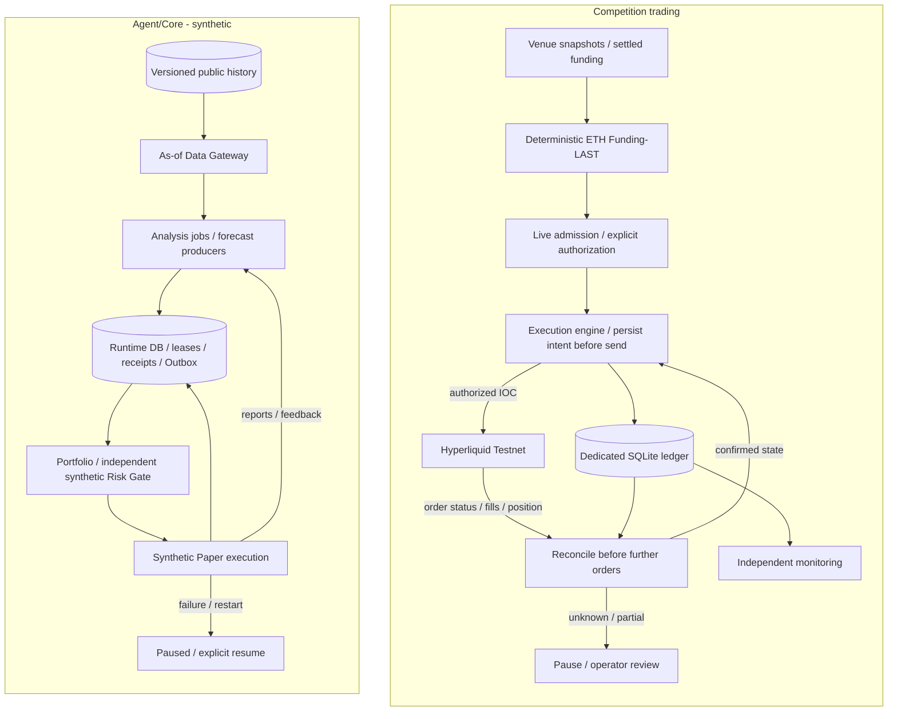

# Perpetual Alpha 2026

**Quantitative Research · Agent-Ready Infrastructure · Perpetual Futures**

Research-driven perpetual futures infrastructure with explicit risk boundaries
and recoverable execution.

[](https://github.com/BouillieAnonymous/Perpetual-Alpha-2026/actions/workflows/ci.yml)

## Overview

Developed by **Team Anonymous** for Perpetual Alpha 2026 on Hyperliquid Testnet,
this Python project combines multi-asset data collection, strategy research,
forecasting interfaces, portfolio construction and trading execution.

The engineering work addresses what happens when processes restart, requests
are repeated, exchange outcomes are unknown or historical data changes.
An independent deterministic **ETH Funding-LAST** runner was deployed during the
competition; the separate **Agent/Core and Synthetic Paper** framework was
implemented and tested without controlling the competition wallet.

**Explore:** [Engineering decisions](#engineering-highlights) ·
[System architecture](#system-architecture) · [Quick start](#getting-started) ·
[Research findings](docs/research/FINDINGS.md) ·
[Technical report](docs/competition/PA26-Anonymous-report.pdf)

## Engineering Highlights

| Engineering problem | Design decision | Trade-off / boundary | Implementation and tests |
|---|---|---|---|
| **Restarted workers and repeated submissions** can lose work or process stale results. | Persist jobs and leases; commit the accepted forecast, receipt and Outbox entry in one SQLite transaction. Delivery epochs reject stale consumer completions. | SQLite serializes writers. Outbox recovery requires the former consumer to have stopped; its local transaction does not cover external side effects. | [Job acceptance](src/perpetual_alpha/runtime/jobs.py), [Outbox](src/perpetual_alpha/runtime/outbox.py); [lease/replay tests](tests/test_jobs.py), [rollback/fencing tests](tests/test_scheduler_outbox.py) |
| **A timeout does not reveal whether an exchange order filled.** Blind retries risk duplicate exposure. | Persist an intent before sending, derive a deterministic client-order ID, then reconcile order status, fills and account position. | Unknown or partial outcomes pause the runner rather than trigger automatic resends/chasing. Recovery can require operator review; no exactly-once exchange guarantee. | [Funding engine](src/perpetual_alpha/funding_live/engine.py), [ledger](src/perpetual_alpha/funding_live/store.py); [timeout, pre-send crash and partial-fill tests](tests/test_funding_live.py) |
| **Later backfills or revisions** can leak into an earlier analysis. | Bind each job to an as-of cutoff, history sequence and anchor; persist query responses and seal the accepted evidence manifest. | Visibility follows recorded receipt/availability times. Freezing cannot repair missing inputs or establish that an upstream timestamp is truthful. | [Gateway](src/perpetual_alpha/transport/data_gateway.py), [versioned history](src/perpetual_alpha/historical/store.py); [backfill, same-millisecond write and restart tests](tests/test_data_gateway.py) |
| **A forecast or prior approval must not bypass current risk state.** | The synthetic Risk Gate recomputes exposure independently of Portfolio metrics and binds approval to state/policy; execution rechecks it. The live runner uses its own admission and signing checks. | Synthetic approval grants no live authority. Restarted supervision stays paused until explicit resume; this trades automatic availability for explicit recovery. | [Risk Gate](src/perpetual_alpha/risk_gate.py), [Paper engine](src/perpetual_alpha/runtime/paper_engine.py), [live venue checks](src/perpetual_alpha/funding_live/venue.py); [state-change/risk tests](tests/test_portfolio_risk.py), [Paper restart tests](tests/test_paper_execution.py) |

The linked tests exercise these failure paths. Local Paper commits synthetic
fills and terminal feedback in the same database transaction
([hard-exit and atomic-feedback tests](tests/test_paper_execution.py)); this
local atomicity does not extend to an exchange.

## System Architecture

<a id="architecture-and-maturity"></a>

The two execution paths have separate state and responsibilities. There is **no
automatic deployment or live-trading authorization** from Agent/Core research
to the competition runner.



Public data collection and CSV export support offline studies; the Gateway's
pinned context serves Agent/Core analysis, while execution checks use fresh
state. Supplied Workers are Dummy/examples. LLM/news extensions remain
experimental or proposed, not deployed autonomous traders. Paper fills and
feedback demonstrate the local lifecycle, not venue execution quality.

For implementation details, see [Funding-LAST](docs/funding-release.zh-CN.md),
[competition admission and safeguards](docs/pas-launch-preparation.zh-CN.md),
[job/Outbox contracts](docs/runtime-jobs-pr1.zh-CN.md),
[as-of Gateway](docs/dynamic-data-gateway-pr4.zh-CN.md),
[forecast integration](docs/forecast-integration-v0.2.1.zh-CN.md) and
[Paper execution](docs/paper-execution-pr8.zh-CN.md).

## Getting Started

Use **Python 3.12.15**. From the repository root, install the pinned runtime and
check dependencies, then run the offline demonstration:

```powershell
python -m venv .venv
.venv/Scripts/python.exe -m pip install -r deploy/requirements-check.txt -r config/requirements-ci.txt
$env:PYTHONPATH="$PWD/src"
.venv/Scripts/python.exe -m perpetual_alpha.cli dry-run --journal .cache/demo.sqlite3
```

The demo uses the shipped synthetic configuration and writes a local SQLite
journal. It needs no credentials, wallet or exchange connection. To run the
regression suite and schema checks in the same environment:

```powershell
.venv/Scripts/python.exe -m unittest discover -s tests -v
.venv/Scripts/python.exe scripts/validate_schemas.py
```

On Linux/macOS use `.venv/bin/python` and `export PYTHONPATH=src`. Some permission
and file-lock checks require Linux; CI runs the container and SSH isolation
checks there. See [environment setup](ENVIRONMENT.md) and
[CI documentation](docs/continuous-integration.zh-CN.md).

Historical research uses a [separate workspace and optional dependencies](research/README.md).
Each study records its required inputs and reproduction entry points; published
derived evidence can be checked even when original raw caches are unavailable.

## Research & Results

The research pipeline moves from observed patterns to frozen hypotheses,
matched baselines, availability/cost checks and longer-history validation.
Some candidates showed positive exploratory behavior; the follow-up tests help
distinguish promising observations from robust executable signals.

| Study | Main finding |
|---|---|
| Traditional strategies | 37 short-window candidates were selected for longer-history validation: 36 failed and ETH Funding-LAST remained inconclusive |
| ETH Funding-LAST | Positive modeled net returns in the long-history study and an actual deterministic competition deployment; excess-return evidence remains inconclusive |
| Weekly traditional-17 screen | 41 of 153 valued combinations had positive simulated net results; dependent rules and thin samples make these candidates, not 41 independent alphas |
| H03 relative residual | Small positive cost-precheck observations in validation/late periods; execution feasibility and complete net returns remain unknown |
| BTC/ETH volatility | Modest validation improvement did not persist in the late period; useful evidence about data activity and weak predictive stability |
| H09 BTC → HYPE | Fixed-spec incremental prediction failed the stop gate, providing a documented negative result for that hypothesis |

Read [Research Findings](docs/research/FINDINGS.md) for sample periods, baselines,
numerical results and limits, and the [complete Research Index](docs/research/INDEX.md)
for original reports, protocols, scripts and frozen outputs. Simulated returns
and account performance are reported separately.

### Interactive dashboards

- [V2 BTC/ETH Visual Discovery](docs/research/btc-eth-volatility/visual-eda-v2/README.md)
  links past-only visual diagnostics to the underlying numerical evidence.
- [V3 All-Asset Dashboard](docs/research/pas-visual-discovery-v3/README.md)
  explores ten-market quote activity, relationships and hypothesis support.

Download the complete dashboard release and open its HTML in modern Chrome;
keep `dashboard.html` beside its `assets/` directory. GitHub's source viewer
does not run interactive HTML. The dashboard guides explain remaining manual
acceptance items.

## Competition Report

**Team Anonymous · Yunfei Zhou and Zhengkai Sun · 6 November 2026**

[Read the four-page Technical Report](docs/competition/PA26-Anonymous-report.pdf) ·
[Display-version LaTeX and provenance](docs/competition/README.md)

The GitHub display edition preserves the authors' names and report content
while omitting personal email addresses. Its account-performance example is a
**5 November historical snapshot**, not final official competition results.

## Documentation & Repository Structure

| Path | Contents |
|---|---|
| `src/perpetual_alpha/` | Maintained data, transport, portfolio, risk and execution modules |
| `config/`, `deploy/` | Runtime configuration, synthetic demo, pinned dependencies and service definitions |
| `scripts/`, `tests/` | Checks, canonical PAS research scripts and regression tests |
| `research/legacy/` | Isolated historical research source, scripts, tests and dependency pins |
| `research/experimental/` | Archived collector prototype |
| `research/tools/` | Disposable workspace and evidence/navigation checks |
| `docs/research/` | Findings, protocols, results and dashboard releases |
| `docs/competition/` | Email-free display report, LaTeX, figures and provenance |
| `docs/consolidation/` | Source mappings, PR dispositions, integration and reproducibility records |

Start with the [documentation index](docs/README.md),
[structure overview](docs/consolidation/repository-structure.md) or
[research workspace guide](research/README.md).
Consolidation [PR #44](https://github.com/BouillieAnonymous/Perpetual-Alpha-2026/pull/44)
was merged into `main` on 6 November 2026 (`4dd270f`); the integrated mainline
is the development baseline. Historical research and operational documents
retain their original dates and context.
