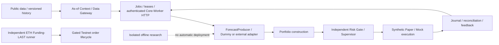

# Perpetual Alpha 2026

**Team Anonymous · Hyperliquid Testnet**

Research and trading infrastructure, execution reliability, and evidence-based alpha validation.

**Competition completed · Research archived**

[](https://github.com/BouillieAnonymous/Perpetual-Alpha-2026/actions/workflows/ci.yml)

A Python research and trading-engineering project for the Perpetual Alpha 2026
competition on Hyperliquid Testnet. The competition and technical report are
complete. This repository preserves the trading infrastructure, Agent-ready
architecture, data lineage, exploratory research and negative results.

**No stable profitable alpha has been established.** Historical simulations,
execution acceptance tests and actual trading results have different meanings.
The research archive does not authorize deployment or changes to the competition
account. Consolidation [PR #44](https://github.com/BouillieAnonymous/Perpetual-Alpha-2026/pull/44)
was merged into `main` on 6 November 2026 as `4dd270fa5cce7dbaaa48bcc7bb420115922fca76`.
The merged repository is the development baseline; a Git merge does not deploy a service.

| Start here | What you will find |
|---|---|
| **[Technical Report — 6 November 2026](docs/competition/PA26-Anonymous-report.pdf)** | Team Anonymous's four-page report; [LaTeX and provenance](docs/competition/README.md) |
| **[Research Findings](docs/research/FINDINGS.md)** | Hypotheses, baselines, negative results and limitations; [complete evidence index](docs/research/INDEX.md) |
| **[Architecture & Implementation](#architecture-and-maturity)** | Independent Funding-LAST, collector, Agent-ready infrastructure, risk and synthetic execution |

**Report context:** the 5 November account performance is a historical snapshot,
not final official competition results or proof of stable profitable alpha.

## Architecture and maturity



| Area | Implemented | Maturity / limits |
|---|---|---|
| Competition trading line | Independent ETH Funding-LAST runner, identity-bound authorization, sizing, limits, reconciliation and monitoring | Production competition path; historical deployment/acceptance records are time-stamped, not a claim about the server's current state |
| Public data | PAS ten-market collector, independent SQLite, normalization, causal minute panels and CSV export | Separate from trading/account state; quotes are not executable fills |
| Agent-ready infrastructure | Versioned contracts, SQLite jobs/leases/transactional Outbox, authenticated Core/Worker, multi-round frozen Data Gateway | Implemented and tested infrastructure; shipped Workers are Dummy/examples, not a deployed autonomous LLM trader |
| Risk and Paper | Market-risk replay, Portfolio, independent Risk Gate, restart-paused Supervisor and recoverable synthetic ledger | Synthetic policies and fills; not a complete live Agent/Core execution stack |
| Alpha research | Basis/cost studies, traditional rules, regimes, momentum, volatility, hypothesis batches and H09 | Research-only; negative, insufficient and unknown results retained |
| News/event Agent | Protocol/design proposal | Proposal-only, no implemented/deployed news trader |
| WebSocket collector | Isolated prototype with original tests | Experimental; not substituted for PAS collector |
| External Agent fork | PR #31 retained separately | ZIP/configuration not imported or executed |

The competition runner is independent of generic Forecast/Agent/Core. Read
[PAS implementation and safeguards](docs/pas-launch-preparation.zh-CN.md),
[Funding-LAST history](docs/funding-release.zh-CN.md), and
[Agent integration contracts](docs/forecast-integration-v0.2.1.zh-CN.md).
Earlier records saying PAS was disabled describe their original dates; they
have not been rewritten to imply later acceptance or present account status.

## Trading safeguards and order lifecycle

The original runtime preserves explicit signing gates, dedicated identities,
collateral isolation, Decimal sizing, spread/depth/staleness checks, persisted
intent and deterministic order identity before submission. Unknown outcomes
require reconciliation; they are not blindly resent. Restart/pause semantics,
partial fills, risk-reducing exits, authorization expiry and notifications have
separate checks. Research scripts cannot enable these services.

This consolidation keeps existing `src/`, `config/`, `deploy/`, `pyproject.toml`
and the original CI workflow unchanged. Optional historical research modules
live outside the installable production package.

## Research and dashboards

Start at the [consolidated research index](docs/research/INDEX.md). It includes
protocols, source commits, negative results, data limitations and reproduction
requirements. Seen historical splits are not clean out-of-sample evidence.
Gross/hypothetical returns are not actual account returns.

- [V2 BTC/ETH Dashboard](docs/research/btc-eth-volatility/visual-eda-v2/README.md):
  download the complete release and open its HTML in modern Chrome.
- [V3 all-asset Dashboard](docs/research/pas-visual-discovery-v3/README.md): keep
  `release/dashboard.html` beside its `assets/` directory. No CDN/server needed.
- [H09 BTC→HYPE](docs/research/h09-btc-hype-2026-11/report.md):
  **NO_INCREMENTAL_EVIDENCE**, with fixed-spec falsification and a stop gate.
- [Batch hypothesis research](docs/research/alpha-hypothesis-batch-2026-11/summary.md):
  negative, duplicate, insufficient-data and execution-unknown outcomes retained.

GitHub's source viewer does not execute dashboard HTML. Browser interaction
acceptance is distinct from numeric or DOM/mock tests. Remaining browser and
data conditions are listed in the final reports.

## Local installation and offline checks

Use **Python 3.12.15**, matching the pinned runtime. From the repository root:

```powershell
python -m venv .venv
.venv/Scripts/python.exe -m pip install -r deploy/requirements-check.txt -r config/requirements-ci.txt
$env:PYTHONPATH="$PWD/src"
.venv/Scripts/python.exe -m unittest discover -s tests -v
.venv/Scripts/python.exe scripts/validate_schemas.py
.venv/Scripts/python.exe -m perpetual_alpha.cli dry-run --journal .cache/demo.sqlite3
```

On Linux/macOS use `.venv/bin/python` and `PYTHONPATH=src`. Some permission and
file-lock tests require Linux. Offline demonstrations do not need `.env`,
wallets, an account or signing. Do not run the manual account/order tools as
test discovery. Environment details: [ENVIRONMENT.md](ENVIRONMENT.md).

For historical modules, use the [separate research workspace](research/README.md)
and optional dependency pins. Full numerical reproduction additionally requires
the exact public raw snapshots/source versions recorded by each study. Missing
inputs are **BLOCKED**, not replaced with fresh data or synthetic evidence.
Never run an original writer on frozen outputs.

## Repository map

```text
src/perpetual_alpha/      maintained runtime, transport, risk and execution
config/                  existing runtime and synthetic-demo configuration
deploy/                  existing runtime pins, images and service definitions
scripts/                 existing checks plus canonical PAS research scripts
tests/                   maintained runtime and PAS archive regression tests
research/legacy/         isolated original research source/scripts/tests/pins
research/experimental/   archived collector prototype, disabled by design
research/tools/          disposable workspace and evidence/navigation checks
docs/research/           frozen protocols, results, dashboards and negative evidence
docs/consolidation/      provenance, disposition, test and merge reports
```

See the [structure overview](docs/consolidation/repository-structure.md),
[documentation index](docs/README.md), and
[final review report](docs/consolidation/final-integration-report.md).

The consolidation changes repository organization, research preservation and
review documentation. It does not deploy, trade, change strategy/risk settings,
delete remote branches, rewrite history or change repository visibility.
