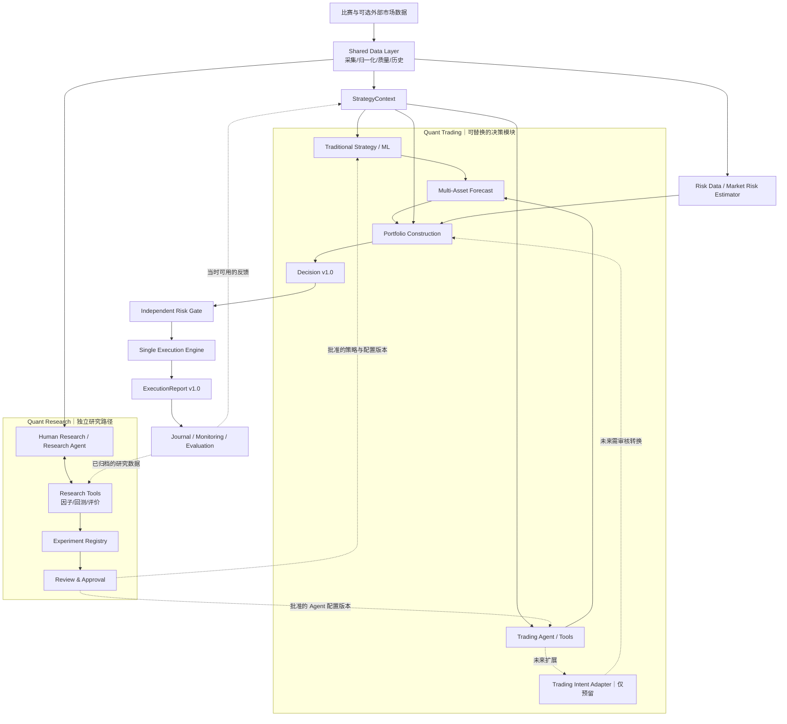

# Perpetual Alpha 2026

[](https://github.com/BouillieAnonymous/Perpetual-Alpha-2026/actions/workflows/ci.yml)

当前可运行：架构 v0.2 的离线多资产 Dry Run、服务器只读采集框架、本地官方 SDK 只读 API 检查，以及手动小额 Testnet 交易验收。交易默认关闭。项目设计仍集中在 [docs 文档入口](docs/README.md)，本页展示架构及运行方法。


## 系统架构 v0.2

架构框架见[系统架构设计 v0.2](docs/architecture-v0.2.zh-CN.md)。图中包含目标模块及未来预留边界，不代表所有模块已实现；用户已批准第一轮模拟实现；协议 1.0 保持现有语义。实际能力见[首轮实现说明](docs/architecture-implementation.zh-CN.md)。



## 架构模拟运行

```powershell
.\.venv\Scripts\python.exe -m perpetual_alpha.cli dry-run
```

完全离线，使用合成 BTC/ETH 行情和账户；同一 Context 对照传统规则与模拟 Agent，只有配置选定版本进入 Portfolio → Risk Gate → Mock Execution。默认 Agent 对 ETH 弃权，BTC 使用固定演示数量。输出及日志显式标记模拟，不调用 LLM 或签名下单；真实采集及手动 Testnet 工具保持独立。

演示配置在 `config/dry-run.toml`，日志默认保存在 `data/dry-run/journal.sqlite3`。运行/替换方法、研究 Registry、异常语义与真实交易缺口见[实现与验证](docs/architecture-implementation.zh-CN.md)，完整输出见[样例](docs/examples/dry-run.json)。

## 自动代码检查（CI）

每次 push / PR 自动检查 Python 3.11–3.13（Linux）及 3.12（Windows）：Ruff、离线回归测试、JSON Schema 与样例、端到端 Dry Run。点击上方 CI 状态查看结果；检查失败时查看对应 job 的日志并修复。CI 不使用交易密钥，也不部署或运行真实交易。它是自动验证，业务逻辑仍需人工审查；运行方法和合并限制说明见[CI 文档](docs/continuous-integration.zh-CN.md)。

## Windows PowerShell：本地 API 验收

在项目根目录执行。需要 Python 3.11–3.13；本项目保留原有版本范围，当前虚拟环境已统一为 3.12.15，SDK 为 0.24.0；运行依赖与服务器 deploy/requirements-check.txt 一致。官方最低 Python 3.10 不代表所有项目代码都兼容 3.10（项目使用 tomllib）。服务器容器为 Python 3.12.15。

已有 `.venv` 可以直接使用；没有时，用兼容的 Python 创建环境：

```powershell
uv venv --python 3.12.15 .venv
uv pip install --python .venv/Scripts/python.exe -r deploy/requirements-check.txt -e .
```

若系统 Python 是 3.14，请改用已安装的兼容解释器创建环境，不修改系统 Python。也可以使用 uv：

```powershell
uv venv --python 3.12.15 .venv
uv pip install --python .venv/Scripts/python.exe -r deploy/requirements-check.txt -e .
```

无需激活环境，也无需修改 PowerShell 执行策略。初次配置时，仅在 `.env` 不存在时复制模板，避免覆盖已有本地设置：

```powershell
if (-not (Test-Path .env)) { Copy-Item .env.example .env }
```

编辑 `.env` 中的两个**公开地址**：TEAM_WALLET_ADDRESS 是资金账户地址，API_WALLET_ADDRESS 是授权代理地址。交易测试另需用户在本地手动填写 API_WALLET_PRIVATE_KEY；只读检查不加载该字段。ENABLE_TRADING 保持 false，此预留字段目前不控制交易；独立测试的唯一启动开关是 --execute。环境变量里的公开地址和签名密钥优先于文件。

```powershell
.\.venv\Scripts\python.exe check_connection.py
.\.venv\Scripts\python.exe check_account.py
.\.venv\Scripts\python.exe check_api_wallet.py
.\.venv\Scripts\python.exe -m unittest discover -s tests -v
```

验收分别应出现 CONNECTION_CHECK_PASSED、ACCOUNT_CHECK_PASSED 和 API_WALLET_CHECK_PASSED。网络请求设 15 秒超时；失败时不发送交易、不重试写操作。

| 文件 | 作用 |
|---|---|
| src/perpetual_alpha/api_client.py | 固定 Testnet／par 的官方 Info 客户端，只提供公开查询 |
| check_connection.py | 比赛 metadata、BTC／ETH 报价与 L2 盘口 |
| check_account.py | Team Wallet USDPR、账户模式、仓位、挂单、近期比赛成交 |
| check_api_wallet.py | 代理授权地址与过期时间；不验证私钥持有或签名 |
| src/perpetual_alpha/execution.py | API Wallet 签名、Testnet 限制、25 USDPR 测试上限、订单状态与持久化记录 |
| test_order.py | 默认禁用；显式 --execute 执行小额挂单、撤单、开仓、只减仓平仓与归零验收 |

账户 balance 以 spotClearinghouseState 的 USDPR 余额查询结果为准；不能把统一账户下 par 仓位查询返回的 0 accountValue 当作资金账户没钱。余额也不等于全部可用保证金。成交查询是接口返回的近期记录，不是完整历史归档。

## 当前交易边界

第一、二阶段不创建 Exchange，不读取 Team Wallet 私钥，也不授权代理、切换模式或发送订单。私钥字段只为未来本地人工配置预留，不把私钥写入源码、日志、README 或 Git。不要在聊天里发送 API 私钥。

10 月 8 日经用户授权已完成一次真实 Testnet 验收：BTC 挂单撤销、买入 0.0002 BTC、只减仓卖出 0.0002 BTC，最终 par 仓位和挂单均为空。总成本 0.0627 USDPR；这不是策略收益测试。仅本地运行，私钥没有发送到服务器。

```powershell
# 不发送订单、不读取签名密钥
.\.venv\Scripts\python.exe test_order.py
# 仅在明确准备好再次测试时运行；会产生实际测试网成交及费用
.\.venv\Scripts\python.exe test_order.py --execute
```

测试要求开始时所有 par 仓位和挂单为空；1 倍交叉杠杆，每笔订单不超过 25 USDPR，IOC 价格保护约 5 基点。实际最小数量从 metadata 读取。成交与账户查询始终使用 Team Wallet 公共地址。订单拒绝或网络结果不明时停止，不盲目重发；partial fill 后按实际剩余仓位平仓，最多三次。失败后保留 data/order-test.lock 阻止重跑，需要先检查 data/order-test.jsonl 和账户，处理剩余挂单／仓位，确认安全后人工移除锁。成功后自动释放锁。

该入口是单次执行验收，不是无人值守交易系统：断线恢复、进程崩溃后的自动撤单平仓、Decision → ExecutionReport 接入及全天运行仍待开发和验证。不要以单次通过替代故障演练。

## 服务器运行与设计

持续报价采集、三段接口协议、部署路径和停止／重启方法见 [系统与部署](docs/technical-plan.zh-CN.md)。本次 API 只读模块是在本地环境运行验收，未将账户或私钥配置发送到服务器，现有服务器采集服务继续运行。

官方依据：[比赛参与指南](https://perpetual-alpha26.github.io/docs/)、[Hyperliquid Python SDK](https://github.com/hyperliquid-dex/hyperliquid-python-sdk)。
