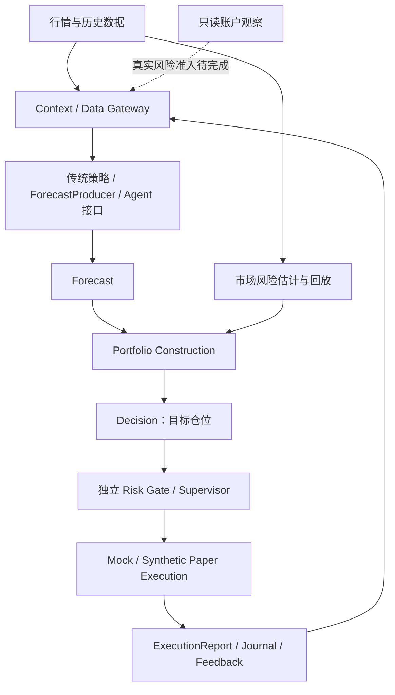

# Perpetual Alpha 2026

[](https://github.com/BouillieAnonymous/Perpetual-Alpha-2026/actions/workflows/ci.yml)

面向 Perpetual Alpha 2026 比赛的 Python 量化交易研究与工程项目。系统使用 Hyperliquid Testnet 的 `par` 排练市场与 `pas` 正式比赛市场，把数据、可替换策略／Agent、组合构建、独立风控和执行记录连接起来。

**当前阶段：数据与模拟交易底座已具备，正在开发和验证策略。** 已实现离线 Dry Run、Core／Worker HTTP 通信、历史数据查询、只读账户观察、市场风险回放、组合风控和可恢复的合成 Paper 执行。实际 LLM 接入及通用 Agent/Core 的真实执行升级仍待完成；本分支新增独立 ETH Funding-LAST 测试网 runner，见下文双环境交付。基础能力记录截至 2026 年 10 月 17 日，独立 runner 验收为 10 月 18 日；服务器现场以对应验收文档为准。

PAS 正式比赛已开始，独立 `venue_collection` 入口已实现十资产公共只读采集：每 60 秒记录 metadata/context 与盘口，每 30 分钟采集最近一小时已结算 Funding，使用独立 SQLite 数据库。PAR 研究／模拟链与 PAS 采集状态分离，PAS 交易未启用。`config/systems/pas.toml` 是环境初始化的预留配置，不控制独立采集服务。配置、质量语义和 2026-10-19 VPS 部署记录见 [PAS 公共行情采集](docs/pas-public-collection.zh-CN.md)，命名空间规则见 [PAR/PAS 环境隔离](docs/rehearsal-competition-separation.zh-CN.md)。本次主分支集成不更新服务器服务或数据库。

离线研究可使用 [PAS Research Data Pipeline](docs/pas-research-pipeline.zh-CN.md)：只读提取现有原始库，增量生成独立派生 SQLite、严格 as-of 分钟数据及十资产日统计/CSV。无需更新 Collector 或部署 VPS，示例报告仅使用合成数据。

## 当前能力

本开发分支新增 [ETH Funding-LAST 双环境执行与排练运维](docs/funding-release.zh-CN.md)：独立 Testnet runner、PAR 小额验收与 PAS 禁用配置。现场结果以该文档的验收记录为准，不能将其视作全部 Agent/Core 已获得真实执行能力。

| 模块 | 已实现内容 | 当前边界 |
|---|---|---|
| 行情与历史 | 公开报价采集、市场规格、K 线修订与质量记录、严格时点读取 | 采集器与研究／模拟链独立，数据可用不等于可以交易 |
| Agent 通信 | SQLite Job、租约、Outbox、HTTP Core／Worker、多轮 Data Gateway、证据封存 | 现有 Worker 为 Dummy／示例，未接真实 LLM |
| 账户观察 | Unified 余额、持仓、挂单与来源核对，独立证据存储 | 只读；`risk_ready` 仍为 false |
| 市场风险 | 历史收益、样本协方差、冻结输入与离线复算 | 市场统计就绪不代表账户交易批准 |
| 组合与风控 | 合成资本预算、持仓及挂单敞口、独立 Risk Gate、默认暂停的 Supervisor | 使用显式模拟政策，未批准真实风险参数 |
| Paper 执行 | 持久 Intent、部分成交、现金与费用账本、对账、反馈及恢复 | 仅合成市场、账户和成交，无真实交易所订单 |
| Paper 运维 | 隔离双容器、存活检查、一致备份、隔离恢复与故障验收 | 已有短期 VPS 验收；多日稳定性、异地恢复与生产报警仍待验证 |
| 策略研究 | 可替换 ForecastProducer、传统规则与模拟 Agent 对照、参考价偏离策略及成本过滤 | 研究中，尚无经过验证的盈利策略 |

独立手动 Testnet 工具已完成过小额订单生命周期验收；它与 Paper 链路分开，不能作为无人值守交易已完成的证据。

## 快速开始

### 1. 准备环境

本地与容器统一使用 **Python 3.12.15**，运行依赖锁定在 [deploy/requirements-check.txt](deploy/requirements-check.txt)。项目声明兼容 Python 3.11–3.13，复现时优先使用固定版本。以下命令在项目根目录的 Windows PowerShell 执行：

```powershell
uv venv --python 3.12.15 .venv
uv pip install --python .venv/Scripts/python.exe -r deploy/requirements-check.txt -e .
uv pip check --python .venv/Scripts/python.exe
```

无需激活虚拟环境或修改 PowerShell 执行策略。环境细节见 [ENVIRONMENT.md](ENVIRONMENT.md)。

### 2. 运行离线演示

```powershell
.\.venv\Scripts\python.exe -m perpetual_alpha.cli dry-run
```

使用合成 BTC／ETH 行情和账户，对照传统规则与模拟 Agent；配置选定的版本进入 Portfolio → Risk Gate → Mock Execution。它不调用 LLM，不读取交易密钥，也不发送订单。

配置为 [config/dry-run.toml](config/dry-run.toml)，默认日志为 `data/dry-run/journal.sqlite3`。其中资金、数量和风险限制均是演示参数。

自定义预测模块的离线接入示例：

```powershell
.\.venv\Scripts\python.exe -m perpetual_alpha.examples.lt_adapter --journal data/dry-run/lt-review.sqlite3
```

实现与替换方法见 [Dry Run 实现说明](docs/architecture-implementation.zh-CN.md)和 [Forecast 接入协议](docs/forecast-integration-v0.2.1.zh-CN.md)。

### 3. 本地验证

```powershell
.\.venv\Scripts\python.exe -m unittest discover -s tests -v
.\.venv\Scripts\python.exe scripts/validate_schemas.py
```

GitHub Actions 在 Linux amd64 容器中检查固定环境、Ruff、离线回归、契约样例、数据／风险／Paper 验证与独立容器故障链路。CI 不使用交易密钥、不部署交易；具体检查及复现方式见 [CI 说明](docs/continuous-integration.zh-CN.md)。上方徽章展示 `main` 分支状态。

## 系统结构



策略负责预测，组合模块把预测转换为目标数量，独立风控审批执行。`Decision` 与 `ExecutionReport` 保留协议 1.0 语义。跨进程任务与数据访问由 Transport／Runtime 管理，重启不会自动恢复 Paper 执行权限。

研究与交易分别保留版本和证据；研究结果需经过对照与审核，才能进入后续执行阶段。架构约定以 [开发基线 v0.3](docs/development-baseline-v0.3.zh-CN.md)为入口，设计与代码之间的差距见 [架构审查](docs/architecture-v0.3-review.zh-CN.md)。

## 最新策略研究：参考价偏离

独立研究分支（[PR #13](https://github.com/BouillieAnonymous/Perpetual-Alpha-2026/pull/13)）新增基于 `oracle` 与比赛盘口偏离的传统 ForecastProducer，并使用现有 Collector 的 BTC／ETH 真实采样进行离线回放。producer 与回放共用成本模型，入场前检查双边手续费、滑点、预计退出价差与资金费压力成本。

这是**无外部对冲的单腿方向策略**。首轮回放及增加成本过滤后的开发对照均未支持盈利结论；约 30 秒的采样不能重建逐笔成交和排队，也尚未验证真实账户资本、保证金与完整估值。原始数据保存在本地缓存，未随 Git 提交。

研究假设、参数、结果、复现方式与局限见 [参考价偏离研究](https://github.com/BouillieAnonymous/Perpetual-Alpha-2026/blob/codex/reference-basis-research/docs/reference-basis-research.zh-CN.md)。该模块尚未部署或接入真实订单。

## 只读 API 与手动 Testnet 工具

离线演示无需 `.env`。需要查询真实 Testnet 时，仅在文件不存在时复制模板，再在本地填写公开地址：

```powershell
if (-not (Test-Path .env)) { Copy-Item .env.example .env }
.\.venv\Scripts\python.exe check_connection.py
.\.venv\Scripts\python.exe check_account.py
.\.venv\Scripts\python.exe check_api_wallet.py
```

分别检查公开行情、Team Wallet 账户和 API Wallet 授权。只读检查不加载签名密钥；API Wallet 授权查询不证明持有对应私钥。账户余额不等于可用保证金，缺失或不可信数据保留为 unknown。

[test_order.py](test_order.py) 是独立的手动小额 Testnet 验收入口，默认不执行，只有显式 `--execute` 才会发送实际测试网订单。`.env` 中的 `ENABLE_TRADING` 预留字段不控制这个入口。再次运行前应阅读 [交易验收与恢复说明](docs/technical-plan.zh-CN.md)，确认账户状态、锁文件和未完成订单；不要把它当作自动交易启动器。

私钥仅保留在本地受控配置中，不放入源码、日志、文档或聊天。`.env`、缓存、数据库、日志与研究原始数据已由 `.gitignore` 排除。

## 目录

```text
src/perpetual_alpha/
  historical/   历史采集、修订、质量与时点读取
  accounts/     只读账户观察与证据存储
  transport/    HTTP、消息契约与 Data Gateway
  runtime/      Job、Outbox、调度、Paper 执行与运维
  examples/     自定义预测模块接入示例
  ...           Forecast、组合、风控、研究与采集模块
config/         采集及离线演示配置
deploy/         固定依赖、Dockerfile 与 Compose
scripts/        契约、回放、容器与运维验收工具
tests/          自动化回归测试
docs/           设计、实施记录、研究及验收证据说明
```

持续采集器使用 Linux `fcntl` 文件锁，部署见 [系统接口与部署](docs/technical-plan.zh-CN.md)；不要直接套用 Windows 离线演示的启动方式。Paper 使用独立容器和状态卷，操作及恢复见 [PR9 运维说明](docs/paper-operations-pr9.zh-CN.md)。本文不代表实时查询了服务器状态。

## 文档入口

- [完整文档目录](docs/README.md)：查找各模块 PR0–PR9 的契约、实现和验收说明。
- [项目总览与任务](docs/project-plan.zh-CN.md)：团队分工、决定和阶段进度。
- [开发基线 v0.3](docs/development-baseline-v0.3.zh-CN.md)：开发顺序、架构约束与验收边界。
- [数据来源与交易规则](docs/data-development.zh-CN.md)：市场、接口、数据口径和质量要求。
- [策略开发与头脑风暴](docs/strategy-development.zh-CN.md)：候选策略、Agent 方向与实验方法。
- [Agent Transport 契约](docs/agent-transport-v0.1.zh-CN.md)与 [Forecast 集成](docs/forecast-integration-v0.2.1.zh-CN.md)：队友接入入口。

下一阶段重点是验证策略、接入真实预测模块、补齐真实行情／账户风险与执行链路，并持续验证恢复和运行稳定性。Synthetic Paper 验收不自动授予真实 Testnet 或主网交易权限。
