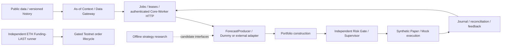

# Perpetual Alpha 2026

**Quantitative Research · Agent-Based Trading Infrastructure · Perpetual Futures**

[](https://github.com/BouillieAnonymous/Perpetual-Alpha-2026/actions/workflows/ci.yml)

## Overview

Perpetual Alpha 2026 is a Python-based quantitative research and trading
infrastructure project developed by **Team Anonymous** for the Perpetual Alpha
2026 competition on Hyperliquid Testnet.

The project combines multi-asset market data collection, reproducible strategy
research, agent-oriented forecasting interfaces, portfolio and risk management,
and fault-tolerant trading execution.

During the competition, we deployed an independent, deterministic **ETH
Funding-LAST** strategy with constrained position sizing, persistent order
intents, exchange reconciliation and operational monitoring. In parallel, we
implemented and tested an extensible **Agent/Core architecture with synthetic
execution**, keeping experimental AI-driven strategies separate from live trading.

Our research identified candidate signals and positive exploratory results
alongside failed robustness tests. Persistent, executable risk-adjusted excess
returns remain unproven. The evidence preserves what worked in simulations,
what failed further validation, and what still needs investigation.

**Project resources:** [Technical Report](docs/competition/PA26-Anonymous-report.pdf) ·
[Research Findings](docs/research/FINDINGS.md) ·
[Architecture](#system-architecture) · [Getting Started](#getting-started)

## Key Features

- **Multi-asset data pipeline:** a ten-market PAS collector, independent SQLite
  storage, normalization, as-of research panels and CSV export. Freshness and
  historical availability are explicit parts of the data model.
- **Reproducible research:** frozen protocols, source provenance, cost-aware
  baselines, chronological validation and archived results across momentum,
  reversal, basis, funding, volatility and regime studies.
- **Agent-ready interfaces:** versioned forecast contracts, authenticated
  Core/Worker HTTP, persistent jobs and leases, transactional Outbox and a
  multi-round Data Gateway with frozen as-of context.
- **Portfolio, risk and synthetic execution:** portfolio construction, an
  independent Risk Gate, restart-paused Supervisor, recoverable Paper ledger
  and reconciliation/feedback, tested with synthetic policies and fills.
- **Competition execution:** a separate deterministic Funding-LAST runner with
  Decimal sizing, pre-order checks, durable order identity, partial-fill handling
  and exchange reconciliation before retrying unknown outcomes.

## System Architecture

<a id="architecture-and-maturity"></a>



| Component | Implementation and role |
|---|---|
| ETH Funding-LAST | Historically deployed competition trading path, independent of generic Agent/Core; deterministic funding signal and dedicated execution safeguards |
| Public data / research | Implemented collection and offline analysis; research outputs are reviewed separately from deployment |
| Agent/Core | Implemented and tested transport, scheduling, forecasting interfaces and Data Gateway; supplied Workers are Dummy/examples |
| Portfolio / Risk / Paper | Implemented synthetic execution and recovery framework; separate from the competition runner's live order controls |
| LLM / news Agents | Experimental or proposed extensions; no autonomous LLM trader is deployed by this mainline framework |

See [Funding-LAST implementation](docs/funding-release.zh-CN.md),
[competition launch and safeguards](docs/pas-launch-preparation.zh-CN.md),
[forecast integration contracts](docs/forecast-integration-v0.2.1.zh-CN.md) and
[Paper execution](docs/paper-execution-pr8.zh-CN.md).

## Getting Started

Use **Python 3.12.15**. From the repository root, install the pinned runtime and
check dependencies, then run the offline demonstration:

```powershell
python -m venv .venv
.venv/Scripts/python.exe -m pip install -r deploy/requirements-check.txt -r config/requirements-ci.txt
$env:PYTHONPATH="$PWD/src"
.venv/Scripts/python.exe -m perpetual_alpha.cli dry-run --journal .cache/demo.sqlite3
```

The demo uses the shipped synthetic configuration and writes a local SQLite
journal. It needs no credentials, wallet or exchange connection. To run the
regression suite and schema checks in the same environment:

```powershell
.venv/Scripts/python.exe -m unittest discover -s tests -v
.venv/Scripts/python.exe scripts/validate_schemas.py
```

On Linux/macOS use `.venv/bin/python` and `export PYTHONPATH=src`. Some permission
and file-lock checks require Linux; CI runs the container and SSH isolation
checks there. See [environment setup](ENVIRONMENT.md) and
[CI documentation](docs/continuous-integration.zh-CN.md).

Historical research uses a [separate workspace and optional dependencies](research/README.md).
Each study records its required inputs and reproduction entry points; published
derived evidence can be checked even when original raw caches are unavailable.

## Research & Results

The research pipeline moves from observed patterns to frozen hypotheses,
matched baselines, availability/cost checks and longer-history validation.
Some candidates showed positive exploratory behavior; the follow-up tests help
distinguish promising observations from robust executable signals.

| Study | Main finding |
|---|---|
| Traditional strategies | 37 short-window candidates were selected for longer-history validation: 36 failed and ETH Funding-LAST remained inconclusive |
| ETH Funding-LAST | Positive modeled net returns in the long-history study and an actual deterministic competition deployment; excess-return evidence remains inconclusive |
| Weekly traditional-17 screen | 41 of 153 valued combinations had positive simulated net results; dependent rules and thin samples make these candidates, not 41 independent alphas |
| H03 relative residual | Small positive cost-precheck observations in validation/late periods; execution feasibility and complete net returns remain unknown |
| BTC/ETH volatility | Modest validation improvement did not persist in the late period; useful evidence about data activity and weak predictive stability |
| H09 BTC → HYPE | Fixed-spec incremental prediction failed the stop gate, providing a documented negative result for that hypothesis |

Read [Research Findings](docs/research/FINDINGS.md) for sample periods, baselines,
numerical results and limits, and the [complete Research Index](docs/research/INDEX.md)
for original reports, protocols, scripts and frozen outputs. Simulated returns
and account performance are reported separately.

### Interactive dashboards

- [V2 BTC/ETH Visual Discovery](docs/research/btc-eth-volatility/visual-eda-v2/README.md)
  links past-only visual diagnostics to the underlying numerical evidence.
- [V3 All-Asset Dashboard](docs/research/pas-visual-discovery-v3/README.md)
  explores ten-market quote activity, relationships and hypothesis support.

Download the complete dashboard release and open its HTML in modern Chrome;
keep `dashboard.html` beside its `assets/` directory. GitHub's source viewer
does not run interactive HTML. The dashboard guides explain remaining manual
acceptance items.

## Competition Report

**Team Anonymous · Yunfei Zhou and Zhengkai Sun · 6 November 2026**

[Read the four-page Technical Report](docs/competition/PA26-Anonymous-report.pdf) ·
[Display-version LaTeX and provenance](docs/competition/README.md)

The GitHub display edition preserves the authors' names and report content
while omitting personal email addresses. Its account-performance example is a
**5 November historical snapshot**, not final official competition results.

## Documentation & Repository Structure

| Path | Contents |
|---|---|
| `src/perpetual_alpha/` | Maintained data, transport, portfolio, risk and execution modules |
| `config/`, `deploy/` | Runtime configuration, synthetic demo, pinned dependencies and service definitions |
| `scripts/`, `tests/` | Checks, canonical PAS research scripts and regression tests |
| `research/legacy/` | Isolated historical research source, scripts, tests and dependency pins |
| `research/experimental/` | Archived collector prototype |
| `research/tools/` | Disposable workspace and evidence/navigation checks |
| `docs/research/` | Findings, protocols, results and dashboard releases |
| `docs/competition/` | Email-free display report, LaTeX, figures and provenance |
| `docs/consolidation/` | Source mappings, PR dispositions, integration and reproducibility records |

Start with the [documentation index](docs/README.md),
[structure overview](docs/consolidation/repository-structure.md) or
[research workspace guide](research/README.md).
Consolidation [PR #44](https://github.com/BouillieAnonymous/Perpetual-Alpha-2026/pull/44)
was merged into `main` on 6 November 2026 (`4dd270f`); the integrated mainline
is the development baseline. Historical research and operational documents
retain their original dates and context.
