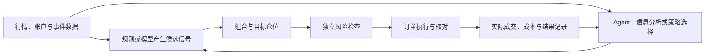

# Perpetual Alpha 2026｜Agent 与交易系统学习资料

更新：2026 年 10 月 14 日（英国时间）。

这是一份独立的学习资料文档，集中收录队友最初发来的 3 份资料、本次扩展检索的 38 个条目，以及 10 月 14 日会后新增的 3 个模型／服务条目，共 44 项。每项标注主题、用途并保留原始链接。目标是理解 Agent 结构，以及传统交易框架如何接入 Agent。[第 10 节](#10-45-小时架构学习与路线选择)提供 4–5 小时学习安排；[第 11 节](#11-10-月-14-日会后新增deepseekfin-r1-与-jev)整理最新模型资料。具体实施方案由双方讨论决定。

## 目录

- [1. 这次要弄明白的两条线](#1-这次要弄明白的两条线)
- [2. 队友发的东西分别回答什么](#2-队友发的东西分别回答什么)
- [3. Agent 的结构：先看一次完整工作过程](#3-agent-的结构先看一次完整工作过程)
- [4. 传统框架里可以把 Agent 放在哪里](#4-传统框架里可以把-agent-放在哪里)
- [5. Agent 通用结构资料](#5-扩展资料目录agent-通用结构)
- [6. 金融 Agent 与自动研究资料](#6-扩展资料目录金融-agent-与自动研究)
- [7. 传统量化框架与做市资料](#7-扩展资料目录传统量化框架与做市)
- [8. RL、评价与宏观资料](#8-扩展资料目录rl评价与宏观资料)
- [9. 按学习问题查资料](#9-对两条学习线最有帮助的资料定位)
- [10. 4–5 小时架构学习与路线选择](#10-45-小时架构学习与路线选择)
- [11. 会后新增：DeepSeek、Fin-R1 与 Jev](#11-10-月-14-日会后新增deepseekfin-r1-与-jev)

项目中的策略假设、适配问题和实验继续在[策略开发与头脑风暴](strategy-development.zh-CN.md)维护；本文件集中维护学习解释和资料目录。


## 1. 这次要弄明白的两条线

用户希望先理解 Agent 的结构，能看懂队友在开发什么，具体技术实现可以由队友主推；同时理解自己的宏观、策略和风险想法怎样进入较传统的交易框架，并在合适位置接入 Agent。最初先收集资料；用户后续要求用 4–5 小时理解并比较这两条线，安排见第 10 节。仍未确定主策略或实施框架。

资料范围：R01–R03、L01–L38，加会后新增 R04–R06，共 **44 个资料条目**。一个条目可以同时有论文和项目链接，数量不是独立实验数。检索以论文作者、项目维护者和官方文档为依据；综述用于导航，具体系统的说明优先对应原论文／原项目。

阅读深度：本次重读 R01 的结构与相关讨论、R02／R03 README；重点读 FinAgent 第 4 节及附录 H.2、FinCon 框架部分、Anthropic 工作流解释和 QuantConnect 模块定义。其余主要核对摘要、README 或官方文档入口，不称作逐篇精读。未下载全部 PDF、未安装运行项目、未复现实验或审计源码。表中的适用性是我们的判断；论文中的收益报告不代表比赛市场结果。

## 2. 队友发的东西分别回答什么

| 已有资料 | 做什么／怎么做 | 你可以从中理解什么 |
|---|---|---|
| R01：[Agentic Trading 综述](https://arxiv.org/html/2605.19337v2) | 用架构、金融能力、适应方式三条轴梳理文献；架构含感知、记忆、推理和执行 | 交易 Agent 可以放在哪些环节；“用 Agent”和“用 RL”如何区分。第 3–6 节看结构，第 7–9 节看职责，第 10–12 节看改进方式 |
| R02：[Hyperliquid 做市项目](https://github.com/zer0cache/hyperliquid-market-maker-bot) | 行情与成交输入 → VWAP／公平价估计 → 双边报价与库存调整 → 风险和执行 | 传统做市系统的模块关系，以及 Agent 可否辅助环境判断／有限参数调整；仓库主体不是 LLM Agent |
| R03：[Hyperliquid 动量项目](https://github.com/Gajesh2007/momentum-trading) | 多周期价格趋势 → 资金费调整 → 波动与仓位计算 → 周期再平衡和订单执行 | “信号、仓位、执行”如何拆开；以后可以给信号增加 Agent 的信息过滤，而不必替换整套策略 |

R02 的报价与 R03 的目标仓位属于不同动作语义，不能因为都能交易就共用同一种简单买卖接口。具体适配问题见[策略文档第 10 节](strategy-development.zh-CN.md#10-三份外部资料分别能帮我们什么)；本次重读不表示这些问题已经解决。

你现有的想法也分三种：宏观／新闻是**可能提供信息的来源**，趋势／回归／做市／资金费是**收益假设**，对冲／仓位／风险指数是**风险与组合管理**。把它们组合成系统之前，应分别说明信息怎样变成数值或标签、预期赚什么、怎样控制损失。Agent 是实现某些步骤的方法，尚不能代替这些定义。

## 3. Agent 的结构：先看一次完整工作过程

以“判断一条宏观公告是否影响已有交易信号”为例，一个 LLM Agent 的工作可以是：收到任务和当时的数据 → 判断还缺什么 → 调用新闻／数据工具 → 读取工具结果 → 检索相关历史记录 → 形成结构化结论 → 满足结束条件后返回。ReAct 研究展示了推理与工具动作交替的模式；工程上还需把循环次数、工具权限、失败处理和日志写进外部运行程序。[ReAct](https://arxiv.org/abs/2210.03629)、[Building Effective Agents](https://www.anthropic.com/engineering/building-effective-agents)

| 术语 | 通俗解释 | 你要能问队友的问题 |
|---|---|---|
| 模型／角色 | 谁处理任务，给它什么职责和背景 | 负责新闻判断、策略选择还是生成代码？ |
| 观察与上下文 | 当前可见的行情、账户、新闻与任务 | 有没有价格和首次发布时间依据？ |
| 工具 | 可以调用的真实程序，如查行情、算指标、跑回测 | 工具返回真实结果，还是让模型凭记忆估计？ |
| 记忆 | 保存或检索过去信息、决策和复盘记录 | 什么时候写入；回测时能否拿到未来的记录？ |
| 工作流／编排 | 决定先后顺序、分支、循环及多人角色如何交接 | 顺序固定，还是模型自己选下一步？ |
| Harness | 运行循环、工具调用、状态、预算、超时、停止与记录的外层程序 | 模型卡住、工具失败或输出错误时如何结束？ |
| 输出约定 | 其他程序能解析的字段和含义 | 返回分析文章、事件标签、策略 ID 还是目标仓位？ |
| 评估与反馈 | 核对结果，决定是否更新某一部分 | 更新记忆、参数、模型权重还是策略代码？ |

这里把 harness 用作“Agent 外层运行程序”的工程称呼，不把它视为必须选用的独立产品。LangGraph 等框架帮助实现状态、流程和恢复；它们本身不提供交易 Alpha。[LangGraph 官方概览](https://docs.langchain.com/oss/python/langgraph/overview)

**工作流和 Agent 的边界。**如果始终先查数据、再算指标、再输出，流程主要由代码决定；如果模型根据已看到的结果选择工具和下一步，Agent 的自主性更强。两者可以在同一系统中组合，角色数量多也不自动意味着自主性或效果更高。[Anthropic 工作流与 Agent 说明](https://www.anthropic.com/engineering/building-effective-agents)

**三种“改进”不要混在一起。**把失败案例写进记忆、下次检索，是经验／上下文更新；根据实验重新选择参数，是策略调参；用奖励算法更新策略网络，才是相应的 RL 训练。FinCon 的文字反馈更新投资信念、Reflexion 的语言反思，不应直接描述成每次都训练了模型权重。[FinCon](https://arxiv.org/html/2407.06567v1)、[Reflexion](https://arxiv.org/abs/2303.11366)

## 4. 传统框架里可以把 Agent 放在哪里

传统框架可拆成数据、信号、组合／目标仓位、风险、执行、反馈。QuantConnect 的模块化架构明确区分资产选择、Alpha、组合构建、风险和执行；我们借鉴职责划分，不据此决定迁移框架。[Algorithm Framework 官方说明](https://www.quantconnect.com/docs/v2/writing-algorithms/algorithm-framework/overview)

以下是**讨论用设计草图，尚未实现**。现有三段接口可承载多数目标仓位路线；做市还需独立报价意图和订单生命周期。



| Agent 落点 | 它具体负责什么 | 传统程序继续负责什么 | 对应资料 |
|---|---|---|---|
| 信息分析 | 将新闻／公告整理成事件、涉及资产、证据和有效期 | 数据对齐、指标计算、信号公式和交易 | FinRobot、FinAgent |
| 信号过滤 | 判断已有候选信号是否遇到不适用的市场／事件条件 | 原策略方向、仓位计算、强制风险约束 | FinAgent；作为我们的候选扩展 |
| 策略选择 | 在预先定义的动量／回归等策略中选择，或建议有限参数 | 各策略实现、切换约束、仓位、执行 | FinAgent 附录 H.2 |
| 因子研究 | 根据你的假设提出特征、生成研究代码、调用实验并读取结果 | 数据隔离、评估指标、独立验证和版本发布 | Alpha-GPT、RD-Agent、AlphaAgent |
| 直接策略决策 | 综合信息与记忆，直接提出目标仓位 | 数量／价格合法性、额度、订单、成交核对 | TradingAgents；需对接本项目语义 |
| RL 控制 | 从观察状态输出仓位或报价动作，通过奖励训练 | 环境、成本、账户约束及真实执行 | FinRL、Spooner 做市论文 |

**一个与你想法对应的具体例子。**原油库存公告先由工具读取；Agent 抽取发布时间、实际变化、可用的预期与供需解释，并给出证据。规则程序核对信息新鲜度、计算信号和仓位，再由风险／执行处理订单。Agent 的文字解释不直接变成确定涨跌概率；若没有可信预期，就只记录事件和风险标签。这里是设计示例，并未确定采用库存策略。[EIA 资料入口](https://www.eia.gov/petroleum/supply/weekly/)

**另一个例子是策略路由。**预先写好动量和回归，Agent 读取市场摘要与这些策略此前的表现，提出选择；系统按既定规则形成目标仓位。FinAgent 确实研究了这一做法，也报告了切换冲突、底层策略弱和提示／随机性敏感的问题。因此“会选择策略”仍需单独验证。[FinAgent 正文及附录 H.2](https://arxiv.org/html/2402.18485v3)

这张图和表仅帮助理解不同位置的职责，不选择其中某条作为团队方案。

## 5. 扩展资料目录：Agent 通用结构

每条最后一列说明阅读用途和局限，不是按天安排的课程。入门／中等／深入是相对于“能看懂结构而不承担算法实现”的目标作出的判断。

| 编号与资料 | 类型／难度 | 讲什么；建议关注哪里 |
|---|---|---|
| L01 [Building Effective Agents](https://www.anthropic.com/engineering/building-effective-agents) | 工程解释／入门 | 区分固定工作流与自主 Agent，解释串联、路由、并行、编排和评价循环；适合先建立结构感 |
| L02 [ReAct](https://arxiv.org/abs/2210.03629) | 论文，2022／中等 | 推理与动作交替；看框架与交互案例，理解工具调用后为什么还要再次处理结果；不是金融策略 |
| L03 [通用自主 Agent 综述](https://arxiv.org/abs/2308.11432) | 综述，2023 起／中等 | 梳理 Agent 构建、应用和评估；用来查角色、记忆、规划与行动的概念 |
| L04 [Hugging Face Agents Course](https://huggingface.co/learn/agents-course/unit0/introduction) | 官方课程／入门 | 从 Agent、工具到框架实例；当前阶段读概念与示例即可，不需完成全部练习 |
| L05 [LangGraph overview](https://docs.langchain.com/oss/python/langgraph/overview) | 官方文档／中等 | 状态化编排、持久执行、记忆与人工介入；理解工作过程如何由图连接，不必先学底层 API |
| L06 [smolagents](https://huggingface.co/docs/smolagents/index) | 官方框架文档／中等 | 小型 Agent、工具与代码动作；可看一个完整工具循环，生成代码的执行环境需另行控制 |
| L07 [AutoGen AgentChat](https://microsoft.github.io/autogen/stable/user-guide/agentchat-user-guide/index.html) | 官方文档／中等 | Agent、团队、消息交接和终止条件；帮助理解多角色协作，不意味着要用多 Agent |
| L08 [Reflexion](https://arxiv.org/abs/2303.11366) | 论文，2023／中等 | 根据反馈形成语言反思与记忆；适合理解不更新权重的行为改进，与训练 RL 网络不同 |

## 6. 扩展资料目录：金融 Agent 与自动研究

| 编号与资料 | 类型／难度 | 讲什么；与你们的关系 |
|---|---|---|
| L09 [Large Language Model Agent in Financial Trading: A Survey](https://arxiv.org/abs/2408.06361) | 综述，2024／中等 | 较早梳理架构、输入、回测与挑战；可与 R01 的更大资料地图对照，不必逐篇读完参考文献 |
| L10 [FinAgent 论文正文](https://arxiv.org/html/2402.18485v3) | 论文，KDD 2024／中等至深入 | 市场信息、记忆、双层反思、工具辅助决策；第 4 节看模块，附录 E 看过程，H.2 看传统策略路由及局限；最贴近“传统框架接 Agent” |
| L11 [TradingAgents 项目](https://github.com/TauricResearch/TradingAgents)／[论文](https://arxiv.org/abs/2412.20138) | 项目＋论文，2024 起／中等 | 多种分析角色、研究讨论、交易与风险角色的交接；看角色图和消息流。分析结果到比赛订单仍需要适配 |
| L12 [FinMem 论文](https://arxiv.org/abs/2311.13743)／[实现入口](https://github.com/pipiku915/FinMem-LLM-StockTrading) | 论文＋项目，2023 起／中等 | 角色设定、分层记忆与决策；理解哪些经验被保留、为什么检索历史，以及训练／测试时的可见信息 |
| L13 [FinCon 论文框架](https://arxiv.org/html/2407.06567v1) | 论文，2024／中等至深入 | 经理—分析师层级、风险反馈、用语言修正投资信念；适合追问“自我改进到底更新什么”。不把同名第三方实现当作原作者代码 |
| L14 [FinRobot 项目](https://github.com/AI4Finance-Foundation/FinRobot)／[原论文](https://arxiv.org/abs/2405.14767) | 项目＋论文，2024 起／中等 | 金融研究、工具和多角色组织；当前 README 与原论文架构属于不同演进阶段，应分开看。尤其适合信息分析和研究报告，不等同于比赛执行系统 |
| L15 [Alpha-GPT](https://arxiv.org/abs/2308.00016) | 论文，2023／中等 | 把人的投资想法转成可研究的因子，人和 AI 交互推进；与你的宏观假设如何进入可测特征相关 |
| L16 [RD-Agent](https://github.com/microsoft/RD-Agent)／[RD-Agent-Quant 论文](https://arxiv.org/abs/2505.15155) | 项目＋论文，2025／深入 | 提出假设、生成因子／模型、实现、实验、读取反馈；重点是研究循环，并不是每个行情 tick 自动下单 |
| L17 [AlphaAgent](https://arxiv.org/abs/2502.16789) | 论文，2025／深入 | 在因子搜索中限制复杂度、检查新颖性和假设一致性；与“让 Agent 挖因子”直接相关，股票实验不能直接外推到 par |

因子可以理解为一个由数据计算出来、用来描述或预测市场的特征。比如“过去一段时间收益”“价格相对均值的偏离”都是候选特征；用它预测什么、何时能知道、能否覆盖成本，还需验证。自动生成更多因子也会增加试错和过拟合的机会，评价方法要与搜索过程一起设计。

## 7. 扩展资料目录：传统量化框架与做市

| 编号与资料 | 类型／难度 | 讲什么；该看哪一部分 |
|---|---|---|
| L18 [Qlib](https://github.com/microsoft/qlib) | 官方项目／中等至深入 | 数据、特征、模型、策略与回测研究流程；看 workflow 结构。主要帮助理解量化研究，不是现成 Hyperliquid 订单系统 |
| L19 [FinRL-X 项目](https://github.com/AI4Finance-Foundation/FinRL-Trading)／[论文](https://arxiv.org/abs/2603.21330) | 官方项目＋论文，2026／中等至深入 | 用组合权重接口连接数据、策略、回测和经纪执行，容纳不同策略方法；是传统结构与 AI 方法组合的参考，权重与本项目目标数量要转换 |
| L20 [LEAN 项目](https://github.com/QuantConnect/Lean)／[Algorithm Framework](https://www.quantconnect.com/docs/v2/writing-algorithms/algorithm-framework/overview) | 官方引擎＋文档／入门至深入 | 资产选择 → 信号 → 组合 → 风险 → 执行；最适合先看职责划分，读模块说明不要求迁移整个引擎 |
| L21 [NautilusTrader](https://github.com/nautechsystems/nautilus_trader) | 官方项目／深入 | 事件驱动交易引擎、回测与实时运行结构；看组件和策略事件，帮助理解订单／账户状态，系统较大 |
| L22 [Backtrader](https://github.com/mementum/backtrader) | 官方项目／中等 | Python 回测中的行情、策略、经纪模拟和订单回调；适合读一个简单策略，普通 K 线回测不解决做市队列问题 |
| L23 [HftBacktest](https://hftbacktest.readthedocs.io/en/latest/)／[成交模型说明](https://hftbacktest.readthedocs.io/en/latest/order_fill.html) | 官方工具文档／深入 | 行情回放、盘口队列、订单与数据延迟、成交假设；用于理解做市测试。回放不模拟你的订单改变市场，不能认定为真实比赛环境 |
| L24 [ABIDES](https://github.com/abides-sim/abides) | 官方项目／深入 | 多参与者的离散事件市场模拟；这里的 agent 是模拟市场参与者，未必是 LLM。与固定历史回放的假设不同 |
| L25 [Time Series Momentum](https://docs.lhpedersen.com/TimeSeriesMomentum.pdf) | 作者公开论文，2012／中等 | R03 引用的传统趋势研究入口；本次 PDF 获取超时，未阅读全文，先保留入口。不能据此认定比赛短周期有效 |
| L26 [Avellaneda–Stoikov 论文入口](https://math.nyu.edu/inmemoriam/avellaneda/Papers.html) | 作者论文目录，2008／深入 | 做市报价如何权衡价差、库存和风险；找 High-frequency trading in a Limit Order Book。先理解库存为什么要影响报价，无需先推公式 |

## 8. 扩展资料目录：RL、评价与宏观资料

| 编号与资料 | 类型／难度 | 讲什么；为什么相关 |
|---|---|---|
| L27 [Reinforcement Learning for Quantitative Trading](https://arxiv.org/abs/2109.13851) | 综述，2021／中等至深入 | RL 在不同交易任务中的分类与挑战；帮助判断是在学方向、仓位、执行还是做市 |
| L28 [FinRL](https://github.com/AI4Finance-Foundation/FinRL) | 官方项目／中等至深入 | 金融 RL 的数据、环境、算法和训练／验证流程；看整体流程即可，状态／奖励与费用仍要按本项目定义 |
| L29 [Gymnasium 基本用法](https://gymnasium.farama.org/introduction/basic_usage/) | 官方文档／入门 | observation、action、reward、reset 和 step；最直接解释“市场状态 → 动作 → 反馈”在程序里长什么样 |
| L30 [Stable-Baselines3 RL Tips](https://stable-baselines3.readthedocs.io/en/master/guide/rl_tips.html) | 官方文档／中等 | 环境检查、训练稳定性与评估；理解为什么训练曲线不能直接当作独立测试结果 |
| L31 [David Silver RL 课程](https://www.davidsilver.uk/teaching/) | 教师官方课程／入门至深入 | 状态、策略、价值、奖励和训练；需要理论时查对应讲，不要求本轮修完整门课 |
| L32 [Market Making via Reinforcement Learning](https://arxiv.org/abs/1804.04216) | 原论文，2018／深入 | 用订单簿模拟与 RL 处理做市，强调库存风险和奖励设计；连接 R02 的做市想法和队友的 RL 想法 |
| L33 [FinBen](https://arxiv.org/abs/2402.12659) | 基准论文，2024／中等 | 金融领域多类任务能力评估；能做文本或金融推理，不直接等于有成本后交易收益 |
| L34 [InvestorBench](https://arxiv.org/abs/2412.18174) | 基准论文，2024／中等 | 在股票、加密资产和 ETF 等环境评价 LLM Agent 决策；有助于理解同环境比较不同 Agent 的方式 |
| L35 [The Probability of Backtest Overfitting](https://escholarship.org/uc/item/4w1110bb) | 作者学术库论文／深入 | 反复试策略后选最漂亮回测的选择偏差；自动因子搜索尤其需要理解这个问题，先看问题描述即可 |
| L36 [Do Actions Speak Louder Than Words?](https://www.federalreserve.gov/pubs/feds/2004/200466/200466abs.html) | 美联储研究论文，2004／中等至深入 | 区分当次利率行动和对未来政策路径的声明信息；帮助细化“加息／降息 → 市场变化”的 H01，而非固定方向口令 |
| L37 [ALFRED](https://alfred.stlouisfed.org/) | 官方历史数据入口／入门 | 按历史时点查看经济数据版本；让宏观研究使用当时已知值，避免把后来修订的数据带回过去 |
| L38 [EIA Weekly Petroleum Status Report](https://www.eia.gov/petroleum/supply/weekly/) | 官方报告与数据／入门 | 原油库存／供需事件的重复公开来源；适合把宽泛地缘想法缩成可观测事件，不自带预测结论或市场预期 |

## 9. 对两条学习线最有帮助的资料定位

这是一张按问题查阅的索引，不是学习时长或先后日程。

| 你现在的问题 | 直接对应的资料 |
|---|---|
| Agent 到底怎么动起来？ | L01、L02、L04；需要图式编排时查 L05 |
| 队友说“记忆、反思、自我改进”在改什么？ | L08、L12、L13；若更新网络权重，再看 L29、L28 |
| 多 Agent 怎么协作？ | L11、L07；观察每个角色输入／输出及最终由谁决策 |
| 传统框架里怎样留出 Agent 的位置？ | L20 的模块划分、L10 第 4 节／附录 H.2、L19 的策略接口 |
| 我提出宏观想法，怎样让 Agent 帮我研究？ | L15、L16；事实数据与事件定义查 L36–L38 |
| 想把做市与 RL 接起来，该理解什么？ | R02、L26、L32；模拟与成交假设查 L23、L24 |
| 如何判断新模块有帮助？ | L34、L35；同数据、同成本、同风险预算比较；API 成本和延迟另计 |

根据这次资料检索，**对你的第二条线最贴近的是 FinAgent、QuantConnect 的模块说明和 RD-Agent／Alpha-GPT**：分别解释运行时组合传统策略与 Agent、交易系统职责划分、研究阶段把人的假设变成实验。对第一条线，Anthropic 的结构解释和 ReAct 更容易先建立直观认识。这里仅给出资料适用性判断，具体选哪条路线仍由你和队友后续决定。

## 10. 4–5 小时架构学习与路线选择

### 10.1 学完需要能做什么

这次目标是能画结构、解释一次完整运行、划分双方工作，并选择 AI 的首个接入位置。4–5 小时足以形成初步架构判断，尚不足以证明策略有效或完成交易系统。

第一条线作为结构学习：理解一个最小 Agent 怎样写。第二条线作为项目方案比较：先画出没有 Agent 的量化系统，再判断哪些环节加入 AI 有明确用途。我的建议是以第二条线作为首版工程骨架，保留第一条线的知识用于看懂和对接队友工作；这是建议，尚未成为团队决定。

### 10.2 默认安排：4 小时 30 分钟

以下按学习累计时间安排，可以跨两晚完成。任务做出对应产物后就进入下一段，避免在某个框架安装或算法细节上耗尽时间。

| 用时 | 做什么 | 只看这些资料／位置 | 留下的产物 |
|---|---|---|---|
| 50 分钟 | 理解最小 Agent：模型、任务、工具、上下文、外层循环、输出 | L01 工作流与 Agent 部分；L02 的交互例子；本文件第 3 节 | 一张 Agent 结构图，能口述一次工具调用如何完成 |
| 40 分钟 | 把 Agent 画成可写的程序，追踪一个实际例子 | L04 工具与 Agent 循环概念；L05 overview 仅作对照 | 半页伪代码或流程图；列出工具、输出字段和停止条件 |
| 10 分钟 | 休息 | — | — |
| 60 分钟 | 画出完全不用 Agent 的传统量化框架 | L20 Algorithm Framework 的模块定义；R03 How It Works；本文件第 4 节 | 数据 → 信号 → 仓位 → 风险 → 执行 → 反馈图，补上回测和监控 |
| 45 分钟 | 比较 AI 接入位置，明确它改变什么 | L10 第 4 节与附录 H.2；L15 摘要，因子研究感兴趣时看 L16 README 的研究循环 | 最多两张候选卡：输入、输出、用途、对照和失败处理 |
| 10 分钟 | 休息 | — | — |
| 40 分钟 | 收敛到首版建议，并准备和队友讨论 | 回看自己的图、技术文档第 12 节现有接口 | 一页架构草案：传统骨架、一个 AI 模块、接口、分工、未决问题 |
| 15 分钟 | 机动／查漏 | 只查卡住的概念 | 补全草案，不新增研究方向 |

合计 270 分钟。只有 4 小时时：取消 15 分钟机动，概念阅读减 10 分钟，最后整理减 5 分钟，保留各项产物。能用 5 小时时：多出的 30 分钟用于复述／审阅队友框架，或完成一个只读工具调用演示。

### 10.3 第一条线：最小 Agent 应该能写成什么

选一个边界清楚的学习例子：**读取市场摘要，必要时调用工具补充指标，输出结构化的市场状态解释**。暂时只让它做分析，便于把 Agent 本身的过程看清楚。

最小组成：任务与角色说明、一个模型调用入口、少量定义清楚的工具、当前消息／状态、循环与结束条件、输出校验和运行记录。长期记忆、多角色协作及 RL 可以在理解这些以后单独增加，不是这个示例的前置条件。

```text
准备任务、数据快照、工具定义和运行预算
循环直到完成或达到预算：
    请求模型：返回工具请求或最终结果
    如果请求工具：
        检查工具名和参数 → 执行工具 → 将真实结果写回上下文
    如果给出最终结果：
        校验字段 → 保存输入、工具结果和输出 → 返回
    如果失败：
        按预定规则重试、返回错误或停止
```

这是概念伪代码，不依赖具体 SDK。你要能解释：模型决定什么、工具执行什么、外层程序保证什么。看到 LangGraph 等框架时，把节点理解成这些步骤，把状态理解成步骤之间传递的数据即可。

本段检查：能说出 Agent 与一次普通模型问答的差异；能追踪“任务 → 工具请求 → 工具结果 → 最终输出”；知道什么情况下停止。此时不要求会训练模型。

### 10.4 第二条线：没有 Agent 的量化系统需要什么

先以简单动量作为说明例子，不代表已选定比赛策略：读取完整 K 线 → 计算趋势 → 按波动与预算换算目标仓位 → 风险检查 → 根据真实仓位差额执行 → 核对成交和账户 → 记录结果。

| 模块 | 核心职责 | 应能说明的输入／输出 |
|---|---|---|
| 数据与存储 | 采集、时间对齐、质量检查、保存原始与标准数据 | 行情／账户来源 → 当时可用的数据快照 |
| 特征与信号 | 按明确规则计算趋势、偏离或事件信号 | 数据 → 有方向、期限与版本的信号 |
| 组合与仓位 | 决定持有多少、各信号如何合并、何时退出 | 信号与风险预算 → 目标资产数量 |
| 独立风险检查 | 核对账户、敞口、成本、过期信息和交易约束 | 目标与真实状态 → 批准或拒绝及原因 |
| 执行与核对 | 将目标和真实仓位的差额变成订单，处理成交、撤单与结果不明 | 批准目标 → 订单状态及实际持仓 |
| 回测与评价 | 历史回放、成本和成交假设、独立验证、策略比较 | 固定策略与数据 → 实验记录及失败案例 |
| 运行与监控 | 配置、日志、心跳、停止、重启恢复和版本 | 程序状态 → 可检查的运行证据 |

研究用回测和实时交易要尽量共享信号逻辑，但不能假定模拟成交与真实执行相同。每个模块回答清楚后，再看项目当前哪些已经有实现、哪些还缺，不需要从零重写所有模块。现有接口与验收边界见[技术文档](technical-plan.zh-CN.md)。

一个最重要的执行概念：若实际持有 0.0004 BTC，目标持有 0.001 BTC，应按实际仓位及未完成订单计算差额，而不是再买入完整的 0.001 BTC。目标仓位与订单是不同层次。

### 10.5 怎样选 AI 的首个接入点

先从自己的问题出发，再选方法。AI 可以是数值预测模型，也可以是调用工具的 LLM Agent；预测函数不需要为了名称而包装成多 Agent。

| 你想解决的问题 | 可考虑的接入点 | 用什么结果判断有用 |
|---|---|---|
| 宏观／新闻太杂，难转成信号 | 事件信息分析 Agent：返回事实、证据、资产和有效期 | 与人工标签比较正确性／遗漏，再测加入标签后的增量价值 |
| 已有策略在某些市场状态失效 | 信号过滤或有限策略选择 | 同数据、同成本、同风险预算，与固定策略及简单规则过滤比较 |
| 有很多假设，但验证太慢 | 离线研究 Agent：提出因子并调用实验 | 研究效率、结果可复现性、未见数据表现和搜索次数 |
| 需要从反馈训练仓位／报价 | RL 控制器 | 环境可信度、奖励定义与独立轨迹表现；单列研究范围 |

结合你现有的宏观想法与队友的实现工作，我建议优先比较“事件信息分析”和“离线研究助手”，再决定其中一个是否适合首版。策略路由也保留为候选，但它需要先有定义清楚的底层策略。本轮不建议把“自动研究、动态选策略、在线 RL 和直接交易”同时放进首版范围。

每张候选卡只写六项：解决什么问题｜输入｜输出｜接入哪个模块｜不用 AI 的对照｜失败时如何处理。例如信息 Agent 无结果时，可以由预先定义的规则选择继续普通策略或暂停相关新开仓；不要临时让模型自行决定故障处理。

### 10.6 最后带给队友的一页纸

1. **传统骨架图**：标明数据、信号、仓位、风险、执行、反馈、回测与监控。
2. **最小 Agent 图**：标明模型、工具、状态、外层循环和输出。
3. **首个 AI 接入建议**：只选一个，说明它新增什么能力，以及如何与普通版本比较。
4. **接口和分工**：你的输入／执行／部署工作与队友的策略／Agent 工作怎么交接；参考已有 DataRequest、StrategyContext、Decision、ExecutionReport。
5. **待确认事项**：baseline、数据需求、输出语义、更新对象、失败处理和验收方法。

完成标准：你可以用 5 分钟讲清整条运行链路，可以指出 AI 改变了哪一段，也能解释拿掉 AI 后系统如何运行。这比记住框架名字更能帮助你们确定开发范围。

## 11. 10 月 14 日会后新增：DeepSeek、Fin-R1 与 Jev

### 11.1 队友发来的内容

来源：用户提供的聊天截图，显示时间 23:01，未显示日期；按本次提交日期作为 10 月 14 日会后补充记录，不以截图证明发信日期。队友提出：基础模型可以选较强的 DeepSeek V4.1 Flash；也可对照别人后训练好的 Fin-R1，链接为 Featherless 的模型页；希望重点研究 Jev，同时表示还不确定与本项目的对齐方式。另一条消息认为 Jev 是语言模型中对本比赛起关键作用的方向。

上述为队友的建议与判断，不是已选模型、采购或接入决定。截图只给了 Jev 名称，没有链接；按名称与结构化决策的上下文，**暂对应 TypeSafe AI 的 Jev**。如果队友指别的项目，需要更换这条资料，不据此认定身份完全确认。

### 11.2 新增资料：分别是什么

| 编号／资料 | 类别／阅读难度 | 写了什么；可帮助理解什么 |
|---|---|---|
| R04 [DeepSeek V4.1 Flash 官方介绍](https://www.deepseek.com/en/news/deepseek-v4-1-flash/) | 通用基础模型／入门 | 官方介绍其推理、Agent 与多模态能力及 API 服务。可以作为 Agent 的模型候选；不提供本项目的交易策略、工具或执行闭环 |
| R05 [Fin-R1 原论文](https://arxiv.org/abs/2503.16252)／[作者项目](https://github.com/SUFE-AIFLM-Lab/Fin-R1)／[模型卡](https://huggingface.co/SUFE-AIFLM-Lab/Fin-R1)／[队友的服务链接](https://featherless.ai/models/SUFE-AIFLM-Lab/Fin-R1) | 金融推理模型＋第三方服务／中等 | 基于 Qwen2.5-7B-Instruct，作者用金融问题做 SFT 和 RL 后训练，评价包含 FinQA、ConvFinQA 等任务。用来理解金融领域后训练，也可作为固定模型对照 |
| R06 [Jev 官方介绍](https://docs.typesafe.ai/introduction)／[模型文档](https://docs.typesafe.ai/models)／[发布说明](https://typesafe.ai/blog/introducing-system-one-models-and-jev) | 结构化决策模型／中等 | 向模型提供状态与类型明确的问题，返回选择、分数或 0–1 判断等结构化结果；部分类型含概率与置信度。可以研究分类、过滤、路由和候选评分 |

### 11.3 Fin-R1：别人已经训练好的金融推理模型

作者论文和模型卡描述的训练重点是可验证金融问题的推理能力，基础规模约 7B；托管元数据显示约 7.6B／8B，属于不同展示口径。理解为同一 Qwen 7B 级模型即可，不把它与名为 R1 的其他模型混淆。

它可以读金融材料、分析表格、回答计算与业务问题。**作者进行了 RL 后训练，不代表模型在调用时会根据你们的成交自动训练，也不等于已经学会 par 交易。**公开问答测试表现不能直接推出成本后交易收益。[作者论文](https://arxiv.org/abs/2503.16252)、[模型卡](https://huggingface.co/SUFE-AIFLM-Lab/Fin-R1)

Featherless 是第三方托管入口，不是原作者的代码仓库。页面当前列出 API、FP8 和工具调用支持等服务信息；账户实际访问、输出格式、工具调用表现、费用和稳定性尚未实测。一个展示页不能代替端到端接入验收。[服务页面](https://featherless.ai/models/SUFE-AIFLM-Lab/Fin-R1)

### 11.4 Jev：适合研究小决策，而非整个交易系统

官方将它称作 System One 模型：输入状态及预设问题，由代码消费结构化输出。Choice 用于选候选，Score 按标准评分，Noul 用于 0–1 判断。官方建议将复杂判断分成小问题，再由程序合并。[官方介绍](https://docs.typesafe.ai/introduction)

我的项目映射是：普通 LLM 可分析材料／提出候选，Jev 可判断事件是否相关、候选是否满足描述标准、选择哪一类动作，传统程序完成数量、风险和执行。这是候选架构，不是已接入功能。

需要特别区分：类型正确不保证事实或交易判断正确；“信心高”不自动等于未来上涨概率经过本市场校准；低成本或低延迟也不代表有 Alpha。供应商的结构化与校准宣传，需要在我们的任务上验证。队友“唯一能起关键作用”的说法目前是研究观点，没有本项目对照结果支持。

官方文档说明各模型共用服务，可通过状态与问题描述定制，而不是按客户数据微调权重；模型别名会随版本变动，因此评估要记录实际版本。本次只读资料，没有调用 API 或上传数据。[模型文档](https://docs.typesafe.ai/models)

### 11.5 放进现有框架的不同位置

| 候选 | 主要位置 | 普通版如何对照 |
|---|---|---|
| DeepSeek／Fin-R1 | 可替换的 Agent 基础模型；运行相同任务、工具与输入输出要求 | 固定其他流程，只替换模型；比较任务正确性、失败、成本、耗时，再测交易增量 |
| Jev | 标签、过滤、工具路由或候选评分模块 | 无过滤／确定性规则／普通 LLM 同题判断，固定其他条件比较 |

先比较模型替换，再单独增加 Jev，避免同时换模型、策略和评分流程后无法归因。适合第一轮试验的问题是“这条已提供的事件是否涉及目标资产、是否满足预设相关性标准”；直接让 Jev 判断涨跌也可以作为独立假设，但需要时间窗口和未见数据验证。

这些资料补充了“现成 API＋改 Agent 系统”的路线，没有确定主策略或取代独立风险检查。与技术接口的关系继续见[技术文档第 15 节](technical-plan.zh-CN.md#15-10-月-14-日agent-信号与传统仓位底座对接讨论)。
