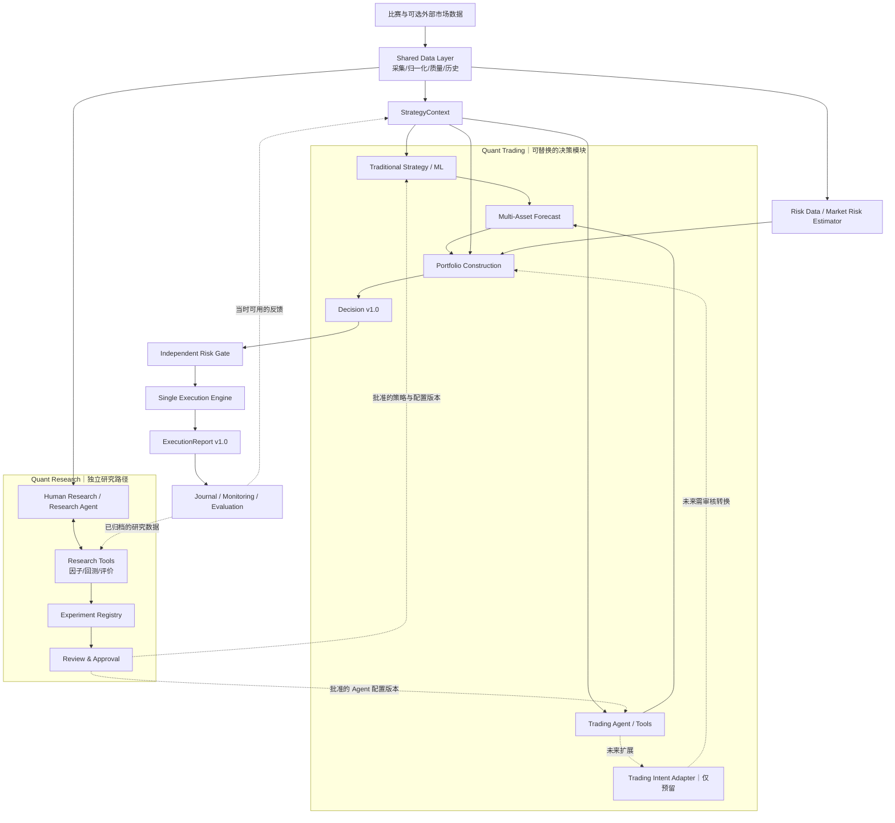

# Perpetual Alpha 2026｜系统架构设计 v0.2（审核稿）

> **状态：用户已批准用于第一轮模拟实现（2026-10-15）。** 本轮确认顶层架构、Forecast 最小字段、多资产语义及 Portfolio / Risk / Execution 边界，实施范围为第 11 节模拟骨架。团队最终审核、真实交易授权与开放决策仍待后续。
> **来源与确认：**根据用户提供的《Perpetual_Alpha_Architecture_v0.2_Review_Draft.md》归档；用户在本次开发对话中明确确认上述范围及固定数量演示映射。原稿的预留/待定事项继续保留。实际交付及运行见[首轮实现说明](architecture-implementation.zh-CN.md)。
> **整理日期：2026-10-15｜基于截至 2026-10-14 的仓库文档、会议讨论和本轮架构讨论。**
> **重要区分：**「已讨论认可」表示本轮对话的架构共识；「建议冻结」仍待用户审核；「预留」不要求本轮实现；「待定」不应由 Codex 擅自决定。
> **版本注意：**架构文档 `v0.2` 不代表修改既有交易协议 `1.0`。

## 0. 一页摘要

**核心选择：一套共享数据、风控与执行底座；两条职责不同的 Agent 发展路线；交易阶段支持传统策略与 Trading Agent 可替换、可对照的决策模块。**

- **Quant Research：**人类研究者或 Research Agent 提出因子／策略假设，调用研究工具，回测、评价并保存可复现的实验产物。研究结果经验证和人工批准后，才能成为可部署策略版本。研究模块无交易签名权限。
- **Quant Trading：**在同一时点的市场与账户上下文下，由传统 Strategy 或 Trading Agent 输出统一的**多资产预测**（Forecast）；Portfolio Construction 将预测、风险估计与账户约束综合为目标仓位；独立 Risk Gate 审查；唯一 Execution Engine 发送并核对订单。
- **Trading Agent 首版：**仅负责预测。未来可能输出 Trading Intent，但只保留扩展边界，暂不启用新的交易意图协议，也不允许绕过共同风控。
- **预测能力：**支持一个或多个资产，第一阶段最小能力为方向、预测期限、时间与有效性；预期收益率、涨跌概率、预测波动率、分位数或条件分布是可选且需要校准的扩展字段，不能要求 LLM 编造精确概率。
- **风险能力：**将市场风险估计、仓位构建、独立风控、执行风险和运行风险分开；具体算法可替换，但最低限度的交易安全约束不可绕过。
- **实施路径：**先实现契约、模拟实现和端到端 Dry Run；不启用真实交易或自主策略发布。上线政策、退出规则与风险预算数值未批准前，不应让无人值守交易上线。

## 1. 设计目标与非目标

### 1.1 目标

1. 建立一个**模块化但不过度分布式**的量化研究与交易系统：职责清晰、接口稳定、实现可替换。
2. 保留现有三段顶层架构 `Input → Strategy → Execution`，在内部细化必要的研究、预测、组合、风险和反馈职责。
3. 允许传统规则、统计/ML 模型以及 LLM Trading Agent 通过同一预测接口接入，不要求内部采用相同算法。
4. 原生支持多资产预测、组合风险及目标仓位；单资产是多资产系统的特例。
5. 支持统一的离线研究、历史回放、模拟执行与真实执行语义；严格区分模拟与真实成交证据。
6. 维持真实账户的单一执行者，防止多个 Agent 或策略绕开风控、重复控制同一仓位。

### 1.2 本轮非目标

本轮不选择最终盈利策略、风控阈值、仓位优化器、具体退出策略、LLM 服务商、RL 算法、多 Agent 协作方式、复杂做市报价协议，或训练基础模型权重。也不要求将所有模块拆成独立服务器/微服务。

## 2. 总体架构



**图例与约束：**
- Research Agent 和 Trading Agent 在**职责/权限**上独立，不要求使用不同的 LLM API。
- Traditional Strategy 与 Trading Agent 可以并行产生影子预测以供比较，但**一次实盘目标仓位只有明确指定的策略版本拥有控制权**。首版不实施多策略资金拆分。
- 共享底座不等于共享所有权限：Research 不访问交易签名密钥，也不允许把生成的代码直接运行到交易进程。
- 使用单项目、模块化单体部署即可；Research 大计算可在本地或其他机器离线运行，实时交易端保持轻量。

## 3. 模块及责任边界

| 模块 | 核心输入 | 核心输出 | 职责与边界 |
|---|---|---|---|
| Data Adapter & Store | 原始行情、盘口、K 线、外部数据 | 带来源与时间的数据记录 | 质量、单位、时效、时间对齐；不生成交易意见 |
| Context Builder | `DataRequest`、当时可用的数据、账户及反馈 | `StrategyContext v1.0` | 满足需求并报告 `ready/missing/stale/error`，不伪造数据 |
| Research Workflow | 历史数据、候选假设、研究工具 | 候选策略与实验记录 | 不得直接发布策略或下单 |
| Traditional Strategy | Context、已批准的规则/模型 | Forecast | 固定规则或数值模型，可作为对照基线 |
| Trading Agent | Context、只读工具、模型配置 | Forecast | 首版只预测；模型失败应明确 `abstain/error` |
| Market Risk Estimator | 历史收益、市场与账户数据 | `RiskSnapshot`（建议新增） | 计算历史波动率、相关性、协方差、模型时效；与模型预测分开 |
| Portfolio Construction | Forecast、RiskSnapshot、账户与配置 | `Decision v1.0` | 决定最终有符号目标数量；不直接下单 |
| Independent Risk Gate | Decision、最新可信账户/行情/订单 | `RiskVerdict`（建议新增） | 批准、拒绝或延后，不静默改数量 |
| Execution Engine | 已批准且仍有效的 Decision | `ExecutionReport v1.0` | 根据真实仓位与未完成订单计算差额，安全下单、撤单、核对与恢复 |
| Journal & Monitoring | 信号、决策、风控、订单、反馈 | 持久化日志、运行状态、评价数据 | 可追溯、可复现；日志不等于模型训练 |

## 4. 契约层：保留现有协议 1.0

继续沿用 `src/perpetual_alpha/interfaces.py` 和 `docs/technical-plan.zh-CN.md` 第 12 节的含义。本轮不应由 Codex 自行更改其已有字段的语义。

1. **`DataRequest`**：策略声明所需 `source/kind/symbols/fields/lookback_ms/max_records/max_age_ms/required/parameters`；请求不被支持应明确报告。
2. **`StrategyContext`**：`protocol_version/context_id/asof_ms/datasets/account/execution_reports`；每个 dataset 独立标状态及来源、单位、截断情况。冻结在该决策时点实际已收到的信息，禁止未来数据泄漏。
3. **`Decision v1.0`**：`decision_id/context_id/strategy_id/strategy_version/created_ms/expires_ms/targets/reason`。`targets` 是**有符号的绝对目标资产数量**，不是下单差额或仓位百分比。`targets=[]` 代表不提出新目标；目标数量字符串 `"0"` 表示对应资产目标归零；未列出的资产不自动平仓。数值使用有限 Decimal 字符串。执行端不静默更改目标。
4. **`ExecutionReport v1.0`**：可报告 `accepted/running/partial/completed/rejected/failed/unknown`。`accepted` 不等于成交；`completed` 需要确认实际目标且无相关未确认订单；`unknown` 不得被当作可以盲目重发的失败。真实订单与成交只能通过账户及订单接口核对。
5. 决策 ID 幂等、冲突拒绝、过期拒绝和 `BUSY` 语义保留。多资产 targets **不提供原子成交保证**。

> 新增的 Forecast、RiskSnapshot、RiskVerdict 与 Research artifacts 都是**内部新契约**；不应通过偷偷给现有 Decision 增加含义不明的字段来实现。版本由各自的 `schema_version` 管理。

## 5. 新契约 A：Multi-Asset Forecast（最小字段已批准用于模拟实现）

### 5.1 为什么需要单独 Forecast

Forecast 是“市场未来可能发生什么”的预测；Decision 是“最终希望持有什么仓位”。预测 ≠ 交易意图 ≠ 目标仓位 ≠ 真实订单。

传统策略、统计模型或 LLM Agent 内部机制不同，但可以输出同一类 Forecast。单资产预测是一个只有一条元素的 `ForecastBatch`。

### 5.2 最小必需信息

- 批次：`schema_version`、`forecast_batch_id`、`context_id`、`producer_id`、`producer_version`、`created_ms`。
- 每资产预测：`symbol`、`asof_ms`、`expires_ms`、`horizon_ms`、`status`、`direction`、证据引用与可选说明。
- 状态区分 `ready / abstain / error`。只有 `ready` 时 `direction` 才可为 `up / down / neutral`；`abstain` 和 `error` 必须没有有效方向，不能默认为空仓、维持仓位或做空。
- `neutral` 是模型的中性市场判断，**不是指令清仓**。持仓调整与何时退出属于 Portfolio / 风控政策的另一个决定。
- `horizon_ms` 是预测未来变化的时间范围；`expires_ms` 是预测信号可被用于新决策的最晚时间；两者不同，也都**不直接等于仓位必须持有多久**。
- 同一批次可以覆盖多个资产；未出现的资产表示没有此次预测，不能擅自映射为 `down` 或 `flat`。

### 5.3 可选扩展，不强制首版填写

- `expected_return`：相对于约定参考价、同一预测期限的预期简单收益率。
- `prob_up` / `prob_down`：对应 `Pr(r>0)` / `Pr(r<0)`；如存在 `r=0` 的概率质量，应在概率定义中说明。概率用 `[0,1]` 的十进制字符串，而不是“60”表示 60%。
- `forecast_vol`：**同一预测期限**内收益率的预测标准差，必须标明是否模型估计；不要与历史波动率或年化波动率混用。
- `quantiles` / `distribution_ref`：进一步表示预测区间、尾部风险或条件收益分布；引用已注册的模型/产物，不允许把未经验证的模型语言当作可信概率密度函数。
- `calibration_id`、`model_version`、`prompt_version`、工具与数据版本：使预测可审计、可比较。

LLM 给出的概率和涨跌幅必须视为**待校准的模型输出**，不是天然正确的概率。预测字段缺失时，仓位政策必须显式说明怎样处理（例如采取简单固定预算、只做观察、拒绝增加风险），不得虚构数值。

### 5.4 示例：同一批次覆盖 BTC 和 ETH

```json
{
  "schema_version": "forecast/0.1",
  "forecast_batch_id": "fc-batch-001",
  "context_id": "ctx-001",
  "producer_id": "lt-trading-agent",
  "producer_version": "prototype-v1",
  "created_ms": 1792000000000,
  "items": [
    {
      "symbol": "par:BTC",
      "asof_ms": 1791999998000,
      "expires_ms": 1792000060000,
      "horizon_ms": 3600000,
      "status": "ready",
      "direction": "up",
      "expected_return": null,
      "prob_up": null,
      "prob_down": null,
      "forecast_vol": null,
      "distribution_ref": null,
      "evidence_refs": ["btc_quotes"],
      "reason": "illustrative signal"
    },
    {
      "symbol": "par:ETH",
      "asof_ms": 1791999998000,
      "expires_ms": 1792000060000,
      "horizon_ms": 3600000,
      "status": "abstain",
      "direction": null,
      "expected_return": null,
      "prob_up": null,
      "prob_down": null,
      "forecast_vol": null,
      "distribution_ref": null,
      "evidence_refs": [],
      "reason": "insufficient evidence"
    }
  ]
}
```

*所有数值仅用于示意字段，不是真实行情、模型置信度或项目已批准的预测参数。*

## 6. 新契约 B：RiskSnapshot 与 Portfolio Construction

### 6.1 Market Risk Estimator

**它不必是 Agent。** 历史波动率、协方差、相关性等可以由确定性 Python 数值模型估计，也可以将来替换为统计/ML 风险模型。

建议 `RiskSnapshot` 包含：`snapshot_id/asof_ms/status/method/model_version/symbols/estimation_window/return_interval`、各资产波动率、协方差矩阵与单位、样本数、数据有效性与异常信息。

必须明确矩阵行列对应资产、时间尺度、年化方法、缺失资产处理；不能把不同时间窗口的收益率直接拼成协方差矩阵。对估计不足、不可靠或过期的风险数据应显式标错或降级，不暗中以零风险替代。

### 6.2 Portfolio Construction

输入：`ForecastBatch + RiskSnapshot + account snapshot + portfolio policy/config`。

输出：现有 `Decision v1.0` 的有符号目标数量，不是未经批准的下单指令。

支持跨资产联合决策：做多 BTC、做空 ETH、持有 GOLD 等是同一个目标组合问题，而不是独立得到三个不考虑相关性的数量后简单相加。

数学上可以抽象为：

\[
\mathbf q^*=\mathrm{PortfolioPolicy}(\text{Forecasts},\ \hat\Sigma,\ \text{Account},\ \text{Constraints})
\]

候选仓位方法（**仅预留可替换算法，不在本轮选定**）：固定预算、逆波动率、波动率目标、协方差组合风险、Beta 对冲、收益预测驱动的优化、Black–Litterman 等。R03 的 `RiskEngine` 是算法参考而非可直接复制的生产标准。

不同资产预测时间窗口不同时，需要明确同周期匹配、转换或拒绝混合；不能直接比较“未来 1h BTC 收益”与“未来 1d GOLD 收益”。未覆盖资产与 `abstain` 的处理规则由 Portfolio Policy 定义，不被 Forecast 隐式决定。

## 7. 新契约 C：Independent RiskVerdict

风险检查发生在目标仓位生成之后、真实执行之前，必须独立于 LLM 和可替换策略。建议最小状态：

- `approved`：按当前风险检查通过；不代表已经提交或成交。
- `rejected`：明确违反限制，拒绝执行。
- `deferred`：因数据/账户/订单状态暂不可验证而延后；在状态明确前不得增加风险。

必须关联 `decision_id`、风险规则版本、所用市场与账户快照、检查时间与原因码；保留拒绝/延后的可审计证据。**不静默缩小、放大、反向或修改 Decision 中的目标。** 未来若需要风险缩量，应设计明确的重新定量与批准流程，而不是偷偷改执行结果。

风险职责建议拆为：

1. **组合风险**：单资产和总名义敞口、净/总敞口、相关风险、波动风险、杠杆、保证金及可能的清算风险。
2. **执行前风险**：市场与数量规则、价差和流动性、交易成本、未完成挂单、可能单边成交；开仓成本门槛不能阻挡合规的减风险操作。
3. **运行安全**：账户/行情不可用、时效过期、重复和冲突 ID、网络结果不明确、Agent 超时、停止及恢复流程。

具体上限数字、波动模型、VaR/CVaR 阈值、止损及退出策略**仍待定**。但最小原则必须固定：数据、账户或订单状态不可确认时不能继续盲目增加风险；停止 Agent 不等于已经平掉旧仓位。已有风险的处置规则需要在无人值守真实交易上线前补齐。

## 8. 执行与反馈：单一真实执行者

- 保持 `Execution.apply(decision)` / `Execution.reconcile(decision_id)` 外部契约；可用内部 `RiskVerdict` 阶段对接。
- 无论来自哪个 Forecast Producer，目标仓位都应由**单一 Execution Engine**处理；LT 的 Agent 不获得交易密钥，也不直接调用签名下单 API。
- 执行端根据**交易所确认的实际持仓和未完成订单**计算差额；历史 Context 中的持仓不能替代执行前复查。
- 处理订单确认、拒单、部分成交、撤单、反向先降风险、重复请求、网络未知、断线重启后恢复与状态核对；这些属于执行架构，不需要 Agent 决策。
- 跨资产 `Decision` 不保证原子执行，多空对冲组合必须处理单边成交与短时敞口风险。
- `ExecutionReport` 与订单/成交/费用记录写入可持久化 Journal；反馈供研究和下一轮 Context 使用，但**日志积累不等于 LLM 权重训练**。
- 目前真实签名操作仍局限已验收的本地手动 Testnet 工具；没有经过专门验收，不得把它当作完整自动 `ExecutionEngine`。

## 9. Quant Research 工作流与产物

研究路径建议定义三类独立产物：

1. **`ResearchTask` / `StrategyCandidate`**：研究假设、适用资产、数据和特征需求、预测目标/期限、策略规则或配置、代码/依赖版本、创建者。
2. **`ExperimentRecord`**：数据快照及可用时间、训练/验证/测试区间、回测成本及成交假设、参数搜索次数、净收益与回撤等指标、失败案例、版本与可复现入口。
3. **`StrategyApproval` / Registry**：候选状态 `draft / evaluated / rejected / approved / retired`，审核人、审核依据、批准版本和部署范围。

Research Agent 可以提假设、调用工具并生成实验产物，但**默认不可自动把生成代码部署到交易进程**，也不可使用未来信息评价过去的决策。批准是清晰的人工治理边界；策略更新要可回滚。

Research Agent 与 Trading Agent 可以共用模型供应商和只读分析工具，但不共享签名权限、自动部署权限和未经隔离的未来知识。研究训练和真实运行所需特征定义必须一致。

## 10. 运行模式、并行与权限

- **Research Mode**：离线研究、回测、实验记录；没有交易签名权限。
- **Shadow / Paper Mode**：传统 Strategy 和 Trading Agent 可以在相同 Context、相同成本与风险预算假设下并行出预测/模拟结果，不向真实交易所发订单。
- **Dry Run Mode**：端到端契约演练，使用确定性 baseline / 假 Agent、Mock Risk / Mock Execution（必须显著标记为模拟）。
- **Real Testnet Mode**：未来单独批准后开放；只有唯一执行者能够持有 API Wallet 签名权限，必须满足风控与故障恢复验收。

“策略并行对比”和“两个系统同时控制同一资金账户”是两回事。本轮不假定 50%/50% 划分资金，更不默认让两个独立 Agent 同时下单。

允许外部 LLM API 的响应延迟，但每条预测必须有时效、超时和失败状态。低频交易不等于延迟完全不重要。生产执行端的风险规则不依赖 Agent 在线状态才能生效。

## 11. 本轮 Codex 可实现的最小骨架（已批准模拟范围）

### 11.1 应交付的内容

- **契约先行**：现有协议 1.0 兼容性回归测试；新增 ForecastBatch/Forecast、RiskSnapshot、RiskVerdict、研究产物的类型/JSON Schema/文档示例。
- **可替换插件**：Rule-Based Forecast Producer、Mock Agent Forecast Producer；统一接口、可配置选择，保留真实 Agent Adapter 的边界，不强制联网调用 LLM。
- **共享数据通道**：现有存储记录 → 满足有限 `DataRequest` 的 ContextBuilder；明确支持范围与 unsupported/missing/stale/error。
- **组合和风控的占位实现**：至少一种简洁、确定性、配置受控的演示仓位政策；基本验证和模拟风控，不假装已经具备复杂风控能力。
- **端到端模拟链路**：Context → Forecast → Portfolio → Decision → RiskVerdict → Mock Execution → ExecutionReport → Journal；同时演示 BTC/ETH 的多资产输入以及其中某资产 abstain。
- **Research Registry 占位**：候选和实验产物保存/读取、人工审核状态；不允许自动晋升到真实交易。
- **运行文档与测试**：样例输入输出、版本和数据流、替换方法、异常语义、已实现/仅预留清单、测试运行命令及结果。

### 11.2 不允许 Codex 擅自决定或执行

- 不启用任何真实下单、不要求上传/读取私钥、不修改已在服务器运行的只读采集服务。
- 不重写已确认的 `Decision` 与 `ExecutionReport` 1.0 语义。
- 不擅自选择最终盈利策略、风险百分比、杠杆、退出规则、预测概率校准方法、ML 模型或 LLM API。
- 不假装 MockExecution 已覆盖真实网络错误、订单队列、滑点与部分成交。
- 不自动把研究生成的策略代码安装到实盘交易进程。

### 11.3 第一轮最低验收

1. 既有接口与只读采集测试不退化；多资产 Forecast 支持单一/多个资产、不同状态和预测期限。
2. 所有关键交接验证字段、身份、时间、单位与状态；异常输入可追溯且不会被误解为有效预测。
3. 相同 Context 可以比较传统规则和模拟 Agent 的输出；只有明确选择的版本进入模拟目标仓位。
4. `abstain`、缺数据、过期、账户状态不明、风控拒绝、重复 Decision、未知执行状态都具有可测处理结果。
5. 完整 Dry Run 的模拟标记贯穿输入、报告和日志；没有实际订单。
6. 记录未解决的真实交易安全缺口，**不能声明已经准备好无人值守交易**。

## 12. 开放决策清单（需以后讨论，不能替用户擅自选择）

| 议题 | 已经确定 | 待讨论/冻结 |
|---|---|---|
| Forecast | 首版至少方向和期限；原生多资产；可选收益/概率/分布 | `neutral` 如何映射到持仓政策；预测幅度/概率是否足够可靠进入真实仓位计算 |
| Agent 接入 | Trading Agent 首版预测；Research Agent 独立 | 实际服务商、工具集、调用预算、何时允许交易信号参与实盘 |
| Trading Intent | 只留扩展点 | 输出语义、权限、是否涉及订单级执行、未来协议版本 |
| Portfolio | 统一多资产仓位层 | 固定预算、逆波动率、目标波动率、协方差与 Black–Litterman 的选型和风险预算 |
| Risk | 独立 Gate、禁止无条件加风险 | 具体阈值、VaR/CVaR、极端情形处置与仓位缩量机制 |
| 退出 | 架构必须可处理已有仓位风险 | 正常退出、止损、持仓期限、故障退出策略；**未定前不得无人值守实盘** |
| 多资产执行 | 统一目标仓位协议和唯一执行者 | 配对执行和单边成交风险容忍度 |
| Research | 可复现实验、人工审核晋升 | 第一批研究因子、样本外评价标准、自动实验范围 |

## 13. 参考依据与项目映射

### 自己仓库（现有事实与正式协议）

- [`docs/technical-plan.zh-CN.md` 第 12 节](https://github.com/BouillieAnonymous/Perpetual-Alpha-2026/blob/main/docs/technical-plan.zh-CN.md)：DataRequest、StrategyContext、Decision、ExecutionReport 的协议 1.0；第 15 节是 10 月 14 日的 Agent 信号对接讨论。
- [`src/perpetual_alpha/interfaces.py`](https://github.com/BouillieAnonymous/Perpetual-Alpha-2026/blob/main/src/perpetual_alpha/interfaces.py)：已实现的协议类型与部分校验；并非完整策略或执行引擎。
- [`docs/meeting-2026-10-14-analysis.zh-CN.md`](https://github.com/BouillieAnonymous/Perpetual-Alpha-2026/blob/main/docs/meeting-2026-10-14-analysis.zh-CN.md)：会议讨论、暂定方向与未决问题。
- [`docs/data-development.zh-CN.md`](https://github.com/BouillieAnonymous/Perpetual-Alpha-2026/blob/main/docs/data-development.zh-CN.md)：`par` 资产、行情/订单规则、历史与外部数据的限制。
- [`docs/agent-learning-resources.zh-CN.md`](https://github.com/BouillieAnonymous/Perpetual-Alpha-2026/blob/main/docs/agent-learning-resources.zh-CN.md)：学习资料索引及 §10 的研究/交易模块划分。

### 外部参考（架构思想与候选算法，不等于已复制或已验证）

- **L18 — [Qlib](https://github.com/microsoft/qlib)**：研究工作流、模型/信号评价、回测与实验追踪。
- **L20 — [QuantConnect Algorithm Framework](https://www.quantconnect.com/docs/v2/writing-algorithms/algorithm-framework/overview)**：Alpha → Portfolio → Risk → Execution 的职责分离。
- **L21 — [NautilusTrader](https://github.com/nautechsystems/nautilus_trader)**：事件、订单与交易系统状态管理。
- **R01 — [Agentic Trading 综述](https://arxiv.org/html/2605.19337v2)**：Agent 在研究、预测、决策及适应方式中的不同角色。
- **R03 — [Momentum Trading](https://github.com/Gajesh2007/momentum-trading)**：多周期动量、逆波动率仓位、协方差和组合风险等候选方法；实际配置与运行可靠性需独立审计。
- **R02 — [Hyperliquid Market Maker](https://github.com/zer0cache/hyperliquid-market-maker-bot)**、**L23 — [HftBacktest](https://hftbacktest.readthedocs.io/en/latest/order_fill.html)**：报价、库存、成交假设；首版不纳入完整做市接口。

---

**用户确认记录（2026-10-15；限第一轮模拟实现）**

- [x] 批准顶层架构和 Research / Trading 边界。
- [x] 批准 Forecast 最小必需字段及多资产语义。
- [x] 批准 Portfolio / Risk / Execution 的责任划分。
- [x] 批准第一轮 Codex 只做模拟骨架与测试。
- [x] 用户明确确认：演示采用配置固定资产数量，up 为正、down 为负；neutral / abstain / error / 未覆盖资产不提出新目标，过期或必要数据/风险/账户不可确认时不生成可执行目标。
- [ ] 最终盈利策略、真实风险预算、退出政策、模型供应商及实盘上线审核仍待讨论。

首轮实际交付以[实现说明](architecture-implementation.zh-CN.md)为准；本文件的目标能力不等于真实自动执行已验收。
