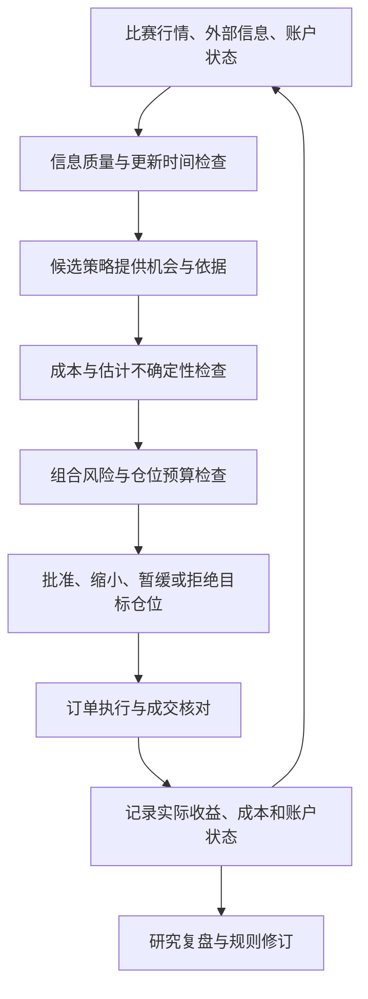

# Perpetual Alpha 2026｜信息、交易门槛与组合仓位框架

更新：2026 年 10 月 7 日（英国时间）  
状态：开发规划。具体策略、交易资产、阈值与仓位参数留待两名队员讨论和验证。

## 1. 当前要确定的框架

先确定系统如何接收信息、判断机会是否值得承担风险，以及怎样限制整个账户的仓位。趋势、均值回归、宏观或机器学习等仍是候选路线，不视为已选策略。

本文件中的“总体仓位”指整个账户及全部资产的组合风险；关注实际持仓、待成交订单和可用保证金，而不是代码仓库。

具体策略负责发现机会，共用决策框架负责判断是否允许增加风险。执行模块根据获批目标与真实持仓、挂单之间的差异执行，不让不同策略分别控制同一个账户。

## 2. 信息层：什么信息可以进入判断

| 信息类别 | 内容 | 进入判断前检查 |
|---|---|---|
| 比赛自身行情 | 可成交报价、价格、盘口、成交、资金费等 | 市场是否正确、是否过期、价差与流动性是否适合 |
| 外部市场 | 对应资产价格、成交活动、相关市场变化 | 资产与计价口径、事件和接收时间、延迟、是否休市 |
| 宏观与事件 | 官方发布时间、事件类型、可获得的数值与预期 | 是否当时已知、有无后续修订、对应的研究周期 |
| 账户状态 | 净值、持仓、挂单、保证金、成交与费用 | 是否完整、能否与交易所核对、是否存在未确认请求 |

信息缺失、过期或请求状态不确定时，暂缓增加风险；记录具体原因。外部信息既可以支持，也可以否定候选信号。已经公开的宏观叙事不能直接当成可成交收益。

数据来源、保存和时间对齐要求沿用[数据开发规划](data-development.zh-CN.md)。

## 3. 机会层：策略提供什么

策略至少说明：候选资产与方向、信息依据、预期持有时间、失效条件和版本。需要判断收益门槛时，还应有基于验证数据的收益估计及其不确定性说明。

策略可以使用规则或模型，但不能仅凭“看涨”或一个未校准的置信度数字，就默认交易具有足够收益。预测概率也不等于预期收益，需要同时考虑可能赚多少、亏多少及成本。

策略尚不能给出可信收益估计时，先在观察与研究阶段积累证据。可以按历史类似信号的结果进行条件估计，但必须使用未参与调参的数据检验，不能把最好看的历史平均值作为保证。

## 4. 值得交易的门槛

针对新开仓或增加风险，采用概念条件：

**估计毛收益率 − 预计完整持仓周期成本 − 不确定性余量 > 最低要求净收益率。**

各项必须针对同一持仓周期和同一名义金额口径：

- 毛收益：候选机会对应的预期价格收益，不是已经实现的盈利，也不是两个市场当前价差的简单替代。
- 成本：预计开仓和平仓手续费、价差、额外滑点及持仓期间的资金费净支出；资金费可能支出或收入，未知时使用保守假设。
- 不确定性余量：为预测误差、延迟和成本误差留出空间，数值后续依据验证与压力测试确定。
- 最低净收益要求：与持仓周期、成本和风险一起讨论，目前不设固定比例。

估计收益若已经使用预期实际成交价，应避免再次扣除同一笔价差或滑点。若以中间价计算毛收益，则需要明确加入执行成本。

纯示例：预计毛收益 0.40%，完整周期成本 0.25%，不确定性余量 0.10%，剩余为 0.05%；若最低要求净收益为 0.08%，该机会不通过。数字仅用于说明计算，不是项目参数。

门槛需要适应订单大小：大订单可能造成更多滑点，所以组合批准的数量变化后，应重新检查成本和收益条件。除平均收益外，还要检查亏损可能性与极端情形，不能以高预期收益覆盖风险限制。

**重要边界：撤单、减仓、止损、强制风险退出不以盈利门槛为前提。** 避免系统因为退出不赚钱而拒绝降低风险。减仓仍需核对方向、数量和成交结果；网络故障时明确记录未完成的退出。

## 5. 组合层：整个账户可以承担多少风险

先定义风险维度，再共同确定数值，不把此前举例的仓位或亏损比例当成已经批准的配置。

| 维度 | 管理目标 |
|---|---|
| 单笔交易 | 控制订单金额、预期亏损及允许的执行偏差 |
| 单资产 | 限制某一个资产的总名义敞口与风险贡献 |
| 总敞口 | 所有资产绝对名义金额之和，相对于账户净值限制 |
| 净敞口 | 监测方向性敞口，同时保留资产分类与共同风险因素的限制 |
| 相关风险 | 防止 BTC 与 ETH 等相似方向的持仓集中承担同一种风险 |
| 保证金与杠杆 | 检查实际可用保证金，保留缓冲，限制杠杆与清算风险 |
| 待成交订单 | 纳入可能成交后的风险；未确认撤单的订单不能提前释放预算 |
| 累计亏损 | 当日亏损、最高净值回撤及对应暂停与恢复条件 |
| 运行状态 | 数据、授权或账户不可靠时暂停新风险，重新核对后再处理 |

总敞口和净敞口不能互相替代。例如做多 BTC 名义金额 100、做空 ETH 名义金额 100，总敞口是 200，简单净额为零，但仍有两个资产相对变化的风险。

统一保证金模式下，持仓共享抵押资金；某个资产亏损会影响其他持仓的保证金空间。账户余额不能直接视为全部可用保证金。实际限制与状态应依照[官方保证金说明](https://perpetual-alpha26.github.io/docs/#venue-mechanics)查询与核对。

批准新机会前计算“持仓＋可能成交订单＋拟新增订单”的风险。风险预算不够时，可以缩小或拒绝；缩小后若不满足最小订单或收益门槛，则不交易，不能为满足最小订单反过来扩大风险。

## 6. 如何选择量化领域与策略

按“资产与市场 → 研究问题 → 信号 → 方法 → 验证 → 执行”的顺序选择。领域可以是趋势、均值回归、跨资产或事件；机器学习是方法，不自动构成独立的交易理由。

筛选原则：

| 标准 | 实际检查 |
|---|---|
| 信息范围可管理 | 用少量可获取数据描述核心状态；不要求资产只受少数因素影响 |
| 信号可量化 | 当时能重复检测，规则与失效条件明确，避免事后解释 |
| 机会足够出现 | 统计新的有效机会、交易日期和成交量；不把重复采样算作独立机会 |
| 成本与执行可接受 | 完整周期成本后的收益空间、流动性、延迟与成交概率 |
| 数据与验证可行 | 历史和实时数据可获得，特征一致，支持时间外验证 |
| 组合风险可控 | 能放入统一预算，不因多资产或多信号重复扩大风险 |
| 团队能完成 | 开发、验证和维护量符合双方实际投入 |

候选资产先检查数据覆盖、报价完整度、价差、流动性和外部市场交易时段。候选策略再在相同成本和风险条件下比较，最后决定是否进入实时观察与小仓位验证。

收益、风险和算法解释性需要一起评价。满足参赛日期和成交额要求属于单独检查，不应绕过成本门槛或风险上限。[官方规则](https://perpetual-alpha26.github.io/about)

## 7. 需要与队友对齐的框架产出

1. **信息清单**：必需与可选来源，更新频率、最大允许延迟、缺失时怎样处理。
2. **机会说明**：任何候选策略如何表达依据、周期、收益估计和失效条件。
3. **交易门槛**：成本口径、误差余量和验证方法；数值实验后确定。
4. **风险预算表**：单笔、单资产、总敞口、相关风险、保证金、亏损与暂停恢复条件。
5. **策略筛选表**：候选领域、所需数据、机会频率、成本、风险与实现工作量。
6. **决策记录**：保存通过、缩小、暂缓、拒绝的原因，之后核对预测与实际成交、成本和风险。

初步分工仍为用户推进信息需求、筛选标准、实验与记录，队友侧重数据接口、账户状态和工程约束；收益门槛、风险预算及策略选择由双方共同确认。此阶段只完善文档与讨论框架。
