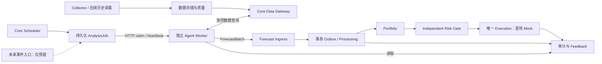

# Perpetual Alpha 2026｜开发基线与分阶段实施计划 v0.3

更新日期：2026-10-16（Europe/London）

文档用途：整合 Architecture v0.3、技术审查结果与用户审阅反馈，作为下一轮小 PR 开发的共同基线。

当前交付：开发文档；尚未开始 PR0 的代码实现。

## 1. 本轮决定与文档效力

本轮接受既定总体架构和技术审查的主要结论，停止重新讨论系统顶层拆分，转向以小 PR 验证工程实现。首轮开发范围确定为 **PR0–PR2：通信契约、任务持久化、双进程通信闭环**。每完成一个 PR，提交测试结果、变更范围和未解决事项供用户审核，再推进下一项；不得一次性实现整套系统或直接修改 main。

**本次用户最新要求是先生成开发文档。** 因此本文件记录后续开发范围与政策，不表示 PR0 已开始、不表示已部署，也不表示任何真实交易授权。后续实施时以本文件约定的小 PR 顺序推进。

本文件区分四种状态：

| 标记 | 含义 |
|---|---|
| 已确认 | 架构方向、权限边界、用户本次接受的首版工程政策 |
| 本轮交付要求 | PR0–PR2 必须落实并验证的功能；目前仍待实现 |
| 实施建议 | 文件名、内部实现、HTTP 细节和测试配置，可在不改变已确认语义的前提下调整 |
| 待用户决定 | 资金风险、退出、真实交易权限及会显著改变成本/业务语义的参数 |

材料来源：

1. 用户提供的《Perpetual Alpha 2026 — Architecture v0.3》完整交接设计。
2. [Architecture v0.3 技术审查报告](architecture-v0.3-review.zh-CN.md)：源码核查、19 项问题、文件级计划及验证边界。
3. 用户在审阅报告后的本轮反馈：接受三条生命周期、SQLite 事务 Outbox、串行控制、严格 as-of，并要求先形成开发文档。
4. [现有 main 固定源码](https://github.com/BouillieAnonymous/Perpetual-Alpha-2026/tree/380284b8dd7fb5fbdb3ead24bef264035e185251)：现行协议和已实现代码的事实依据。

附件中的命令、候选算法、示例金额、建议参数和目录结构均需按其性质理解，不自动转成实施或交易指令。旧文档批准的模拟参数不得变为真实交易参数。

## 2. 已确认的总体架构

| 事项 | 当前共同决定 |
|---|---|
| 业务进程 | Trading Core 与 Agent 为两个独立 Python 程序 |
| 容器 | 两者使用独立 Docker 容器；已有 Collector 可作为第三个容器保留 |
| 首版部署目标 | 现有 VPS；资源可用性由实测确认，不因架构通过而视作部署已验收 |
| 通信 | HTTP JSON，Agent 主动 Pull 领取任务，无需向外暴露 Agent HTTP 服务 |
| 首版触发 | Core Scheduler 定时创建任务；Agent 被动分析 |
| 后续触发 | 预留新闻、Jev、市场事件接入边界，暂不实现扫描器或供应商调用 |
| Agent 输出 | 现有 ForecastBatch；不返回订单、不直接设置仓位、不持有签名密钥 |
| Agent 数据 | 最终支持同 Job 内多轮受控查询，冻结本轮 asof；历史服务在后续 PR 落实 |
| Core 职责 | 统一 Portfolio → Independent Risk Gate → 唯一 Execution 控制链 |
| 未来迁移 | 支持将 Agent 移到另一 VPS，业务协议保持；不跨主机共享 SQLite |
| 首轮 Agent | Dummy Agent，不连接真实 LLM |
| 首轮执行 | 保留已有 MockExecution；不接真实下单 |



图中的目标模块不代表均已实现。PR0–PR2 用受控 quote fixture 与现有 Mock 子链验证通信；历史 K 线、动态 Session、真实账户、风险算法和可恢复 Paper 仍属后续阶段。

## 3. 当前代码基础与真实缺口

审查时 main 为 `380284b8dd7fb5fbdb3ead24bef264035e185251`。本地 HEAD 虽为另一提交，但文件树相同。后续每个开发 PR 必须重新确认最新 main；本文件不承诺远端永远停留在该提交。

| 层 | 当前能力 | 开发边界 |
|---|---|---|
| 行情 | `market_data.py`、`storage.py`、`cli.py`：Testnet par 报价采集、SQLite/WAL、健康检查与文件锁 | 不是完整历史 K 线服务或全市场实时 feed |
| 契约 | `interfaces.py`、`contracts.py`、七份 JSON Schema | 现有业务协议保留；Job/Transport 为新增契约 |
| Context | `context.py`：quote 查询与 event/received 双时间冻结 | 尚不支持 candle 和动态远程 Session |
| Producer | `producers.py`、`forecasting.py`：进程内注册、静态需求、严格预测校验 | 不等于远程 Worker；同步调用无法强制中止阻塞 Harness |
| Agent/策略 | Rule/Mock、独立 Dummy LT Adapter | 合成演示，无真实 LLM、无已验证 Alpha |
| 组合/风险 | FixedQuantityPortfolio、MockRiskEstimator、DemoRiskGate | 仅 Demo；非生产资本分配或真实账户风险管理 |
| 执行 | MockExecution 有事务、去重、unknown/BUSY 持久化 | 非真实订单状态机；人工 Testnet 工具未接自动控制链 |
| 账户 | `api_client.py` 有低层只读 SDK 查询 | 缺标准化、完整性与一致性核对的账户快照服务 |
| 日志/研究 | Journal、ResearchRegistry | Journal 当前固定模拟标记；Registry 不执行回测或部署 |
| 部署/CI | Collector Compose、离线 CI | 没有 Core/Agent 业务双容器；没有跨进程网络故障验收 |

审查阶段复验：57 项离线测试通过；[main CI 成功](https://github.com/BouillieAnonymous/Perpetual-Alpha-2026/actions/runs/38733601425)。本地缺少 Ruff 与 jsonschema，未完成这两项本地复验。该结果是审查时快照，不是未来 PR 的测试结果。

后续保留现有已通过测试的代码、入口和协议语义，不为满足示意目录进行大规模重构。源码路径与行号详见技术审查报告第 2、3 节。

## 4. 审查发现、用户反馈与处理决定

### 4.1 四项优先决定

| 审查发现 | 用户反馈 | 开发决定与验收证据 |
|---|---|---|
| 分析、处理、成交混在同一状态流程 | 接受拆分，避免交易失败重新触发 Agent | AnalysisJob、Processing、Execution 三条状态轴；下游失败恢复原处理单元，不创建第二次分析或第二份逻辑订单 |
| submission_id 单点去重不足 | 接受 SQLite 事务与 Outbox，暂不引入 Redis/Kafka | Job 终态、Batch、submission receipt、processing 和 Decision 各有持久身份/约束；同 Batch 换新提交 ID 也不能重复处理 |
| 旧预测晚返回可能覆盖新目标 | 首版同一控制范围串行，禁止旧结果覆盖新结果 | 每 Worker 一个活动任务；控制身份/版本/epoch 和接受/消费水位均受保护；乱序结果记录或拒绝推进 |
| 任务创建后补抓的历史不属于当时已知数据 | 接受预先采集与严格时间管理 | event、published（适用时）、received 分开；asof 冻结；新收到的信息用于新任务，不倒填接收时间 |

### 4.2 其余审查问题的落实位置

下表保留审查编号，便于未来 PR 逐项关闭；“采纳原则”不等于本次已实现。

| 问题 | 反馈后的处理 | 阶段 |
|---|---|---|
| A01 同步校验与异步 Ingress | 旧调用保留，抽取纯校验供新入口复用，严格时钟/身份/证据语义不变 | PR0、PR2 |
| A02–A04 状态、租约竞争、持久化幂等 | 采纳三轴状态、事务终态竞争与 Outbox；不能仅靠内存去重 | PR0–PR2 |
| A05 控制切换与结果乱序 | 采纳串行控制与水位；shadow 无交易推进权 | PR0–PR2 |
| A06 动态证据身份 | dataset ID/请求定义不可变；绑定返回 digest 与 manifest | PR0 定边界，PR4 完整实现 |
| A07 Journal 模拟标记 | 运行事件与 Mock 子链日志区分；禁止真实证据沿用固定 simulated=true 包装 | PR1–PR2 |
| A08 交易开关误解 | 不能把 ENABLE_TRADING 预留字段当全局安全开关；新运行服务不组装签名客户端、不挂密钥 | 全阶段 |
| A09–A10 补数时点与历史修订 | 采纳严格 asof、预热与版本化数据；研究重建历史另标假设 | PR3–PR4 |
| A11 账户快照一致性 | 真实 Adapter 记录来源/时间/完整性，余额与可用保证金分开 | PR5 |
| A12 最终目标以外的风险 | 全账户持仓、挂单、未知订单及过渡敞口纳入 Gate | PR5–PR8 |
| A13 SQLite 并发 | Core 单活动实例；短事务、有界写入、Outbox 同事务域；不共享跨线程 connection | PR1 起 |
| A14 Mock 与真实执行差异 | 保留旧 Mock；另建可恢复 Paper，真实 Adapter 另行授权 | PR8 及以后 |
| A15 身份与资源授权 | 认证身份与 lease 分离；按 Job/producer/role 授权，查询和 payload 有界 | PR0–PR4 |
| A16 十资产数据/估值口径 | 通用接口覆盖十资产，但缺失如实报告；交易规则与估值按可信 metadata/规则核对 | PR3、PR5–PR7 |
| A17 CI 网络边界 | 保留原离线测试，新增仅连 Dummy/Core 的隔离网络测试 | PR2 起 |
| A18 部署验证过晚 | PR2 就验证容器和重启；最终 VPS 阶段做资源/故障/备份验收 | PR2、PR9 |
| A19 同名模块/包冲突 | 保留 risk.py、portfolio.py、execution.py；新增模块用不同名称，不预建大量空文件 | 各相关 PR |

## 5. 已确认的首版运行政策

### 5.1 调度、并发与乱序

- 每 Worker 同时只处理一个活动分析任务；Core 服务端校验，不只依赖 Worker 自律。
- 同一控制范围串行。首版不实施多策略资金拆分；不同策略可以独立产生 Shadow，但不因此获得执行权。
- 定时积压丢弃过期任务、合并冗余触发；历史补跑属于独立研究模式，不混入在线控制队列。
- 维护控制身份、版本、control epoch，以及已接受结果与已消费决策的水位。旧结果不能覆盖已接受的新结果，也不能在消费端覆盖更新的控制状态。
- 具体控制范围 key、相同 asof 的重复/冲突和版本切换规则由 PR0 写成精确契约，并由 PR1/PR2 验证；不留给运行时“最后到达者获胜”。

### 5.2 数据时点与权限

- Core 创建本轮可信 asof；本轮查询只看该时点以前发生且已接收的信息。
- 多轮取数不推进 asof；需要新信息时创建新任务。
- 背景历史采集先预热，任务中不得通过补抓并倒填 received 来绕过冻结。
- 后续 candle 只使用已收盘条目；迟到、修订、缺失、过期如实保留；分页/截断不能伪称数据完整。
- 预测资产权限与读取辅助资产权限分开；kind/source/fields/parameters 使用服务端 allowlist，禁止任意 URL、SQL、路径或代码执行。

### 5.3 身份、存储与进程

- SQLite、Core 单活动实例、事务性 Outbox 为首版选择；不引入 Redis、Kafka、Kubernetes 作为前置条件。
- Job result 与 Outbox 在同一事务域；行情采集库继续独立，Agent 不直接读取 Core SQLite。
- HTTP 请求身份绑定 producer/version/role；lease token 描述任务所有权，不能代替身份认证。
- Agent 无签名密钥、无下单 endpoint；Core 初期只组装 Mock 后端。
- 同机使用受限 Docker 网络；未来跨 VPS 使用认证与加密连接，数据库仍留 Core 主机。

## 6. 业务协议不变量

保留 DataRequest/StrategyContext/Decision/ExecutionReport 1.0、ForecastBatch forecast/0.1 与现有风险契约版本。新增 Transport 版本只描述 HTTP 信封和任务运行语义。

1. Forecast 预测市场，不是订单或仓位指令。可选收益/概率/波动字段继续可缺省，不要求 Dummy 或 LLM 编造数值。
2. Forecast.asof 是信息截止点；Batch.created 是完成时间；expires 是可用于新决策的截止时间；horizon 是预测期限，四者不混用。
3. Decision.targets 是绝对有符号资产数量。未列出不自动平仓；空 targets 不提出新目标；显式数量字符串 "0" 才提出归零。
4. neutral、abstain、未覆盖资产不隐式退出；当前运行器对 Batch 中任一 error item 阻断整个 Producer 路径，不能网络化后悄悄只跳过该资产。
5. Portfolio 可以依据明确预算生成更小目标；Risk Gate 对最终不可变 Decision 批准、拒绝或延后，不静默缩量。
6. ExecutionReport.accepted 不代表成交；unknown 不视为可以重发的失败；completed 必须符合现有目标确认语义。
7. RiskSnapshot 保留未年化 simple-return-per-interval 单位及矩阵资产顺序；Demo 的模拟条件与期限限制不等于生产算法选择。
8. 控制版本显式选择，Shadow 只审计/比较；Shadow 失败不得阻塞有效控制链路。

## 7. 三类资产集合与风险职责

**可交易资产集合 ≠ 当前策略预测集合 ≠ 实际账户风险敞口集合。**

| 集合 | 定义 | 对后续实现的约束 |
|---|---|---|
| Tradable Universe | 架构支持的十种比赛资产，实际规则由可信 metadata 核对 | Data Layer/接口按通用 N 资产设计；不保证每种资产都有足够历史 |
| Forecast Universe | 本策略本轮实际预测的资产子集，例如 BTC/ETH | 不强制给其他资产填零预测，不自动赋予未批准资产控制权 |
| Exposure Universe | 实际持仓、未完成/未知订单和拟新增目标的并集 | Account/RiskSnapshot/Portfolio/Gate 不能只按 Forecast items 构建风险覆盖 |

十资产文档集合：par:BTC、par:ETH、par:HYPE、par:SP500、par:EWY、par:EWJ、par:BRENT、par:GOLD、par:USDEUR、par:USDJPY。运行时可用性和合约规则仍需验证，不把文档清单当实时市场事实。

例如仅收到 BTC Forecast，但账户还有 GOLD 仓位或挂单：组合仍需保留/估值 GOLD，Gate 仍需检查其潜在敞口。未知仓位、缺数据、未确认订单均不能默认为零。数据不足时保守阻断新增风险；受控退出需要独立政策与授权，不能临时交给 Agent 决定。

风险估计、仓位构建、独立审批、执行恢复分别验收。首轮 Mock 的成功不能替代这些后续工作。

## 8. PR0 要落实的契约设计

以下是 PR0 的设计任务；状态名与字段名属于待落地契约，不声称当前代码已经存在。

### 8.1 独立状态轴

```text
AnalysisJob:
queued → running(attempt, lease_epoch)
running → submitted | completed_without_forecast | failed | expired
running → queued 仅在无终态结果、未超 deadline、允许重试且未耗尽尝试次数时

Processing（submitted 后独立维护）:
pending → running → completed | blocked | failed
处理崩溃后恢复原处理单元，不重新运行 Agent

Execution:
沿用 ExecutionReport 1.0 的 accepted/running/partial/completed/rejected/failed/unknown
```

Job submitted 后，预测因排队而过期应使 Processing blocked，而非重置 Job 重新分析。no_forecast 与合法 abstain Batch 分开；坏请求通常拒绝该次请求，不自动将整个 Job 置 failed。submit 与 complete 竞争同一个终态边界。

### 8.2 身份与幂等

至少明确 job_id、context_id、producer/version、control_epoch、attempt/lease_epoch、submission_id、forecast_batch_id、processing key、decision_id 的用途和作用域。claim 本身也需稳定请求标识，以处理“领取成功但响应丢失”。

同 ID 同规范化内容重放原结果；同 ID 不同内容拒绝冲突。换 submission ID 重发同 Batch 不能创建第二个 Processing；同 Job 不能接受第二个分析终态。结果被接受后，重试可以查询原 receipt，不能再次消费。

新的提交必须验证当前身份、租约、deadline 和 Forecast TTL。已接受结果的历史回执查询与新提交是不同操作，不应因为旧 lease 到期而诱导 Worker 创建第二份结果。

### 8.3 Forecast Ingress

保留原 checked_forecast(producer, context) 与带时钟严格调用。必要时抽出纯校验函数供 Ingress 复用，保留身份、时点、TTL、资产、证据和错误语义；不把远程 Worker 伪装成阻塞 Python Producer。

远程入口另加 Job/lease/control epoch/权限/manifest 校验。静态 requirements 语义不变；动态 Session 是并行新增能力。PR0 用契约与测试固定二者边界，PR4 再落完整动态查询。

### 8.4 HTTP 消息范围

| 消息 | PR0 Schema/语义要求 | 实现阶段 |
|---|---|---|
| claim | 身份、请求 ID、Job、lease、asof/deadline、预算；无任务响应 | PR1 领域能力，PR2 HTTP |
| heartbeat | Job/attempt/lease 校验，续租不越 deadline | PR1–PR2 |
| forecast submit | Transport 信封嵌套原 ForecastBatch、提交 ID、持久化 receipt | PR1–PR2 |
| complete | no_forecast/失败分类，与 submit 终态互斥 | PR1–PR2 |
| feedback | Job、receipt、Processing 与 Mock Report/Verdict 引用，状态版本 | PR2 |
| data query | 原 DataRequest 外层的身份/请求/预算/证据边界，预留扩展 | PR2 有界 quote fixture；PR4 完整多轮 |
| health | 存活/就绪边界，不泄漏账户凭证 | PR2 |

路径可沿用设计中的 /v1/jobs/...；具体 HTTP 状态码、错误对象、必填字段及版本拒绝规则在 PR0 固定。202 只表示结果与处理记录持久化接受，不表示风控批准或成交。Transport 错误码不能直接塞入旧 ExecutionReport 原因码集合。

## 9. 分阶段 PR 计划

### A. 通信基础设施：首轮正式范围 PR0–PR2

| PR | 交付与文件建议 | 测试与验收 |
|---|---|---|
| PR0 通信契约与 Ingress | 新 docs/agent-transport-v0.1.zh-CN.md、runtime/contracts.py、Transport Schemas；forecasting.py 仅做有回归保护的纯校验抽取；test_forecast_ingress.py / test_transport_contracts.py | 原 57 测试、七 Schema、两示例兼容；新契约往返、未知字段/版本、时点、身份、最小 Batch、error 整批阻断、状态迁移表。验收：字段/状态/错误/幂等作用域明确；不引入 HTTP 服务或真实交易 |
| PR1 任务持久化与恢复 | runtime/store.py、jobs.py、scheduler.py、migration；Submission/Processing/Outbox；test_jobs.py、test_job_recovery.py | 多连接/进程 claim 竞争、终态竞争、epoch、同 Batch 换 ID、调度去重/积压、commit 前后崩溃、重启恢复。验收：一个合法分析终态、一个逻辑处理单元，接受结果与 Outbox 同事务；无 HTTP 也能验收 |
| PR2 双进程通信闭环 | transport/api.py/security.py/client.py、runtime/ingress.py/consumer.py、独立 agent_worker；Core/Worker 镜像与隔离测试 Compose | 实际两个 Python 进程/容器完成 Scheduler→claim/heartbeat→quote fixture→Forecast→Mock→Feedback；响应丢失、杀进程、重复/过期/越权、控制切换/乱序。验收：恢复后无重复控制 Decision，无真实 LLM/Exchange/签名密钥；区分运行审计与旧 Mock Journal |

文件名为实施建议，不要求为符合表格创建空文件。PR0 可以交付可运行的纯契约/Ingress 校验与测试，但不能提前把 PR1/PR2 全部塞入同一 PR。

第一轮完成只证明通信与持久化可靠性。它不包含完整历史数据、多轮量化分析、真实风险管理或可恢复 Paper 成交，不构成无人值守交易验收。

### B. 数据与量化基础设施：后续 PR3–PR7

| PR | 目标 | 依赖与验收重点 |
|---|---|---|
| PR3 历史数据/metadata | 通用十资产规则、历史 candle 抓取/存储/质量/版本；BTC/ETH 实样 | 与通信工作可按契约并行；闭合 bar、缺口/迟到/修订、来源/单位/received 时间；不承诺不存在的历史 |
| PR4 动态数据 Gateway | 同 Job 多轮 DataRequest、预算、权限、缓存/幂等、证据 manifest | 依赖 PR2；真实 candle 依赖 PR3；覆盖并发额度、跨 attempt 证据、submit/query 竞争、严格 asof |
| PR5 真实只读账户 | 标准化权益、可用保证金、持仓、挂单和完整性快照 | 区分余额/margin，处理接口间变化与 unknown；只读，不启用交易 |
| PR6 风险估计/最小 Replay | 历史 simple returns、N 资产协方差、冻结输入重放 | 依赖数据/账户契约；单位、资产顺序、PSD/奇异、缺失与样本不足、复现性 |
| PR7 Portfolio/Gate/Supervisor | 资本政策、全账户风险独立审批、已有风险监督 | 依赖 PR5/6 及用户批准的业务参数；不静默改目标、覆盖额外持仓/挂单，保留 Demo |

### C. 执行与部署：后续 PR8–PR9

| PR | 目标 | 验收重点 |
|---|---|---|
| PR8 可恢复 Paper | 单独 Paper 后端、order intent/state、reconcile、费用/成交模型 | 部分成交/撤单/unknown/反向/多腿/dust、崩溃恢复与幂等；旧 Mock 保留，无真实下单 |
| PR9 VPS 与运维验收 | Core/Agent Compose、资源/健康/日志、备份恢复、故障演练 | CPU/RSS/IO/磁盘/WAL/延迟、网络与只读卷、跨进程恢复；Agent 无密钥/DB mount，Core API 不暴露公网 |

PR2 提前做容器基础验收，PR9 做完整运行目标的最终验收。后续真实 Testnet Adapter 与启用须独立 PR、独立授权，不属于 PR9 完成后的自动动作。

依赖主线：PR0→PR1→PR2→PR4；PR3 支撑 PR4/5/6；PR5/6→PR7→PR8；完整集成后进入 PR9。新闻/Jev 扫描器始终不在本轮范围。

## 10. 测试专用配置提案

用户允许 Codex 提出测试数字。下面仅用于合成时钟、Dummy、故障注入与本地/CI 配置；**尚未作为运行部署默认值，更不是真实资金风险参数。** PR0–PR2 可以根据测试需要调整并在 PR 中说明。

| 配置 | 初始测试提案 | 用途 |
|---|---|---|
| scheduler interval | 60 秒 | 验证重复 tick、过期积压与串行；多数测试注入时钟，不实际等待 |
| Job deadline | asof 后 120 秒 | 构造成功/超时/到期竞争 |
| lease duration / heartbeat | 30 秒 / 10 秒 | 验证续租、Worker 崩溃与 fencing |
| HTTP request timeout | 5 秒 | 本地故障与重试演练；不同 endpoint 可进一步细分 |
| Dummy inference budget | 20 秒 | 使用可推进测试时钟制造正常/迟到输出 |
| max input age / Forecast TTL | 90 秒 / asof 后 90 秒 | 独立验证输入年龄、接收及排队消费过期，Job deadline 不替 Forecast 续期 |
| attempts | 最多 2 次分析尝试 | 测试租约丢失后重领；已提交结果不重跑 |
| data queries | 每 Job 最多 10 次，每次最多 100 条，总返回预算 256 KiB | 为未来 Gateway 契约测试保留有界额度；PR2 仅小 quote fixture |
| Worker active jobs | 1 | 已确认的首版政策，不随测试线程数放宽 |

边界测试应覆盖值恰等于 deadline/expiry、时间回拨、重试不重复扣额度、并发查询不能绕过上限。未决的单请求大小/字段长度/队列深度/轮询退避也要显式有界，由具体 PR 提出测试配置；不得默认为无限。

## 11. PR 工作流与交付标准

每个 PR 使用从当时最新 main 创建的独立 codex/ 分支。先检查工作树与差异，再修改；不直接提交 main、不自动合并、不通过合并触发部署或真实交易。

每次提交审核材料包含：

1. 解决的问题、包含与不包含的范围，以及本文件对应的审查编号。
2. 具体文件与契约变化，兼容性说明；旧测试不删除、不降低断言。
3. 测试命令、环境、通过/失败/未运行项；新增并发与恢复测试的证据。
4. 运行示例、错误与恢复行为，测试配置及其非生产性质。
5. 数据迁移、回滚方式和保留的未解决事项。

PR0–PR2 保留原离线 CI，必要依赖锁定；跨进程测试使用仅连接 Core/Dummy 的隔离测试网络，不依赖真实 LLM、市场账户或签名凭证。不能只用同进程 HTTP TestClient 宣称双进程成功。

回滚以停用新入口、保留旧 collect/dry-run 为基础；migration 版本化，已接受的结果/Outbox/Decision/intent 不删除。不能清库解决 unknown/BUSY，也不能重启时将未知执行状态当作“未发送”。

## 12. 后续仍须用户决定的参数

以下没有在本文件中获得真实交易批准：

- 最终交易/预测资产子集、策略与控制版本，以及生产运行的任务周期、预算与性能恢复目标。
- Portfolio 固定预算、逆波动率等方法；风险窗口/间隔/预测期限处理；再平衡与到期行为。
- 资本分配、单资产/总/净敞口、杠杆、保证金缓冲、亏损/回撤及单边/未知订单风险容忍度。
- neutral/abstain/error/未覆盖/过期后退出政策；自动减仓、撤单、Kill Switch 与暂停恢复的权限。
- 实际订单类型、价格/数量精度与残差、费用/滑点/资金费模型、部分成交/反向/多腿处置。
- LLM 供应商/版本、账户摘要外发、费用与留存；是否新增 VPS，须先测资源。
- 真实 Testnet 启用时间、签名凭证运维、具体授权范围及验收；主网不在当前计划内。

这些参数在对应模块开发前单独决定。PR0–PR2 不需通过假定真实风险数字来推进；真实交易始终不授权。

## 13. 本文档后的推进顺序

当前已经完成：总体架构讨论、源码技术审查、用户反馈收敛，以及本开发基线文档。

下一项是按本文件执行 **PR0：通信契约与 Forecast Ingress**，形成可审查的数据结构、状态规则、Schema 和兼容性测试；提交结果后再推进 PR1、PR2。当前不开始历史/风险/执行全系统实现，不开发扫描器，不部署服务或发送订单。

本文件归档为开发基线；实现状态仍由各 PR 的源码、CI 与验收证据决定，不因计划中出现模块名称就将其标记为完成。
