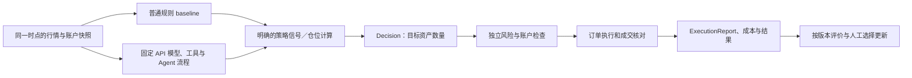

# Perpetual Alpha 2026｜10 月 14 日讨论总结与评论

整理：2026 年 10 月 14 日（英国时间）。第一部分总结今天讨论的内容；第二部分集中放我的点评、与网页 ChatGPT 分析的对照及后续建议。持续开发状态仍以项目核心文档为准。

## 第一部分｜今天的讨论总结

### 1.1 讨论的起点与整体脉络

今天主要围绕如何把 Perpetual Alpha 的交易系统做出第一版，以及 Agent 在系统里承担什么工作展开。

开头先讨论传统量化系统：从行情和其他信息形成因子／信号，对资产方向与波动作判断，再决定做多做空哪些资产、各持有多少。用户提出可以在挖因子的环节接入 Agent，但当时也表示其他位置还没有确定想法。

接着讨论怎样改进 Agent：是训练基础模型，还是使用已有模型 API，主要调整工具、提示、推理流程和运行框架。随后讨论历史数据能否在本地支持测试，以及真实运行能提供什么反馈。

后半段转到怎样协作、怎样先做一个可运行原型，并继续比较几种接法：把传统策略作为工具、让 Agent 处理信息，或者由 Agent 直接判断方向。最后暂提出让 Agent 承担策略方向判断，传统框架负责后面的仓位、风险与执行；具体输出需求仍待进一步研究。

### 1.2 基础模型与 Agent 改进

双方讨论过模型后训练、SFT／自训练、多次生成候选后评分或选一致答案，以及修改工具和 harness。考虑到时间和算力，当前较明确的倾向是首版优先使用现成 API，暂不训练基础 LLM 权重，把精力放在 Agent 系统本身。

录音后面仍提到寻找别人已经训练好的模型及其 API，也保留以后训练的可能性。具体供应商、模型、开源项目和改进方法没有选定。

### 1.3 本地测试、传统底座与 Agent 职责

关于测试，用户提出可以把历史数据交给策略作决策，再模拟交易和收益，无需先部署到服务器；队友讨论实际交易收益与每一步工具调用、推理流程的反馈。双方进一步考虑先利用历史数据和一个基础框架做原型，再进入运行与改进。

关于传统底座，用户提出完善既有 Python 框架中的仓位和风险控制，将这些部分以传统方法实现并共享给队友，留出接入 Agent 的位置。动量等简单传统策略被提出作为起点，尚未确认最终采用哪一个。

关于 Agent，讨论从开头的因子研究，扩展到信息处理、调用策略工具和直接方向判断。末段暂按“策略部分交给 Agent、向框架提供看涨看空”讨论，双方作了口头回应；随后用户表示还要确认只给方向是否足够，是否需要预测幅度、波动等信息，接口没有最终确定。

### 1.4 协作和交付意向

- 用户争取当晚或次日完善基础框架、仓位／风险部分和接口理解，将结果及知识整理到仓库，讲给队友听并征求意见。
- 队友按可用时间继续研究模型 API、Agent 结构和系统改进，也可以先写自己的原型。
- 双方讨论过各写一个东西，再展示、解释、比较和整合；后段也提出共用基础框架，各推进一部分。
- 提出周日对照原型，按本次日期推算为 10 月 18 日；具体时间和最终安排还需复核。队友投入时间没有硬性承诺。
- 各用 50% 资金运行一周被作为一种比较方式提出，没有确认执行。

这些都是讨论中的交付意向，本次录音没有提供新代码完成、GitHub 发布或交易部署的验收证据。

### 1.5 较明确的倾向与仍待决定的事项

| 较明确的倾向 | 仍待决定 |
|---|---|
| 先做出一版可以运行的系统，再逐步改进 | 首版具体做到哪些功能、如何验收 |
| 优先使用现成模型 API，暂不训练基础 LLM | 具体模型、API、费用及是否复用某个项目 |
| 探索工具、提示、推理流程与 harness 的改进 | 先改哪一项、怎样评价效果 |
| 传统底座处理仓位、风险与执行 | Agent 和仓位模块之间的输入输出及数量责任 |
| 用具体原型推进理解、及时互相交流 | baseline、个人交付、整合方式和比较时间 |

Agent 的最后临时方向是提供方向判断；它是否还承担因子研究、策略选择或其他工作，以及方向对应的资产、期限和行为含义，仍待定义。

### 1.6 关键内容的录音位置

| 内容 | 时间（约） |
|---|---|
| 传统系统、因子／信号、波动与仓位 | 00:36–01:45 |
| 模型训练、API、工具、候选筛选与运行框架 | 04:00–07:20 |
| 历史数据、本地模拟与实际反馈 | 08:00–10:50 |
| 用现成 API，主要改 System | 11:53–12:22 |
| 首版运行、各做原型与共享基础 | 14:59–17:25 |
| 完善风险、仓位与 Python 底座 | 17:31–19:20、25:37–26:40 |
| 策略工具、信息处理或 Agent 直接判断方向 | 27:01–28:52 |
| 方向、幅度和波动的输出需求仍需确认 | 28:53–29:36 |
| 各推进一部分、及时同步、先跑起来 | 29:40–30:58 |

### 1.7 会后截图补充：模型与 Jev 资料

以下来自用户随后提交的聊天截图，**不属于录音原文**。队友建议基础模型考虑 DeepSeek V4.1 Flash，并提供第三方托管的 Fin-R1 链接，希望与项目需求做对照；又提出重点研究 Jev，认为它可能在本比赛中起关键作用。队友也明确表示仍不确定具体对齐方式。

本次整理暂将 Jev 对应 TypeSafe AI 的同名结构化决策模型；截图没有给链接，身份仍可向队友核对。三项均为候选资料，没有确定采用或付费接入。原始链接、官方摘要与项目映射统一见[学习资料第 11 节](agent-learning-resources.zh-CN.md#11-10-月-14-日会后新增deepseekfin-r1-与-jev)。

## 第二部分｜点评与建议

以下是对第一部分讨论内容的评价和建议，不属于团队已经通过的决定。

### 2.1 我的独立判断

**你们对“先跑起一版、优先用现成 API、共用传统仓位与风险底座”已经有较明确的倾向；对 Agent 承担的任务和如何证明改进仍没有完成定义。**这比上次只讨论做一个大 Agent 更具体，但还不能叫最终技术方案。

这次讨论的演变很重要：开头是挖因子和传统系统，中间转到训练与系统优化，后面探索策略工具、信息处理，最后暂提出将策略方向判断交给 Agent。双方认可这个临时方向后，马上又提出仅涨跌是否足够、幅度和波动是否需要等问题。因此应记录成“候选对接方向”，而不是“已经选定传统策略”或“已经确认整个 Agent 决策架构”。

我认为眼下最影响开发的是三个问题：**Agent 的单一任务；方向到目标数量的责任；改动怎样被独立评价。**把这三个问题写清楚，工具、提示和运行框架的改进才能成为可交付工作。

### 2.2 我认为需要澄清的六件事

#### 2.2.1 “策略”“模型”“训练”各指什么

交易策略决定资产、时机、仓位和退出；Agent 的工具调用策略决定查什么、怎样推理；基础 LLM 权重训练又是另一项工作。即使基础 LLM 固定，工具、提示、记忆、候选筛选和运行流程仍能改进。传统规则也可以直接生成信号，不要求先训练复杂预测模型。

所以“用 API 就没什么可做”和“Agent 本身必须训练”都过于绝对。你们本次选择的是首版资源范围，不是所有 API 或所有 Agent 的技术限制。已后训练模型也不自动意味着掌握比赛交易策略。

#### 2.2.2 方向输出可以做首版，但不能含义不明

网页分析正确指出看涨／看跌不足以决定仓位。我补充：这不代表首版一定要让 LLM 预测收益幅度、波动和精确概率。方向加明确窗口，可以与固定预算、行情计算的波动、确定性退出规则组成完整策略。

必须知道它在判断哪个资产、哪个时间范围、是否有新决策、什么时候过期，以及哪个模块将信号转换为数量。若加概率或收益预测，再验证／校准；不能因为字段更丰富就认定更专业。

现有执行协议要求目标资产数量，方向信号可以放在策略内部。无需因这次讨论立即修改 Decision。[现有协议](technical-plan.zh-CN.md#12-三段之间的固定接口协议-10)

#### 2.2.3 “改进系统”需要一个具体目标

best-of-N 可以筛掉格式错误、证据缺失或违反约束的候选，但评价器不能在当时偷看未来收益。另一个 LLM 可以帮忙检查解释，不因此证明交易收益更高；多次一致也可能是一致地错误。

每项改动写清：改变哪个对象、预期改善什么、用哪个普通版本对照。除交易指标外，记录耗时、费用、工具错误及输出失败。反复用同一历史区间选最好结果，会使评价失去独立性。

#### 2.2.4 研究 Agent 与实时 Agent 要分别交付

因子研究 Agent 输出的是可验证假设／实验；实时 Agent 输出的是当时有效的交易信号或目标。两者可以共享工具，但评价、数据可见范围和部署位置不同。录音末段更接近实时方向 Agent，不能沿用开头“挖因子”的描述当作最终职责。

#### 2.2.5 回测、真实执行与上线是不同证据

你关于本地历史模拟的观点成立，队友关注实际反馈也有依据。历史数据能模拟假设下的决策和收益，却不保证限价单成交、盘口流动性、部分成交、延迟与比赛 par 的资金费条件。已有数据文档区分外部长期数据和比赛行情，应继续保留。

研究无需先投入实际订单；正式参赛仍需实际运行算法。[官方比赛任务](https://perpetual-alpha26.github.io/about) 本地手动小额验收也不等于无人值守交易闭环。[当前验收边界](technical-plan.zh-CN.md#14-g02api-wallet-小额交易链路验收2026-10-08)

#### 2.2.6 共用底座能减少重复，但要明确合并方式

双方先做原型能帮助沟通，值得保留。底层采集、账户、执行、日志和风险不必各写一套。建议各自实现可替换的策略／Agent 原型、共用同一输入快照和执行接口。若未来比较资金分配，先定义组合预算和唯一执行者；本次提到的 50%／50% 不能直接当成配置。

### 2.3 与网页 ChatGPT 分析的对照

| 网页分析的判断 | 我的处理 | 理由 |
|---|---|---|
| 基本共识已形成，Agent 任务／评价仍不清楚 | 大体认可，降低“已决定”的强度 | 首版资源倾向清楚，后段职责仍在变化 |
| 第一版从传统量化策略开始 | 作为建议保留，不当作最终事实 | 录音末段又暂提出方向判断整体交给 Agent |
| 固定 LLM 也能改进工具／harness／推理 | 认可 | 与独立初判相符，但收益增量仍要测 |
| 涨跌不能直接推出仓位，保留目标仓位协议 | 认可并补充 | 可用固定规则换算数量，未必需要首版输出幅度／概率 |
| 研究 Agent 与交易 Agent 不应混用 | 认可 | 开头到结尾确实跨了不同任务 |
| 回测收益不同于实际成交收益 | 认可 | 仓库已有数据与验收边界支持这一点 |
| 只分析前面技术讨论 | 必须补全 | 攀岩后约 24:00–30:58 再次讨论架构和输出，包含临时方向 |
| 评分为 40%／30%／30% | 本次未确认 | 当前 About 正文只有三项评价，未给这些比例；等待书面依据 |
| 11 月 6 日交报告／代码、正式阶段至少一笔成交 | 当前官网支持，已修正旧文档 | 旧日期和资格说法此前没有保持足够核实，现已移除错误现行表述 |
| 10/14–18 的逐日分工与过滤器方案 | 仅作外部建议 | 不是录音中的承诺；此次没有批准实施或部署 |

官网核对日期为 2026-10-14。比赛节点与资格统一维护在[项目总览第 3 节](project-plan.zh-CN.md#3-比赛节点与资格)，来源为[官方时间表](https://perpetual-alpha26.github.io/schedule)和[比赛规则](https://perpetual-alpha26.github.io/about)。所读页面未明确要求必须使用 LLM，也未规定全部 API 参数冻结；不能据此把自主交易算法和某一种 LLM Agent 实现等同起来。

### 2.4 综合后的首版建议

**保留现有数据／账户／执行底座和目标仓位接口，保留一个无 LLM 的 baseline，另做一个职责有限的 Agent 版本。**优先把录音末段的方向输出想法定义清楚，而不是立即同时开展因子挖掘、在线自训练和多 Agent 系统。

讨论用候选架构如下，尚未实施：

两条分支用于选择和对照，不默认同时执行。数值计算和数量换算可以用规则工具完成；模型的分析结果要落到确定语义。信号、数量、拒绝、订单状态要分别记录。

我建议下一次只冻结五件事：

1. **一个收益假设与 baseline**：资产、周期、入场／退出、成本及风险预算。
2. **一个 Agent 任务**：输入什么、能用什么工具、输出什么，如何处理不判断与失败。
3. **一个数量责任方**：方向怎样换成目标数量，谁负责该逻辑。
4. **一套对照与验收**：同一输入、成本、预算，记录净收益、回撤、换手、延迟和调用费用；Practice 另验成交与恢复。
5. **一份可检查交接**：版本、启动方法、示例输入输出、负责人及解释／复核时间。

这些是综合后的建议，不是把网页分析的日程当作团队决定。本次仅整理和评论，没有改交易程序、发送订单、采购 API 或发布到 GitHub。

### 2.5 对会后模型资料的点评

Fin-R1／DeepSeek 可以作为基础模型候选；Jev 更适合单列为小决策、评分或路由候选。这个区分可以让模型选择与 Agent 系统改进分别比较。金融推理基准好、结构化输出或低延迟，都不能单独证明交易有效。

队友“只有 Jev 能起关键作用”的表达可以作为优先研究兴趣，但目前没有对照结果，应继续保留普通规则和普通 LLM 对照。建议一次只替换模型或增加一个判断模块。具体研究建议见[策略文档第 20 节](strategy-development.zh-CN.md#20-会后资料模型替换与-jev-判断模块候选)。

## 附录 A｜来源与分析顺序

首先读取《新录音 8.m4a》，在本机转写完整约 37 分 02 秒的录音，独立形成初判并保存；随后才读取用户粘贴的网页 ChatGPT 分析，比较其结论，再核对当前官网与仓库文档。没有把附件中的建议、时间安排或口头工具请求作为执行指令。

技术话题在约 00:00–21:55，以及闲聊后的约 24:00–30:58。第二段包括“策略工具／信息处理／Agent 方向输出”的关键讨论，必须纳入。无关生活话题省略。

自动转写存在重叠、低声和英文术语识别问题，已对模型改进及末段接口讨论做片段复核。下文时间为约数，没有按自动转写断言说话人身份；按既有工程／Agent 角色理解的个人归属需要双方核对。未确认的论文名、平台名和模糊词不据此引出新技术结论。

## 附录 B｜本次文档归档

- [项目总览第 10 节](project-plan.zh-CN.md#10-10-月-14-日队友讨论录音纪要)：会议事实、分工意向和未决事项；第 3 节修正规则。
- [策略文档第 19 节](strategy-development.zh-CN.md#19-10-月-14-日从-agent-想法到可检验任务)：研究方向、优化对象、对照实验建议。
- [技术文档第 15 节](technical-plan.zh-CN.md#15-10-月-14-日agent-信号与传统仓位底座对接讨论)：方向到数量的接口责任及兼容现有协议的建议。

全文转写与独立初判保存在本地忽略的 `.cache/`，包含私人闲聊，不作为团队共享正文。项目事实持续在核心文档更新，本文件保留本次分析的日期与证据边界。
