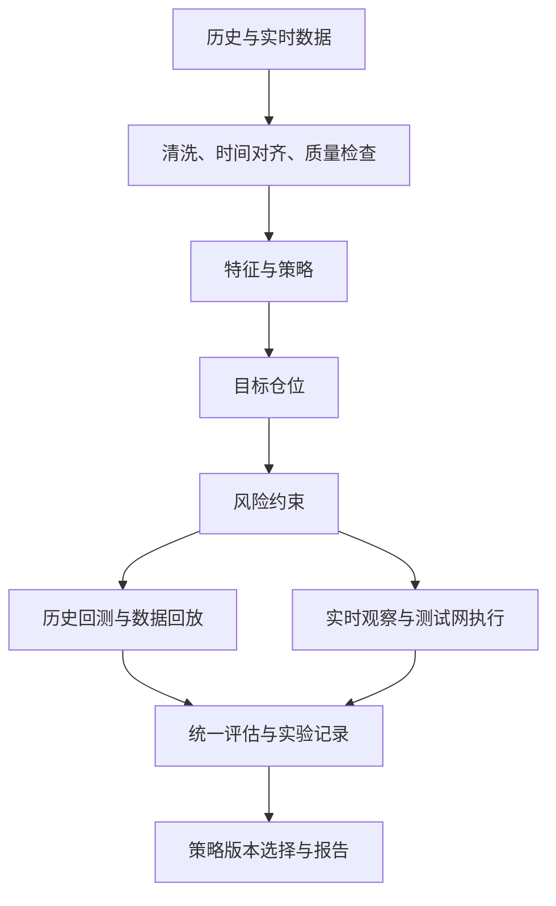

# Perpetual Alpha 2026｜项目规划与技术探索路线

更新日期：2026 年 10 月 7 日（英国时间）  
用途：供两名队员讨论、确认分工，并作为后续工作总览。  
状态：规划稿。文中的任务、实验和验收均为待开展事项，不代表已经完成。

## 1. 项目目标与范围

目标是先完成一个可靠的参赛系统，再在证据支持下改善成绩，并积累一段能解释、能展示的量化交易项目经历。

项目交付三项成果：

1. **交易系统**：持续读取数据、产生决策、执行订单、控制风险，并能检查和恢复运行状态。
2. **研究材料**：策略假设、数据说明、包含成本的实验、失败案例与版本选择依据。
3. **报告与代码**：说明方法、实验、实际结果和局限，提供可检查的运行说明。

当前优先完善信息、成本门槛与整个账户的风险框架，具体交易资产和策略留待两名队员讨论。`par:BTC` 起步、ETH 数据采集和简单趋势基准属于此前建议，尚未确认为交易方案。6/24 小时均线等参数也仅为候选示例。

当前不承诺同时实现全部候选路线。时间有限时，优先保留数据、基准策略、风控、执行与报告，缩减模型和资产数量。

官方资产清单、行情与账户信息、交易约束集中记录在[可交易资产与交易信息](markets-and-trading.zh-CN.md)，作为资产筛选和开发需求的事实依据。

### 当前已知条件与待确认项

| 事项 | 当前理解 | 对规划的影响 |
|---|---|---|
| 用户背景 | 需要逐步学习交易和量化项目流程 | 每个阶段同时安排概念解释、操作和结果复盘 |
| 队友背景 | 据其描述正在做 AI Infra | 适合优先讨论数据、系统、部署、监控方面的职责；具体经验仍需确认 |
| 队友时间 | 尚不确定 | 不把持续投入视为已经承诺；任务必须能交接 |
| 时间预算 | 此前估计两人合计每天 3–5 小时 | 暂作情景估算，确认实际可用时间后再调整工作量 |
| 账户进度 | 已报名、组队、创建钱包并提交公开地址，来自已有记录 | 主办方审核、资金到账和授权状态需另行核实 |

比赛排名还要求至少在 10 个不同日期交易，并达到最低累计名义成交额。成交额具体阈值及日期统计口径要向主办方确认；监控中应展示进度，不能假定任意低频策略都自动满足资格。[官方规则](https://perpetual-alpha26.github.io/about)

## 2. 团队分工：明确负责人，同时保留交接能力

以下为建议分工，需与队友确认；AI Infra 经验不自动意味着熟悉交易执行或量化研究。

| 工作 | 用户主要负责 | 队友建议负责 | 共同验收的产出 |
|---|---|---|---|
| 比赛与项目推进 | 规则、主办方消息、日程、任务清单 | 评估技术任务工作量和依赖 | 一页规则与时间表 |
| 数据 | 定义研究需要，检查样例是否可理解、可使用 | 采集、存储、时间对齐、质量检查 | 数据样例、字段说明、缺失情况 |
| 策略研究 | 理解假设、组织实验、分析和记录结果 | 协助实现与检查计算、数据泄漏 | 基准结果与对比表 |
| 交易系统 | 定义预期行为，核对交易是否符合策略 | 接口、订单状态、账户核对、异常处理 | 可重复的测试交易与恢复记录 |
| 风控 | 共同制定暂停条件、风险范围 | 实现约束并验证触发行为 | 风控说明与故障测试结果 |
| 部署运行 | 每日查看摘要，记录问题 | 部署、进程管理、监控、恢复流程 | 两个人都能使用的运行手册 |
| 报告 | 主导结构、实验结论和结果分析 | 补充工程架构与可靠性证据 | 报告、代码和依赖说明 |

“用户负责研究”意味着逐步学习提出假设、读懂结果和作出判断，并不要求现在就独立设计盈利策略。AI 可以辅助解释概念、起草实现、设计实验、检查结果和整理文档；生成内容仍需通过数据与测试验证。

### 队友投入不确定时的安排

- **能稳定参与**：队友负责数据与工程线，用户负责研究与项目线；在数据格式、策略输入输出、上线验收三个节点共同检查。
- **只能零散参与**：优先交给他边界清晰的任务，例如架构检查、数据采集模块、订单处理检查、部署演练。避免安排必须由他每日维护才能继续的工作。
- **阶段性无法参与**：缩减研究分支，保留单市场、单策略；缺少必要的执行或风控验证时，继续采集和离线研究，不跳过验收进入自动交易。

每项任务需注明负责人、交付日期、可检查的成果、验收方法和交接说明。成果不能只存在于某个人的电脑或记忆中。两名队员都必须会查看账户、停止新交易、检查剩余仓位，并知道出现问题时如何处理。

## 3. 技术总架构：数据、研究、运行三个部分

### 数据部分

保留价格、K 线、成交量、买卖报价、必要的盘口信息、参考价格、标记价格、资金费率；同时记录自身订单、成交、手续费、仓位、账户净值和运行错误。

技术方向为 REST 查询加 WebSocket 订阅。前者用于启动补数和账户核对，后者用于持续接收变化；断线恢复后检查重复和遗漏。初期使用 SQLite 和数据文件，具体配置推迟到实施阶段。

数据必须同时保留事件时间和接收时间，统一用 UTC 存储。策略只能使用当时已经收到的信息。特别是研究外部价格领先关系时，不能把数据延迟误当成预测能力。

外部历史数据用于初步研究，比赛自身数据用于检查实际可用性；两类市场的价差、深度、成交和费用不能混同。官方历史数据尚有待发布或明确，不将其作为唯一数据来源。[官方 FAQ](https://perpetual-alpha26.github.io/faq/)

### 数据来源与训练安排（10 月 7 日补充）

数据开发详情见[《数据获取与模型训练开发规划》](data-development.zh-CN.md)，其中包含实际接口、历史窗口、数据格式、模型需求和交付检查。

| 来源 | 规划用途 |
|---|---|
| 比赛测试网 REST／WebSocket，明确选择 `par:BTC`、`par:ETH` | 获取实时行情和账户事件，并持续保存为比赛历史数据 |
| 比赛历史接口 | 在可用窗口内补齐近期 K 线和资金费；K 线仅保留最近 5,000 根，不能无限追溯 |
| Binance 官方公开 USD-M Futures 数据 | 先整理 BTCUSDT／ETHUSDT 最近 6–12 个月的 1 分钟 K 线，支持初步研究与模型训练 |
| 主办方数据集 | 检查 Discord／邮件通知；公开 FAQ 尚未给出下载链接，实际发布情况待核实 |

价格与波动模型先用 K 线开展；资金费、参考价、盘口和外部领先关系需要各自的同步历史记录，不能由 K 线代替。外部训练特征要与运行期可获得的特征一致；比赛数据负责验证实际适用性与交易成本。先检查官方通知并启动比赛采集，再整理外部长历史开展基准研究，官方数据到位后补充。

数据采集与存储建议由队友侧重，用户推进来源确认、数据分析与实验整理；双方共同检查时间单位、缺失、市场口径和特征一致性，具体责任待确认。

### 研究部分

研究采用统一的数据整理、特征和信号逻辑。回测、实时观察和实际交易尽量复用这部分代码，避免同一个策略在不同环境中含义不同。

策略提供候选机会、依据与预期周期；共用决策层检查完整周期成本、估计不确定性与组合风险，再批准或限制目标仓位。模型可以帮助预测收益、判断市场状态或过滤交易，不直接发送订单。详细安排见[《信息、交易门槛与组合仓位框架》](decision-framework.zh-CN.md)。

技术方向：Python、pandas/NumPy、简单统计分析，必要时加入 scikit-learn 和梯度提升树。暂不投入 GPU、深度学习训练平台或复杂服务架构。

### 运行部分

风控覆盖单笔、单资产、总敞口、相关风险、保证金、待成交订单和累计亏损，数值由双方讨论与验证。执行模块比较获批目标与真实仓位，处理下单、撤单、部分成交、拒单、网络超时和重启恢复。撤单与风险减仓不以盈利门槛为前提。第一版采用单交易进程，账户状态以交易所查询和成交记录核对。

策略可以按分钟或小时评估，风控和订单状态检查需要更及时地运行，不能等到下一次策略决策才发现异常。正式运行计划放在 Linux 服务器，具备日志、监控和恢复说明。

交易只使用比赛测试网及授权 API 钱包；主钱包用于账户管理，不进入交易程序。具体部署和密钥配置不在本规划中执行。[参与指南](https://perpetual-alpha26.github.io/docs/)

## 4. 技术探索路线：候选池与优先级

以下方向均为研究假设，不代表已知存在可交易优势。策略逻辑、仓位管理和机器学习方法要分别比较，避免一次改变多个因素。

宏观与产业方面的原始想法另记在[《研究想法与假设记录》](research-ideas.zh-CN.md)：包括利率与美元、黄金与美元、原油与地缘及产业链、股指与总体趋势。各条影响周期、数据要求与规则尚待细化；先保留假设，再逐项验证，不据此直接增加交易资产或发送订单。

| 路线 | 核心问题与候选方法 | 需要的数据 | 验证重点 | 安排 |
|---|---|---|---|---|
| 趋势／动量 | 近期上涨或下跌是否延续？均线、多周期收益、突破 | K 线、成交量、报价 | 横盘损失、成本、参数稳定性 | 基准候选，待共同选择 |
| 波动与成本控制 | 波动大时缩仓、价差大时不入场，能否改善结果？ | 波动、价差、费用、成交 | 在可比风险或交易量下分析收益变化 | 主线：基准后的首个改进 |
| 均值回归 | 短期偏离是否回归？标准化偏离、滚动区间 | 价格、波动、报价 | 区分过度反应和趋势启动 | 备选策略假设 |
| 参考价与外部信息 | 本地盘口是否滞后或偏离参考与外部市场？ | 本地报价、参考价、外部价格、接收时间 | 延迟、可成交价格、偏离持续时间 | 特色探索：优先观察 |
| 跨资产 | BTC 信息能否改善 ETH 判断？相对强弱、领先滞后、配对关系 | 对齐后的两资产数据 | 关系稳定性、相关风险、双边成本 | 基础系统稳定后 |
| 订单簿与成交信号 | 买卖深度或成交方向是否有额外信息？ | 深度、买卖报价、成交 | 信号寿命、数据质量、执行延迟 | 先尝试辅助特征 |
| 机器学习过滤 | 哪些已有信号值得交易？逻辑回归、梯度提升树 | 上述特征及明确的预测目标 | 时间切分、过拟合、成本后增益 | 数据与基准合格后 |
| 做市 | 挂双边报价能否在库存风险下获利？ | 盘口、成交、订单与撤单记录 | 成交概率、不利成交、库存和撤单可靠性 | 本轮不作为交付主线 |
| 深度学习／强化学习 | 复杂模型或连续决策是否增加价值？ | 更丰富的数据、可信模拟器 | 样本量、模拟偏差、调试与验证成本 | 保留为后续方向 |

### 此前建议组合（待共同选择）

**主线：简单趋势 → 波动仓位控制 → 成本过滤。**

先得到可解释的完整基准，再逐项增加控制条件。趋势周期、入场门槛和仓位比例属于后续实验参数；不依靠搜索大量组合来挑选最好看的结果。

**特色探索：参考价格与比赛盘口的关系。**

先观察偏离是否预测后续变化，再检查加入延迟和成本后是否仍有信息。发现有效关系时，优先作为主策略的入场过滤条件。参考价、标记价和成交价不同并不自动意味着套利机会。[价格机制](https://perpetual-alpha26.github.io/docs/#asset-references-and-pricing)

**可选升级：简单 ML 过滤器。**

先用逻辑回归建立可解释基准，再考虑树模型。比较“相同策略、相同成本与风险约束，有过滤和无过滤”的差异。机器学习是实现判断的工具，必须服务于明确的交易假设。

当前尚未选定策略。先确认共用决策与组合风险框架，再共同筛选基准和一个探索方向；其他路线留在候选池。此前建议第二周同时推进的探索分支最多一个，不要求本次比赛全部实现。

## 5. 实验与上线评估

验证顺序为：**历史回测 → 时间外验证 → 实时观察但不下单 → 小仓位测试网运行 → 正式版本选择**。

### 实验设计

- 按时间切分开发与验证数据；重叠的预测区间需要隔离，避免未来信息进入训练。标准化和特征选择也只使用训练区间。
- 从完整结束的 K 线生成信号，按之后可执行的价格模拟成交；不能看完收盘价再假设以同一价格无成本成交。
- 纳入手续费、价差、滑点和资金费；检查更差的成本和延迟假设下是否仍有可接受表现。
- 不把“价格碰到挂单”直接等同于成交。没有可靠挂单模型时，用更保守的执行假设。
- 一次只增加一个主要因素，固定对照数据与评估口径，保留失败实验。
- 短期正收益只能作为继续研究的证据，不能据此认定长期盈利能力。

可用时间序列验证工具支持按时间推进的切分，但仍需根据预测区间设计隔离规则。[TimeSeriesSplit 文档](https://scikit-learn.org/stable/modules/generated/sklearn.model_selection.TimeSeriesSplit.html)

### 统一比较指标

每次实验报告成本后净收益、每日收益波动、最大回撤、交易次数、累计成交额、费用、持仓时间、风险敞口以及异常情况；检查利润是否集中于极少数交易。

不要仅按预测准确率选模型，也不要把“交易少、波动低”自动认定为更好。需要同时考虑参与资格、收益和风险。空仓基准可用于研究比较，不代表满足参赛要求。

### 工程验收

上线前需验证行情过期、网络中断、拒单、部分成交、请求结果不确定、重复启动、程序重启、亏损限制和人工停止等情形。

重要结果包括：不盲目重复下单；重启先核对账户；触发限制后停止增加风险并处理挂单和持仓；平仓失败时明确显示剩余风险。无法联网时不能保证撤单或平仓成功，恢复后必须重新核对。

## 6. 阶段安排与调整规则

日期是工作目标。账户和数据等外部条件未就绪时，继续独立的数据、研究和文档工作，不把等待期间的任务标记为完成。

| 时间 | 阶段重点 | 交付与验收 |
|---|---|---|
| 10 月 4–6 日 | 确认规则、队友能力与时间、技术范围；准备数据路线 | 分工确认表、规则摘要、数据清单 |
| 10 月 6–8 日 | 获取数据；资金到位后验证账户与订单流程 | 数据样例；下单、撤单、成交、平仓的完整记录 |
| 10 月 8–11 日 | 简单基准、基本风控与日志 | 可解释的策略；小仓位连续运行至少 12 小时 |
| 10 月 11–15 日 | 研究成本与风险改进；只选一个探索分支 | 基准与改进对照表；继续或放弃该分支的依据 |
| 10 月 16–18 日 | 固定主要功能、部署、故障演练 | 至少 48 小时稳定运行目标；两人可用的应急说明 |
| 10 月 19 日–11 月 6 日 | 正式运行、资格进度、日常复盘 | 运行与交易记录；必要修改有版本和理由 |
| 11 月 7–9 日 | 汇总结果、完善说明、提交 | 报告、代码、依赖及复现说明 |

正式阶段与报告节点来自当前官网。[比赛时间表](https://perpetual-alpha26.github.io/)

如果进度落后，按顺序缩减 ML、多资产、额外策略、界面和便利功能。保留订单核对、风险限制、数据质量、必要日志和恢复验证；未达到上线条件时继续观察或研究，明确记录对参赛进度的影响。

每日检查系统和账户；每周至少一次共同复盘。在重要版本变更前共同核对假设、实验结果和风险，不凭一次盈利或亏损频繁改策略。

## 7. 项目记录与当前下一步

### 四类记录

1. **项目总览与任务清单**：阶段、负责人、截止时间、完成标准和阻碍。
2. **实验日志**：假设、数据时间范围、配置、代码版本、结果、局限和决定。
3. **运行记录**：净值、交易、费用、资格进度、异常与处理。
4. **报告素材**：架构、策略解释、比较实验、实际与回测差异、失败与改进。

任务卡模板：

> 任务｜负责人｜预计投入｜交付日期｜产出｜验收方法｜依赖｜交接说明

实验卡模板：

> 假设｜相对基准只改什么｜数据与时间切分｜成本假设｜结果｜失败情况｜是否进入下一阶段

### 当前只需确认的三件事

- 队友的 AI Infra 工作具体偏训练、推理、数据平台还是部署运维；更适合负责模块还是阶段检查。
- 两人未来两周各自可承诺的时间，以及队友无法参与时的交接方式。
- 对齐信息来源、完整成本与净收益门槛、整个账户的风险预算和策略筛选标准；交易领域与策略随后共同选择，不预设趋势或均值回归已经获选。

规划阶段先把以上内容与队友对齐。环境配置、代码开发、钱包操作和实际交易属于后续执行事项，本文件不表示这些工作已经完成。
