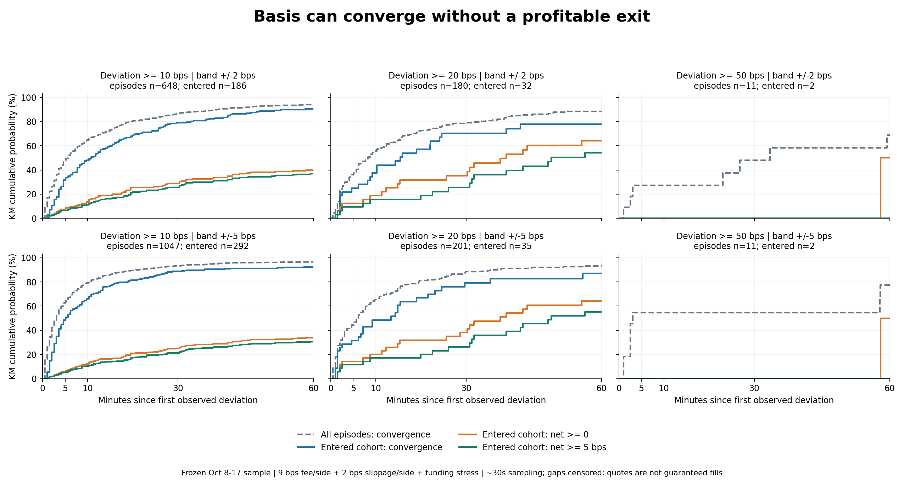
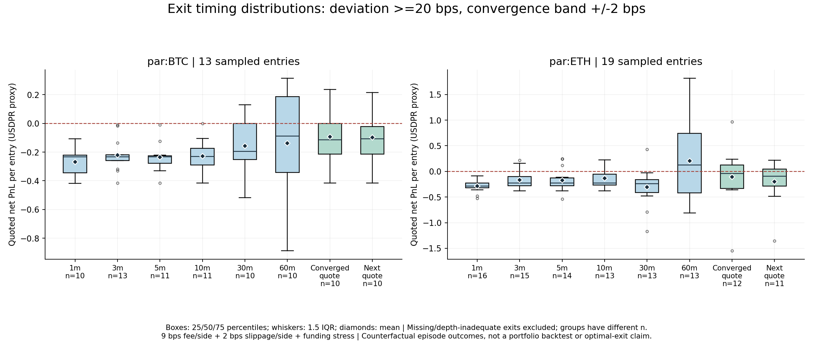

# 参考价偏离：是否存在可交易的回归机会？

2026-10-17｜独立离线统计研究｜PR #13 保持 Draft；不部署、不合并、不发送订单。

**这批数据存在经常回到参考价附近的现象，但还没有证明成本后可交易的正期望收益。**不能用延长持有期代替论证。主展示口径为偏离 ≥20 bps、收敛到 ±2 bps；完整保留 10/20/50 × 2/5 bps 六组结果，不据结果挑参数。

## 数据与旧实验纠正

沿用冻结的 `.cache/basis-market-history.jsonl`：50,050 条真实测试网 BTC/ETH 盘口／Oracle 快照，约覆盖 10 月 8–17 日、30 秒采样。输入 SHA-256 为 `3cf036db92ec090736596c80e76f8e69522bb171aec2ea1469867aa41e73ba93`。保留 50,044 条有效记录，6 条缺少合格 Oracle 接收时间被隔离，44 次超过 90 秒的连续性中断拆分观测段。

比较对象是比赛合约盘口中间价与其 Oracle，不是两条平滑均线，也不是独立外部合约的可成交双腿价差。收到 Oracle 的时间合格，不代表上游报价一定新鲜；当前无法重建独立源的发布时间。

已核对[官方规格](https://perpetual-alpha26.github.io/docs/)：未折扣基础 Taker 单边费率 9 bps，BTC/ETH lot 均为 0.0001，最低订单价值 10。[仓库 metadata 捕获](../../../examples/history/testnet-par-capture.json)也记录两者 `szDecimals=4`。旧版用了 5 bps 和 BTC 0.00001，存在低估成本和不可执行数量问题；旧表只保留为历史记录，代码默认值已修正。

9 bps 仍是基础费率情景，不是账户 `userFees`／真实逐笔费用的重建；没有完整历史规则修订序列。本次未优化原策略退出规则、未切换运行配置，也未申请付费档案或假设官方已有比赛专用盘口下载。

## 固定研究方法

令 `M=(bid+ask)/2`、`O=Oracle`，偏离为 `b=(M/O−1)×10000 bps`。负偏离对应潜在多头，正偏离对应潜在空头；中间价不是实际入场价。

每个资产、每组阈值／收敛带，必须先观察到带内报价，才等待新的偏离事件。首次达到外层阈值记录一次；连续偏离不重复计数，回到内层带才重置。段首已偏离的过程视为左截断，不伪造起点；直接从负偏离跳到正偏离而没有带内观测，不算观察到收敛。六组参数包含重叠事件，不能把共 2,098 条网格事件当作独立机会数。

从首次偏离的接收时间起，测量三个首次观察终点：回到收敛带；按足量盘口净清算收益 ≥0；净利润 ≥入场 touch 名义价值的 5 bps。观测窗口是 1/3/5/10/30/60 分钟。第一个终点覆盖全部事件，另两个仅覆盖满足入场条件的事件，另报相同入场子样本的收敛率以免混淆分母。

无效数据或 >90 秒缺口在最后有效快照处截断随访；期末未完成也右删失，最长随访 60 分钟。未完成不当作失败或简单丢弃。主要概率用 Kaplan–Meier（KM），同时归档各窗口命中、删失、风险集和缺失结果界限 `命中/n` 至 `(命中+提前删失)/n`。KM 假设删失不依赖未观察结果，采集缺口未必满足，不能只凭 KM 作强推断。

这是**首次被采样观察到**的到达时间，不能排除两次采样之间短暂收敛再偏离。事件的 `observed_detection_bracket_ms` 只是最后带外快照与检测快照的区间，不是连续时间真正首次穿越的严格区间。没有插值、补零、跨缺口前向填充或用 K 线代替盘口。

主汇总按触发 UTC 日期整日有放回重抽样 200 次，固定种子 20261017，给出逐窗口／均值的 95% 百分位区间。主口径仅 9 个有事件日期，跨日相关、重叠随访和多重比较仍存在；区间不是显著性证明。细分组给出样本数和点估计，不假设每个事件独立。

## 怎样测量可交易性

每笔名义金额上限 100，按 0.0001 向下取整，检查最低 10 和整笔顶层深度。信号后至少等 1 秒，在下一张有效快照重新要求同方向偏离仍达阈值；消失或深度不足记未入场，不追单。**没有用旧成本过滤器筛这批研究事件**，避免先用此前开发结果删掉不利机会。

多头按卖一入、买一出，空头反之。相同触发、入场时点和数量下，分别保存：按买卖 touch 的毛损益（已含买卖价差，无其他摩擦）；单边 9 bps 费用、2 bps 不利滑点的基准净损益；单边 18 bps、4 bps 滑点及资金费压力翻倍的情景。手续费分别按调整后的开平金额计。

资金费压力项按每段左端可见的 `|小时 funding|×Oracle×持有时间×数量` 积分。它不是逐小时真实结算，不借用未来费率开仓，也不保证覆盖未观察到的峰值。真实结算仍需 fundingHistory／userFunding 验证。

固定期限退出取截止后第一张有效快照，最多容忍 45 秒采样滞后；没有报价或深度不足即 unavailable，不使用旧价。收敛时同时报告同张快照清算估计和至少再等 1 秒后的下一张快照估计（最多 90 秒，仍需深度），另做两者都可报价的相同样本配对比较。

首次盈利终点只表示“曾出现过可报价盈利机会”，不能倒推当时一定能成交，不能事后挑每个事件最高收益的退出。各固定时点是反事实对照，随访可重叠；未做资金占用、全仓风险、保证金／清算和真实撮合验证，不累计为组合收益或报告 Sharpe。

## 结果一：多久回到 Oracle 附近？

全部偏离事件的 KM 收敛概率如下，不是实际成交概率。

| 初始偏离 / 收敛带 | 事件数 | 1 分钟 | 3 分钟 | 5 分钟 | 10 分钟 | 30 分钟 | 60 分钟 | KM 中位时间 |
|---|---:|---:|---:|---:|---:|---:|---:|---:|
| ≥10 / ±2 bps | 648 | 9.6% | 31.5% | 47.4% | 64.8% | 86.8% | 94.1% | 5.64 分钟 |
| ≥10 / ±5 bps | 1,047 | 16.2% | 48.3% | 62.6% | 79.2% | 93.3% | 96.5% | 3.08 分钟 |
| ≥20 / ±2 bps | 180 | 4.4% | 26.7% | 36.1% | 55.8% | 78.5% | 88.4% | 8.22 分钟 |
| ≥20 / ±5 bps | 201 | 9.5% | 35.3% | 44.3% | 65.4% | 88.4% | 93.2% | 6.15 分钟 |
| ≥50 / ±2 bps | 11 | 0.0% | 18.2% | 27.3% | 27.3% | 48.1% | 68.8% | 33.46 分钟 |
| ≥50 / ±5 bps | 11 | 0.0% | 45.5% | 54.5% | 54.5% | 54.5% | 77.3% | 3.07 分钟 |

50 bps 只有 11 个事件、2 次满足入场条件，带宽稍改中位数就差很大，不能选某个持有周期。带宽也改变重置时点，所以不同带宽的事件数不一定相同。

主口径 180 个事件，157 次在 60 分钟内观察到收敛，其余 23 次删失，其中 4 次在 60 分钟前中断。10 分钟收敛率 55.8%，日期分块区间约 42.3%–66.4%；60 分钟 88.4%，区间约 77.4%–94.4%。简单 60 分钟命中率为 157/180=87.2%，提前删失结果界限约 87.2%–89.4%。

已收敛者的平均检测时间为 11.20 分钟，**只是成功子样本均值，不是所有事件的平均等待时间**。KM 中位数为 8.22 分钟，限制到 60 分钟的平均等待时间为 17.02 分钟；未限制的长期均值无法据此确定。

## 结果二：同样事件，何时能回本或盈利？

180 次主口径事件中：103 次在下一张快照已不满足偏离，45 次入场深度不足，仅 32 次满足研究入场条件，其中 BTC 13 次、ETH 19 次。

| 时间 | 全事件收敛 n=180 | 入场子样本收敛 n=32 | 入场后曾可净回本 n=32 | 入场后曾可净赚 ≥5 bps n=32 |
|---|---:|---:|---:|---:|
| 1 分钟 | 4.4% | 0.0% | 0.0% | 0.0% |
| 3 分钟 | 26.7% | 21.9% | 12.5% | 9.4% |
| 5 分钟 | 36.1% | 25.0% | 12.5% | 9.4% |
| 10 分钟 | 55.8% | 37.5% | 18.8% | 15.6% |
| 30 分钟 | 78.5% | 70.4% | 35.2% | 25.5% |
| 60 分钟 | 88.4% | 77.8% | 64.2% | 54.2% |

入场子样本的收敛中位数 15.40 分钟，首次净回本中位数 38.92 分钟，首次达到目标利润中位数 48.88 分钟。触及终点后收益还会变化，不能把“60 分钟内曾盈利”当作“60 分钟平仓盈利”。



## 结果三：收敛后能赚钱平仓吗？

下表采用当时足量买卖盘，单位为按报价／结算约定估算的 USDPR 名义损益，不是账户实收金额。每笔实际名义价值因取整略低于 100。不同退出时点的缺失／深度不同，各行分母不同，不能直接当作同一批仓位的收益改善。

| 退出观察点 | 可报价样本 / 32 次入场 | 平均毛损益 | 平均基准净损益 | 平均成本翻倍净损益 |
|---|---:|---:|---:|---:|
| 1 分钟 | 26 | -0.0610 | -0.2782 | -0.4954 |
| 3 分钟 | 28 | +0.0250 | -0.1919 | -0.4087 |
| 5 分钟 | 25 | +0.0181 | -0.1994 | -0.4169 |
| 10 分钟 | 24 | +0.0402 | -0.1776 | -0.3954 |
| 30 分钟 | 23 | -0.0190 | -0.2396 | -0.4601 |
| 60 分钟 | 23 | +0.2776 | +0.0553 | -0.1669 |
| 首次收敛同张盘口 | 22 | +0.1175 | -0.0997 | -0.3168 |
| 收敛后下一张盘口 | 21 | +0.0659 | -0.1511 | -0.3681 |

收敛同张报价的平均毛收益 +0.1175，被平均双边手续费 0.1767、额外滑点 0.0393、资金费压力项 0.0012 覆盖。22 个样本仅 7 个净非负；下一张盘口的 21 个样本只有 5 个净非负。**可观察到一些毛回归空间，但不足以支持基准成本后的正收益。**

只取两种退出都可报价的**相同 21 个样本**，同张均值 −0.1506，下一张 −0.1511，配对差仅 −0.0005；不能把全行 −0.0997 到 −0.1511 的变化全归于延迟。

60 分钟的 +0.0553 没有隐去：其日期分块均值区间约 −0.2674 至 +0.5355，跨过零，且 9 次入场缺少该时点退出；不能据此选一小时策略。收敛后下一张报价均值区间约 −0.2640 至 −0.0240，但只覆盖可报价的已收敛子样本，不代表所有事件或未来市场。



## 结果四：是合约在动，还是 Oracle 在动？

精确分解为 `ΔM = ΔO + Δ(M−O)`。各分量除以事件初始中间价，再按潜在多／空方向调整为同分母 bps；另存未经方向调整的实际 mid／Oracle 涨跌率。不能把相对比例价差直接混入金额分解。

主口径已收敛的 157 个事件，方向调整后的均值：合约中间价 **+22.07 bps = Oracle −1.27 bps + 绝对基差变化 +23.34 bps**。约 87.3% 的这些事件里中间价向有利方向移动，也有约 12.7% 反向。因此不能简单解释成只是 Oracle 追赶；但这是已收敛子样本，其基差缩小本身也不能证明全体偏离有正 Alpha。

按潜在仓位方向，BTC 多头已收敛事件的合约价格平均上涨 21.95 bps，BTC 空头对应平均下跌 18.57 bps；ETH 多头上涨 23.76 bps，ETH 空头下跌 20.05 bps。完整 Oracle 与 mid 原始回报分布在摘要里。实际买卖价差和成本解释了为何有利中间价变化仍可能净亏。

## 分市场、方向、时段与浮亏

主口径收敛后下一张报价：

| 市场 / 方向 | 事件数 | 满足入场数 | 全事件 10 分钟收敛概率 | 可报价退出数 | 平均净损益 |
|---|---:|---:|---:|---:|---:|
| BTC Long | 45 | 5 | 48.9% | 4 | -0.0968 |
| BTC Short | 21 | 8 | 47.6% | 6 | -0.0987 |
| ETH Long | 79 | 10 | 65.8% | 7 | -0.2230 |
| ETH Short | 35 | 9 | 46.4% | 4 | -0.1581 |

每组仅 4–7 个退出，不据此排名。ETH Long 前半段 3 个退出均值 +0.1632、后半段 4 个退出 −0.5127，结果不稳定；两段早已查看，均标 `seen`。按 UTC 00–06、06–12、12–18、18–24 的完整分组也归档；12–18 时段虽有 4 个退出均值 +0.0720，也不能变成可靠时段规则。cohort 按触发时点分组，随访可以越过分割线，完全不是样本外验证。

等待收敛期间的最大不利浮亏（MAE）采用可按顶层数量整笔平仓的净清算估计，包括入场时立即清算的买卖价差及费用。主口径 24 个已收敛且曾有足量报价的事件：MAE 中位数 **−28.66 bps**，较差 10% 分位 **−45.40 bps**，最差 **−154.95 bps**；另存每个事件全随访 MAE 和深度不足报价数。

这不是保证金压力或清算价。深度不足时无法整笔退出，快照之间可能有更大浮亏；不把缺失风险当作零，不据此批准杠杆。首轮不引入 OU、机器学习或动态止损。

## 结论与下一步

保留回归作为研究假设，但不将旧五分钟策略或“等收敛就平仓”升级为获利策略。样本中有效入场较少，实际报价的毛空间常不够覆盖基准成本，未收敛／缺少足量退出仍须保留。

冻结本方法后，另收未来未参与开发的数据重复研究；补账户真实费用、逐小时 fundingHistory、高频盘口／撤单和延迟执行，再决定是否设计退出规则或对冲腿。本批数据均已见，不能重新命名为样本外，也不因某一格均值为正继续加过滤条件。

本研究未做随机时点／匹配市场状态的对照，未建立反事实基线或检验成本后长期期望值。当前答案是：**存在观察到的回归现象；尚未证明可执行、稳定、成本后的套利空间。**

## 复现与归档

```powershell
.venv/Scripts/python.exe -m perpetual_alpha.basis_convergence .cache/basis-market-history.jsonl --output .cache/basis-convergence.json
.venv/Scripts/python.exe -m unittest discover -s tests -p 'test_basis*.py' -v
# 绘图依赖不进入服务器运行依赖。
uv pip install --python .venv/Scripts/python.exe --target .cache/basis-plot-libs -r config/requirements-research.txt
$env:PYTHONPATH = (Resolve-Path .cache/basis-plot-libs).Path
.venv/Scripts/python.exe scripts/render_basis_convergence.py .cache/basis-convergence.json --output docs/research/basis-convergence-2026-10-17
```

统计模块只用标准库，不导入网络、账户或交易执行。PNG 已目视检查，附 SVG 便于导出。

41 项价差／收敛测试通过；连同既有 Forecast 架构、Adapter 和接口回归，91 项通过。Ruff、diff 检查及归档摘要校验通过，六组主汇总可从已归档逐事件证据精确复算。既有 Windows Paper 全量测试进程异常仍是原项目限制，本次未修改其运行逻辑，不声称全量回归已通过。

- [summary.json](summary.json)：固定参数、输入／方法摘要、六组主汇总的概率、删失、成本和归因。
- [group-summaries.jsonl.gz](group-summaries.jsonl.gz)：全部 102 个分组的完整汇总，包含市场／方向、已见前后段与 UTC 时段。
- [probabilities.csv](probabilities.csv)：可筛选概率表；空值表示数据不支持，不等于零。
- [event-index.csv](event-index.csv)：事件索引、入场状态、终点及浮亏。
- [events.jsonl.gz](events.jsonl.gz)：逐事件退出、归因与成本明细；标准库 gzip 可读取，其摘要归档在 summary。

71 MB 原始盘口保留本地。其他人取得同一输入才能完整复跑提取；归档事件足以复算概率与重绘图，不足以独立核验原始盘口提取。没有提交账户、密钥或数据库。PR 保持草稿；盈利假设未通过，不构成自动交易准入。
