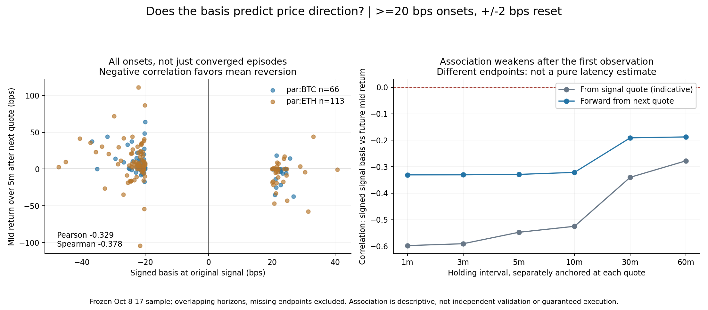
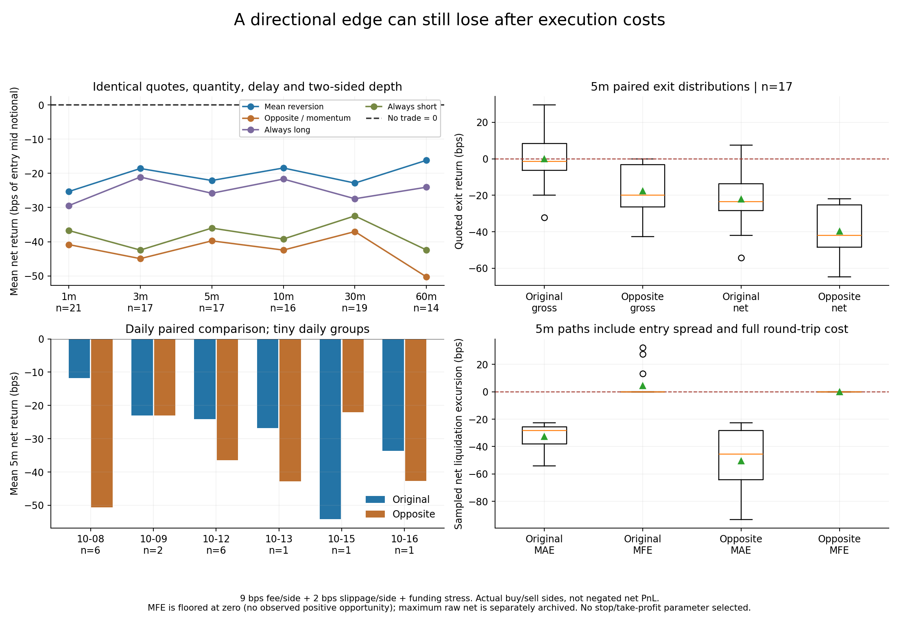

# 多空方向审查、价差相关性与官方历史补充

2026-10-17｜PR #13 离线研究补充｜保持 Draft，不合并、不部署、不改交易方向或止盈止损。

**没有发现均值回归多空映射写反；已见数据中偏离方向与后续涨跌有一定相关，但严格报价对照下原方向、反方向都没有证明成本后正收益。**偏离越大是否越能赚钱，也尚无稳定证据。

## 1. 审查对象：不能只看成功收敛者

`basis_research.direction()` 的映射为：卖一显著低于 Oracle → up／潜在做多；买一显著高于 Oracle → down／潜在做空。独立研究使用 `b=(mid/Oracle−1)×10000`，潜在方向 `s=−sign(b)`，与此一致。现有 `rule-demo` 是另一演示 producer，不能混同为本研究的价差信号。

之前“157 个已收敛事件中 87.3% 中间价方向有利”有条件选择，不能回答全体信号的预测力。本次沿用冻结事件起点，**不按未来是否收敛、回本或盈利筛事件**。主口径仍是偏离 ≥20 bps、先回到 ±2 bps 才允许新事件，共 180 次；同时保存 10/50 bps 参照，只用 ±2 bps 重置带以免把两个带宽的事件重复混合。

原始 50,050 条 BTC/ETH 快照及事件归档与[收敛研究](../basis-convergence-2026-10-17/report.zh-CN.md)一致。缺口、无效时间戳、段首偏离、下一张报价及最大 90 秒连续性约束沿用原协议。不用连续快照冒充独立机会。不同阈值的事件仍重叠，不能合并当作独立样本。

## 2. 官方历史：实际拉取了什么？

本次不只查文档，实际向官方 `https://api.hyperliquid-testnet.xyz/info` 发出固定 `par:BTC`／`par:ETH` 的公开只读请求：

| 来源 | 实际返回 | 纳入方式 |
|---|---|---|
| `fundingHistory` | BTC、ETH 各 217 条，共 434 条 | 校验研究期 217 个 UTC 小时桶，无缺桶；作为事后资金费率情景 |
| `recentTrades` | 每资产各 10 条近期成交 | 归档并检查与本地窗口重叠，不能冒充完整市场成交历史 |
| 官方 S3 历史上下文对象 | 无凭证 HEAD 返回 403 | 仅说明该次访问不成功，无法确认对象是否存在或覆盖 testnet/par |
| K 线 | 未下载 | 按用户要求，不拿 OHLCV 替代盘口和 Oracle 历史 |

资金费请求区间为 `[1791421200000,1792199169928]`，从 10 月 8 日 01:00 UTC 至研究窗口尾部；返回首尾时间为 `1791421200030`、`1792198800136`，217 个小时桶齐全。实际接收时间、请求、完整费率、摘要见 [official-evidence.json](official-evidence.json)。这些历史值是在本次研究时才取得，不伪装为当年决策时已经存入本地的数据，也不作为新交易特征。

近期成交中，BTC 只有 3 条落在原始研究窗口，并能匹配交易时间之前、90 秒内最后收到的本地快照；ETH 没有重叠。三条 BTC 成交价均为 81500，约比对应本地 Oracle 低 9.68 bps，规模与时间都不足以验证本轮所有信号。它们不是新的完整盘口样本，也不是样本外策略验证。

实际尝试的 S3 对象为 `https://hyperliquid-archive.s3.amazonaws.com/asset_ctxs/20261008.csv.lz4`。没有加载 AWS 凭证、添加 requester-pays 标志或进行付费下载；403 不等于不存在档案。官方说明 S3 有历史 L2 与 asset contexts，但数据可能缺失且由下载方付传输费，并未由此确认本比赛 testnet `par` 的覆盖。[官方档案说明](https://hyperliquid.gitbook.io/hyperliquid-docs/historical-data)

`recentTrades` 没有提供这次需要的任意起止时间回溯；不能不断请求最新尾部就声称补齐旧历史。[官方 API](https://hyperliquid.gitbook.io/hyperliquid-docs/for-developers/api/info-endpoint) 与[资金费历史接口](https://hyperliquid.gitbook.io/hyperliquid-docs/for-developers/api/info-endpoint/perpetuals)提供了各自请求口径；[比赛 FAQ](https://perpetual-alpha26.github.io/faq/)未给出本次可直接下载的专用历史盘口档案。

## 3. 比较方法：方向、执行与风险分开

**方向**：在每个事件上测未来 1/3/5/10/30/60 分钟中间价收益。分别从信号快照、下一张有效快照起算各自的持有窗口；后者回答报价到达之后还剩多少预测关系。窗口末端取第一张报价，最多滞后 45 秒，缺失另记，不按零收益填充。未变动报价不记方向命中，单列 ties。

相关系数一：带符号初始偏离 `b` 与未来实际涨跌 `r`。均值回归假设对应**负相关**，不能把负号误读成方向反了。相关系数二：`|b|` 与原方向调整收益 `s×r`／净收益，检验“偏离越大是否越值得交易”。同时报 Pearson 与处理并列值的 Spearman，避免只看线性极端点。

**执行**：保留下一张报价仍同方向达阈值的事件；多头 ask 入／bid 出，空头 bid 入／ask 出。数量取两方向共用、按 ask 加滑点预算向下取整的数量，lot=0.0001、上限名义 100、最低 10。正反严格对照仅使用两方向在开平时都足量的相同样本；原方向独自可行的样本也单独保存，不能把反向不可成交的报价收入当作已实现。

比较 A 原始均值回归、B 相反方向动量、C 永远做多、D 永远做空、E 不交易=0。相同事件、延迟、退出报价、数量、费用，各方向分别取正确买卖边；**反向净收益绝不是原净收益乘 −1**。币种不同，统一按共同入场中间价名义价值归一为 bps。

基准成本仍为单边 9 bps 费用、2 bps 不利滑点、绝对资金费压力积分；毛收益已经跨买卖盘，仅不加额外摩擦。这是[官方基础档情景](https://perpetual-alpha26.github.io/docs/)，不是账户实际费率／成交验证。相同样本另计算官方逐小时资金费情景，见第 7 节。

**风险**：保存两方向到实际固定窗口退出快照的采样净清算 MAE／MFE，包含立即退出的价差与双边费用；深度不足的中途报价不用于整笔清算估计，但逐事件记录不可清算报价数。没有模拟止损、止盈、时间择优或 7:1 参数搜索。

所有结论均来自已看过的 10 月 8–17 日数据。日期分块重抽样 200 次只能描述这批数据的不确定性，主样本 9 个有事件日期；重叠随访、市场状态与多重比较未消失，不是独立样本外证明。

## 4. 方向是否有预测关系？

≥20 bps 全体事件，下一张报价之后的固定持有窗口；这里只检验中间价，不要求可执行深度。

| 持有时间 | 有未来报价的事件数 | 原方向严格命中率 | 原方向平均中间价变动 | 带符号偏离与未来涨跌 Pearson |
|---|---:|---:|---:|---:|
| 1 分钟 | 180 | 48.3% | +5.10 bps | -0.331 |
| 3 分钟 | 180 | 62.2% | +8.00 bps | -0.331 |
| 5 分钟 | 179 | 68.2% | +8.71 bps | -0.329 |
| 10 分钟 | 178 | 70.2% | +11.11 bps | -0.321 |
| 30 分钟 | 175 | 63.4% | +9.92 bps | -0.191 |
| 60 分钟 | 172 | 63.4% | +13.31 bps | -0.187 |

5 分钟中，122/179 朝原方向移动、38/179 朝反方向、19/179 未动；所以原方向 68.2%、反方向 21.2%，不是互为 `1−命中率`。永远做多方向命中 57.0%、永远做空 32.4%，平衡准确率约 71.7%（在实际上涨／下跌两类分别计算，不包含平价）。不能只拿含平价的命中率和 50% 随机基线比较。

5 分钟 signed Pearson 为 −0.329、Spearman −0.378；按日期分块的 Pearson 区间约 −0.461 至 −0.225。样本内方向关系更符合均值回归而非完全反向，但仍可能混入中间价噪声、宽盘口恢复和公共价格状态，不等于独立可交易 Alpha。

从信号快照直接起算 5 分钟，原方向平均 +15.43 bps、Pearson −0.548。不能把它全当作收到下一张报价后还可赚的空间。使用**同一个信号后 5 分钟端点、同一个起始中间价分母**分解：约 +6.47 bps 已在下一张报价前发生，之后还剩约 +8.95 bps，两者加总 +15.43。单独“从下一张报价再持有五分钟”的 +8.71 使用更晚端点，不能将两行差额全归为纯延迟损失。



## 5. 偏离越大，收益是否越高？

主口径下一张报价后 5 分钟、179 个可观察事件：

| 相关性 | Pearson | Spearman |
|---|---:|---:|
| 初始偏离绝对值 vs 原方向中间价收益 | +0.098 | +0.076 |
| 初始偏离绝对值 vs 原方向报价净收益（暂不要求深度） | +0.144 | +0.103 |

前一项 Pearson 的日期区间约 −0.066 至 +0.219，后一项约 −0.081 至 +0.242，均跨零。**有方向关系，不代表偏离每多一点，收益就稳定增加。**单纯提高阈值没有足够证据。

在 17 个严格配对可报价样本里，偏离绝对值与净收益 Pearson 看似高达 +0.724，Spearman 为 +0.498，但日期分块区间分别约 −0.953 至 +0.896、−0.800 至 +0.800，极不稳定。不能拿它替代全体样本结论或据此筛出“最赚钱”阈值。非重叠初始幅度分箱 `[20,30)`、`[30,50)`、`≥50` 也完整归档，未据结果选参数。

## 6. 正反相同条件下，哪边能赚钱？

180 个起点中，77 次到下一张报价仍达原方向阈值，32 次原方向入场数量足够。5 分钟后：179 次有未来报价；仍偏离者中，原方向开平深度都足够的仅 23 次；进一步要求正反方向均足量，只有 **17 次**。这些分母不能混用，未退出／缺深度事件没有当成零损益。

相同 17 个样本、从下一张报价起持有 5 分钟：

| 对照 | 平均中间价方向收益 | 平均买卖报价毛收益 | 平均基准净收益 |
|---|---:|---:|---:|
| A 原均值回归 | +8.83 bps | -0.05 bps | -22.10 bps |
| B 完全反向 | -8.83 bps | -17.70 bps | -39.76 bps |
| C 永远做多 | — | 另见逐事件证据 | -25.83 bps |
| D 永远做空 | — | 另见逐事件证据 | -36.03 bps |
| E 不交易 | 0 | 0 | 0 |

原方向平均 +8.83 的中间价空间，约被跨买卖盘的 8.87 bps 吞掉，毛收益已接近零；再扣手续费约 18.01 bps、额外滑点 4.00 bps、资金费压力 0.05 bps，净值约 −22.10。每笔名义约 100 时，−22.10 bps 对应约 −0.22，但实际金额仍随取整数量变化。

原方向中间价正确者 10/17，真正期末净盈利仅 3/17；其中 7 次是“方向正确仍净亏”。反方向期末净盈利 0/17。**当前更像方向空间太小，而不是把方向反过来就能盈利。**

严格配对窗口对照，全部基准净均值均为负：

| 持有期 | 正反都可报价数 | 原方向净均值 | 反方向净均值 |
|---|---:|---:|---:|
| 1 分钟 | 21 | -25.34 bps | -40.84 bps |
| 3 分钟 | 17 | -18.60 bps | -44.96 bps |
| 5 分钟 | 17 | -22.10 bps | -39.76 bps |
| 10 分钟 | 16 | -18.45 bps | -42.46 bps |
| 30 分钟 | 19 | -22.86 bps | -37.04 bps |
| 60 分钟 | 14 | -16.20 bps | -50.29 bps |

各窗口缺失与深度不同，不是同一批事件在各时点都有报价。金融收益对照属于满足事后退出报价条件的子样本，不能代表所有信号或组合净值。此处持有期从入场观察报价起算、正反共用数量，与旧报告从偏离时点起算的窗口不同，旧五分钟／六十分钟均值不能直接拼接。



## 7. 官方资金费加入之后有改变吗？

官方费率以 API 返回的时间戳作为结算观察点，计算 `(入场,退出]` 内的资金费。正费率多头支出、空头收入，负费率相反；估值用结算时点之前最后收到且不超过 90 秒的本地 Oracle。缺小时费率或缺少合格 Oracle 则记 unknown，不补零；区间内没有结算点才记实际零笔资金费。

这是**官方历史费率 × 本地近似结算 Oracle**的有符号现金流估计，不是 `userFunding` 的真实账户付款；结算价和同毫秒撮合顺序没有完全重建。历史费率只修正事后结果，不回填成过去可用的入场信号。

同样 17 个五分钟配对样本全部具备该计算所需信息：原方向净均值从 −22.10 变成 **−22.05 bps**，反方向从 −39.76 变成 **−39.71 bps**。官方数据已实际加入，但没有把负收益翻成正收益。旧收敛报告仍保留原压力成本口径，本次官方费率情景明确另报，不伪称所有旧结果都已经按实际结算重算。

## 8. 多空、市场、日期和极端样本

先看未要求深度的全事件下一张报价后五分钟方向表现：

| 资产 / 原方向 | 有未来报价事件数 | 方向命中 | 平均有利中间价变动 |
|---|---:|---:|---:|
| BTC Long | 45 | 73.3% | +10.10 bps |
| BTC Short | 21 | 71.4% | +5.63 bps |
| ETH Long | 79 | 72.2% | +9.84 bps |
| ETH Short | 34 | 50.0% | +6.15 bps |

严格配对五分钟退出分别只有 3/4/6/4 个事件，原方向净均值依次为 −26.33/−26.05/−17.06/−22.54 bps，全部为负。不能据小样本挑只做多或只做某个币。

17 个配对样本只分布在 6 天，逐日原／反均值：10-08（n=6）−11.80/−50.56；10-09（n=2）−23.03/−23.03；10-12（n=6）−24.06/−36.50；10-13（n=1）−26.82/−42.82；10-15（n=1）−54.13/−22.01；10-16（n=1）−33.58/−42.62 bps。两方向每日均值都负；10-15 原方向反而更差，但不能据一天一笔改规则。

对全部 179 个方向观察，每次去掉一天，原方向平均中间价收益仍约 +6.83 至 +10.58 bps，signed Pearson 在 −0.389 至 −0.291。去掉未来绝对涨跌最大的 5%（9 次）后，170 次平均 +7.23 bps、Pearson −0.376。该关系不完全依赖单日或最大几个变动，但这是事后敏感性分析，不能当成可在线实施的过滤器。

配对净收益每次去掉一天后，原方向均值仍约 −27.73 至 −20.10 bps，反方向 −41.99 至 −33.87 bps。收益尾部剔除仅作诊断，没有据此重新发布策略收益。

## 9. MAE、MFE 对止盈止损说明什么？

相同 17 个配对样本，从入场观察到五分钟窗口对应的实际退出快照（最多滞后 45 秒）：

| 采样净清算轨迹 | 原方向 | 反方向 |
|---|---:|---:|
| MAE 中位数 | -28.42 bps | -45.65 bps |
| 较差 10% MAE | -44.57 bps | -86.78 bps |
| MFE 中位数 | 0 | 0 |
| MFE 均值 | +4.31 bps | 0 |
| 实际观察到的最佳净清算值中位数（不截零） | -22.04 bps | -27.36 bps |

MFE 定义为 `max(0, 最大净清算值)`，零只表示没有正净机会，**不意味着曾能保本**；所以额外保存允许为负的原始最佳净值。中途深度不足会漏掉整笔清算价值，快照之间也可能有更大极值，不能把观测到的 MAE 当作风险上限。

现阶段不能从这里选 10/20 bps 止损或 7:1 止盈止损。还没有进行“先到止盈还是先到止损”的竞争终点策略回放，也没有高频成交／止损跳空验证。MFE 是事后路径描述，不能把每笔最好报价收入当作策略利润。

## 10. 复现、证据和后续决定

```powershell
# 固定官方窗口的公开只读采集；不下载 K 线，不读取钱包或 AWS 密钥。
.venv/Scripts/python.exe scripts/capture_official_basis_history.py --start-ms 1791421200000 --end-ms 1792199169928 --output .cache/official-basis-evidence-public.json
.venv/Scripts/python.exe -m perpetual_alpha.basis_direction .cache/basis-market-history.jsonl --episodes docs/research/basis-convergence-2026-10-17/events.jsonl.gz --official docs/research/basis-direction-2026-10-17/official-evidence.json --output .cache/basis-direction.json
.venv/Scripts/python.exe -m unittest discover -s tests -p 'test_basis*.py' -v
# 复用 config/requirements-research.txt 的可选绘图依赖。
$env:PYTHONPATH = (Resolve-Path .cache/basis-plot-libs).Path
.venv/Scripts/python.exe scripts/render_basis_direction.py .cache/basis-direction.json --official docs/research/basis-direction-2026-10-17/official-evidence.json --output docs/research/basis-direction-2026-10-17
```

再次采集近期成交会改变尾部；精确复现本轮必须用已归档官方响应。原始本地行情与冻结事件摘要有绑定校验；官方响应、方法、逐行观察和分组证据也有摘要。新官方记录的收取时间不等于历史可用时间。

- [summary.json](summary.json)：主口径 30 个汇总、相关性区间、去日／极端值敏感性、官方覆盖检查和摘要。
- [direction-statistics.csv](direction-statistics.csv)：全部阈值／持有期／市场／方向的 810 个汇总。
- [group-summaries.jsonl.gz](group-summaries.jsonl.gz)：完整分布、MAE/MFE 和区间。
- [observations.jsonl.gz](observations.jsonl.gz)：9,985 条固定窗口观察，含各方向报价、eligibility、资金费情景和路径极值。
- [daily.csv](daily.csv)、[magnitude-bins.csv](magnitude-bins.csv)：逐日与初始幅度分箱；完整保留小样本和空值。
- [official-evidence.json](official-evidence.json)：434 条官方资金费、20 条近期成交与 S3 探测。成交账户列表已省略，保留原始／规范化摘要，不含钱包配置或凭证。

62 项价差／收敛／方向测试通过，包括正反买卖边、共同数量与深度、无未来 Oracle 估值、资金费借贷符号、未知覆盖、未收敛事件保留、时间起点、路径极值和相关性并列值；连同既有架构、Adapter 与接口回归，共 112 项通过。Ruff、diff、官方及归档摘要校验通过，图形已目视检查。既有 Windows Paper 全量运行限制没有在本轮修复，不宣称全量回归通过；本轮不改运行策略。

当前决定：**保留方向假设，不反转交易方向，不选新的止盈止损参数，不把样本内相关性当成成本后 Alpha。**先用未来未见报价验证，并补更高频可执行深度和真实账户费用；官方已补到的是费率与有限成交尾部，仍缺比赛完整历史盘口／同步 Oracle 档案。
