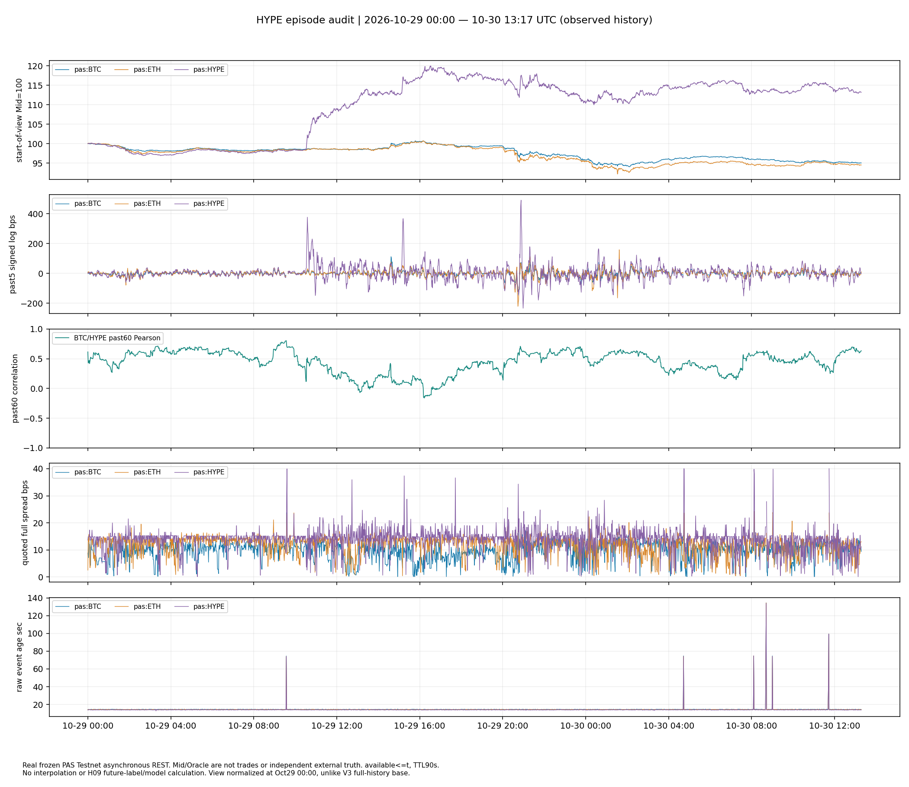

# H09 BTC→HYPE：固定规格历史否证报告

**最终状态：NO_INCREMENTAL_EVIDENCE**

在控制HYPE与ETH过去5分钟收益后，BTC过去5分钟收益没有持续改善HYPE未来15分钟预测。A末段MSE与MAE恶化，三个UTC日期仅一天改善；B末段三个日期均恶化。按冻结规则停止，不计算条件执行收益，不改期限或阈值，不启动H10。

此结论仅适用于本次固定规格与已见短历史，不证明BTC永远没有信息，也不构成已验证Alpha。冻结时间2026-11-05 03:08:13 UTC；全部旧数据早已被观察。

## 1. 先看异常行情



图源：PAS Testnet冻结异步REST L2/Context，2026-10-29 00:00—10-30 13:17 UTC。此图重设区间起点=100，V3截图保留完整历史基点，两者绝对指数不同。所有窗口只用过去数据；无填充、插值，A保留新有效报价产生的零收益；相关性使用过去60分钟至少54个共同有效分钟，非预测相关。价格水平图不跨缺口计算有效收益。

[Chrome V3实际放大截图](chrome-v3-episode.jpg)；V3辅助图仍是minute return，右侧有past5；上面专用PNG第二行才是完整past5曲线，不能把两者混称。

|资产|Mid变化%|Oracle变化%|有效quote/2238|无效分钟收益|spread median/p99 bps|
|---|---:|---:|---:|---:|---:|
|pas:BTC|-4.9517|-4.9403|2236|9|10.413/14.817|
|pas:ETH|-5.4841|-5.4903|2236|9|12.912/17.636|
|pas:HYPE|13.1878|13.2088|2236|9|14.611/23.306|

**直接观察**：HYPE与BTC/ETH区间方向相反；图中既有突发跳升，也有之后的继续调整及回撤，并非单一瞬间跳价，也非单调趋势。10/29 20:49、20:51的HYPE Mid分钟log收益分别179.13、174.44bps，Oracle也同向，事件推进约60秒且有盘口。其他上涨集中在10:33、15:11等时点。缺失/陈旧报价真实存在（每资产2个无效quote、9个无效收益）；不能声称全程数据完美。

**可能解释**：HYPE特有消息、共同PAS定价/Oracle机制、流动性变化均可能；仅此来源不能归因。Oracle没有独立上游事件时钟，Context receipt年龄不等于Oracle真值年龄。L2快照不能确认成交或秒内路径。

**已有证据不支持**：把HYPE仅当BTC高Beta、把同期相关当预测、把事后趋势当事先可识别信号、把Mid涨幅当可实现收益。人工观察也无法单凭此图判断当时能否事前识别持续趋势。

## 2. 固定模型与样本

Baseline=intercept+HYPE past5+ETH past5；Candidate再加BTC past5。目标HYPE未来15分钟有符号log收益。UTC每15分钟锚点，完整[t−5,t+15]价格支持在同一split内；仅开发段拟合，每口径一次。A/B均使用同点共同资格，A-on-B沿用A系数。开发10/20–25，验证10/25–28，末段10/28–30 13:18（半开区间，最后可用网格13:17）。每个评估split三日期，末日仅半天，不能推导足够统计功效。详情见[冻结协议](protocol.md)、[封存哈希](freeze.json)。

输入范围2026-10-19 13:43—10-30 13:17 UTC。as-of available=max(requested,received,stored)≤决策时点；有效quote事件/接收TTL90秒；latest bad不回退。A要求有效相邻分钟、独立新序号和推进事件；B额外要求顶部变化及事件间隔30–90秒。有效新报价零收益保留。REST报价异步，非同步成交。

|口径/段|同点n / UTC日期|MSE skill %|MAE baseline/candidate bps|方向命中 baseline/candidate %|有符号毛诊断 baseline/candidate bps|
|---|---:|---:|---:|---:|---:|
|A/development|473/5|0.00033|22.3485/22.3465|52.22/52.43|2.6321/2.6145|
|A/validation|281/3|0.04186|23.1752/23.1701|53.02/53.02|2.5874/2.5874|
|A/late|235/3|-0.01581|42.2645/42.2708|50.21/50.64|1.8666/1.8975|
|B/development|97/5|0.22303|33.9796/33.9974|52.58/51.55|4.4687/4.5003|
|B/validation|44/3|3.00112|34.8395/34.2212|52.27/52.27|1.6570/3.1828|
|B/late|78/3|-0.77493|62.6844/63.2027|48.72/50.00|-3.3194/-0.3926|
|A_on_B/development|97/5|0.01360|34.2112/34.2055|53.61/54.64|5.4266/5.8425|
|A_on_B/validation|44/3|0.10041|31.2628/31.2422|52.27/52.27|1.6570/1.6570|
|A_on_B/late|78/3|-0.02744|57.4324/57.4482|50.00/50.00|-2.8537/-2.8537|

MSE单位为log-return²，完整原值见[metrics.json](results/metrics.json)。毛诊断=sign(预测)×实际log收益，未扣点差费用、无成交路径，**不是回测或交易收益**。A开发BTC系数约0.01378，新增信息在样本内也极小。没有对另一窗口、方向、阈值、异常剔除或模型进行搜索。

## 3. 缺失与资格选择

|口径/段|全部锚点|过去合格|未来缺失且过去合格|最终同点|
|---|---:|---:|---:|---:|
|A/development|480|477|4|473|
|A/validation|288|285|4|281|
|A/late|246|241|6|235|
|B/development|480|149|52|97|
|B/validation|288|64|20|44|
|B/late|246|105|27|78|

全部2028条A/B锚点均保留，过去合格即输出预测，不按未来资格删信号。B在验证段丢20/64个过去合格标签，末段丢27/105个；未来连续活跃属于事后资格，可能偏向更活跃行情，B不能替代A。A-on-B仍在末段恶化（−0.02744%），不将B验证段+3.00%误当稳健优势。非重叠未来标签数即表中最终同点数，重叠计数0；相邻误差与同日冲击仍可能相关，不当IID样本。逐UTC日配对误差见[daily CSV](results/daily-paired-errors.csv)。

## 4. 唯一BTC冲击描述

阈值为开发段A口径所有过去合格分钟abs(BTC5)的Q90，线性插值=15.241214bps。每split逐分钟扫描，正负共用30分钟冷却；缺标签或控制仍消耗冷却，未来缺失不影响入选。B沿用同一A阈值，按自身过去资格独立扫描。残差相对各自仅开发段拟合的Baseline，不是超额成交收益。

|口径/段/冲击|事件 / 日期|标签缺失 / 控制缺失|目标median / IQR / SD bps|残差median / IQR / SD bps|
|---|---:|---:|---:|---:|
|A/development/positive|59/5|0/0|-3.158/27.848/37.890|-6.013/29.121/38.172|
|A/development/negative|53/5|0/0|-1.907/28.023/34.965|-2.854/31.298/34.621|
|A/validation/positive|33/3|1/0|7.419/38.669/33.461|7.710/37.452/33.200|
|A/validation/negative|32/3|0/0|20.692/42.067/43.644|15.872/39.582/45.709|
|A/late/positive|35/3|1/0|-0.553/67.291/119.364|7.568/72.889/110.838|
|A/late/negative|32/3|1/0|4.642/56.883/64.527|11.724/62.224/63.962|
|B/development/positive|59/5|27/12|-0.477/57.076/48.560|2.378/54.194/54.875|
|B/development/negative|40/5|9/8|1.045/52.457/46.040|3.305/66.215/54.121|
|B/validation/positive|30/3|14/8|13.714/69.711/35.970|20.066/57.843/34.391|
|B/validation/negative|26/3|6/6|18.095/43.785/40.467|14.471/39.607/54.797|
|B/late/positive|31/3|13/4|2.588/144.835/162.612|18.346/124.195/144.461|
|B/late/negative|32/3|8/8|0.287/55.799/68.422|24.752/98.551/74.332|

正负反应的中位数并不稳定地支持同向滞后传导；不按表现选方向。Q05/Q95、有效n及缺失见[event-summary](results/event-summary.json)，全部逐事件见[events.csv](results/events.csv)。最小间隔30分钟，未来15分钟与特征+目标20分钟支持均无重叠；这不证明事件经济独立。所有分布都描述已见历史，不提供p值或盈利推断。

## 5. 新数据单独保留

通过之前已使用的只读PAS公共Reader导出已采集前缀，max_seq=508657，共508657行，十资产最晚available约2026-11-05 03:10:48 UTC。封存SHA256 `1829776f4e25752448215c26de7df45cdff7db7c35c8bf48131a03192cbe6bd0`。输入本地路径见[reserved-data.json](reserved-data.json)。**新于10/30的数据没有计算价格、收益、未来标签或预测，也未并入模型。** BTC/ETH较晚的旧缓存不能充当HYPE新数据。

Reader使用mode=ro/query_only、固定append-only最大序号、短只读查询；reserved manifest中“read transaction”并不表示长时间数据库快照锁。没有修改Collector、重启服务或写数据库。新段覆盖可核对，但尚未做时钟/缺口质量验收，不能仅凭最晚时间就保证干净完整，更不能声称此前所有研究人员都未见过。保留供以后单独授权验证；本轮已因旧数据否证停止。

## 6. 精度、成本与停止

PAS历史metadata seq1（available 2026-10-19 13:43:12.948 UTC）确认HYPE szDecimals=2，数量步长0.01；这不是PAR metadata。历史最小notional、价格tick、实际账户费率、滑点和成交未知。未访问账户以确认tier。9bps/side费用+5bps/side滑点仅延用历史**假设情景**，往返28bps再加真实spread，不能冒充实际费率或利润。

预测门未通过，条件执行收益严格未运行，executable_net_return=null；真实Bid/Ask与L2只用于行情审查。[cost-diagnostic](results/cost-diagnostic.json)明确标记NOT_RUN_PREDICTIVE_GATE_FAILED。

本次结论为NO_INCREMENTAL_EVIDENCE，不能改成COST_REJECTED（尚未进行成本收益计算），也不能以EXECUTION_UNKNOWN掩盖已失败的预测门。不修改生产策略/钱包/授权/仓位/风控，不合并、不部署。

## 7. 复现与审阅

使用仓库已有Python环境，无新增生产依赖。输入大缓存保留本地，PR41 causal panel在父分支可得，原始前缀仅本地保留并以SHA追踪。

```powershell
.venv/Scripts/python.exe docs/research/h09-btc-hype-2026-11/run_h09.py --out .cache/h09-review-reproduction
.venv/Scripts/python.exe docs/research/h09-btc-hype-2026-11/verify_h09.py
```

不要覆盖results或freeze；新的--out必须不存在。`audit_anomaly.py`默认也拒绝覆盖已封存审查。`inventory_local.py`和`reserve_public.py`是采集前缀来源记录，不属于离线复现步骤，不要为了复现重新连接服务器；reserve只读导出现有观测、不是启动采集。

独立50位Decimal正规方程与QR系数最大差4.45e−16；逐条核对47328个旧分钟收益、2028个预测行及只依赖过去BTC的事件选择，冻结与输出哈希通过。没有调参检验。Chrome GPT扩展确认原V3指定区间三资产、corr60、spread/age正常，未使用Edge或原生computer-use技能。

先看三处：10/29约10:30跳升及其后续；20:49–20:52连续冲击与Oracle同步；10/30回撤、corr60及报价年龄异常。它们帮助人工找反证，不是新候选假设或自动后续实验。

项目管理：GitHub Issue #42；独立Draft PR在交付时回链。最终停止，等待人工审阅。
