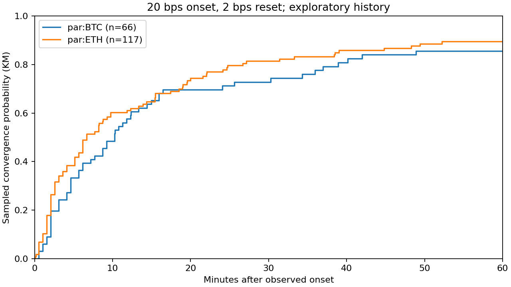
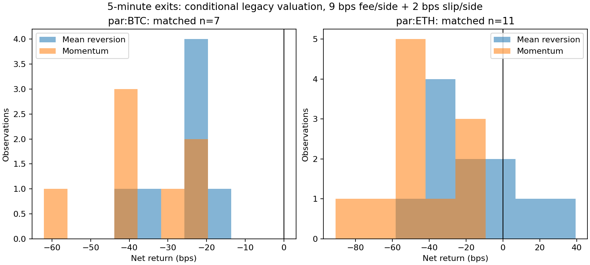

# 十资产 Reference-Basis 研究，2026-10-18

当前没有任何资产获得“成本后正期望已成立”的结论。BTC/ETH 仍有方向关系可继续验证，
但少量同信号、同时间、双方向均满足盘口深度的样本，平均净收益仍为负。
其他八个资产只有几分钟的真实盘口和 Oracle 观察，不能判断长期收敛或盈利能力。
零个完整偏离事件不是“市场不存在机会”的证据。

## 数据与审查

从 main `f2768e7` 审查 Collector、historical catalog/storage/client，
从 PR #13 的 `dee8b1b` 审查并复用 basis_research、convergence、direction、成本模型和测试。
PR #13 尚未合并且 GitHub 报告存在合并冲突；本研究不覆盖其提交或旧报告。
采集改动从 main 独立分支提交，研究改动以 PR #13 分支为基础。
提交前已对齐 main `2d28b15` 与 PR #13 的 `13888e7`，保留并行加入的十资产配置。

完整公开输入已以 gzip 归档，避免仅交付摘要而无法重算：

- `legacy-btc-eth.jsonl.gz`：原冻结 50,050 条真实快照，2026-10-08 至 17 日，主要约 30 秒采样。
- `vps-extension.jsonl.gz`：只读 SQLite 导出的 30,622 条新增记录；BTC/ETH 各 15,015 条，
  其余八市场各 74 条。导出不改表、不热复制 SQLite 文件、不停止 writer。
- `ten-asset-probe.jsonl.gz`：本地约 180 秒十资产 WebSocket 观察，共 2,061 条关联记录，含无效接收偏差行。
- `metadata.json`：本次真实官方 `meta` 响应，各市场数量精度独立解析。
- `official-history.json`：十资产各 241 条小时资金费和 10 条近期成交，已去除参与者地址字段。

VPS 最初只读检查仍为 BTC/ETH、5 秒配置；工作期间再次检查，远端已被外部改为十资产，
新增八市场记录也因此进入导出。本次没有修改、重启或部署 VPS。新增短历史不能误写成八市场长期历史。

多个输入若没有连接 ID，按输入文件视为独立连续性域；本地流与 VPS 在时间上交错时，中断连续性，
不把两份不同步来源拼成一条可交易路径。真实连接 ID 也会切断前后路径。
主质量统计包含不同采样频率，不能直接横比快照出现比例；事件率同时报告连续有效小时分母和包含缺口的总跨度。

## 逐资产比较

下面固定展示 20 bps 触发、±2 bps 重置；这是沿用的研究网格，不是挑选出的最佳参数。
收敛列为全事件 10 分钟 Kaplan–Meier 概率；收益列为下一报价开仓后五分钟、两方向均有足量盘口的严格配对样本。
“可入场”仅指原方向下一报价通过模拟检查；它和五分钟配对样本不是同一分母。
所有收益、成本和 MAE 均以 bps 计。

| 资产 | 有效行 | 事件 | 可入场 | 10m收敛 | 5m配对数 | 毛收益 | 净收益 | 成本 | 反方向净收益 | MAE中位 | 数据可信度 |
|---|---:|---:|---:|---:|---:|---:|---:|---:|---:|---:|---|
| BTC | 40,148 | 66 | 13 | 48.5% | 7 | -4.14 | -26.17 | 22.04 | -37.71 | -28.11 | 探索历史，估值条件情景 |
| ETH | 40,133 | 117 | 20 | 60.2% | 11 | +8.15 | -13.92 | 22.08 | -45.71 | -28.60 | 探索历史，估值条件情景 |
| HYPE | 177 | 0 | — | — | — | — | — | — | — | — | 短观察；估值未验证 |
| SP500 | 177 | 0 | — | — | — | — | — | — | — | — | 短观察；估值/参考源时效未验证 |
| EWY | 177 | 0 | — | — | — | — | — | — | — | — | 同上 |
| EWJ | 177 | 0 | — | — | — | — | — | — | — | — | 同上 |
| BRENT | 177 | 0 | — | — | — | — | — | — | — | — | 同上 |
| GOLD | 177 | 0 | — | — | — | — | — | — | — | — | 同上 |
| USDEUR | 178 | 0 | — | — | — | — | — | — | — | — | 短观察；USD/EUR 口径、估值未验证 |
| USDJPY | 178 | 0 | — | — | — | — | — | — | — | — | 短观察；JPY/USD 口径、估值未验证 |

完整数字见 [comparison.csv](comparison.csv)。逐资产 JSON 保存质量、Basis 分布、事件率和 20 bps 主规格概率表；完整网格保留在压缩 evidence，含
首次收敛时间、中位时间、仅已收敛者均值、删失数量和限制平均等待时间，不能混淆这些时间统计。
`*-evidence.json.gz` 保存全部事件、方向观察、资产/方向/日期组和敏感性结果，可直接逐条检查。

## 方法与估值约束

复用 PR #13 的首次到达时间、事件去重、右删失和配对方向回放，不接入在线策略。
10/20/50 bps 触发、±2/5 bps 重置、1/3/5/10/30/60 分钟窗口，未因利润结果修改网格。
先观察到回到内圈才能生成新偏离；连续快照不被当成独立机会。缺口、无效行、连接变化均中断跟踪。
延迟入场在下一有效观察重新检查信号，未来平仓使用各自正确 bid/ask，反向收益不是原收益取负。
顶部盘口足量检查较保守：超过顶层深度就拒绝，未声称能扫完整多层盘口或保证 IOC 成交。

资产无关入口默认关闭所有未经独立估值审查的 PnL，只输出价格关系和收敛结果。
`szDecimals` 能证明数量步长，不能单独证明合约乘数、计价币种或结算换算。
未来只能通过逐市场 valuation evidence 文件开启已核对的 `linear_quote` 模型和正乘数；不支持的逆向/其他估值继续关闭。
数量按该市场 metadata 步长向下取整；非整数报价校验 5 位有效数字与 `6-szDecimals` 小数限制。
价格规则失败的观察仍可用于描述价格关系，但不能成为可执行入场或退出。
底层引擎也禁止其他市场默认沿用 BTC/ETH 的步长和启用状态。

上表 BTC/ETH 特意用 `--legacy-btc-eth-scenario` 复现旧线性单位假设，标记为 **条件情景**，
没有升级为“可靠 PnL 已验证”。每笔约 100 USDPR 名义值、单边 9 bps 手续费、单边 2 bps 额外滑点，
实际盘口价差已经包含在毛收益内；基础/双倍成本情景均归档。
资金费主结果采用绝对小时费率累计的压力扣减，另列官方历史费率符号现金流估算；
后者使用本地 Oracle 估计结算基数，不是账户实际资金费账本。
历史交易规则和账户费率没有完整重建，metadata 捕获时间不能回填成过去已知信息。

除了逐市场、Long/Short、日期和 UTC 六小时时段，新增固定的过去五分钟波动率分组：
平方收益和除以有效分钟后开方，单位 bps/√分钟，预设 10 为高低界限；排除信号与未来报价，
过去不足四分钟或少于三个观察时记 unknown。周末/工作日仅是 UTC 标签，不冒充交易所节假日日历。
`stratified` 保存所有分组，包括空组；没有据此选择最赚钱的阈值或止盈止损。

## 数据质量与官方历史边界

各资产 JSON 包含：来源行数、有效行、实际间隔、连续小时、缺口诊断、5 秒接收网格、重复盘口时间、
过期盘口、上下文缺失、两侧层数/顶部深度和 Basis 分布。旧约 30 秒采样的 5 秒网格天然稀疏，
它不是历史服务丢包率。BTC/ETH 老输入未保存 mark，因此仅按可成交报价评估 MAE，不能推导保证金强平风险。

本地 WebSocket 默认最多 10 秒年龄、2 秒两路接收偏差；约一半关联观察被标记为偏差过大。
无效行及其原始盘口仍归档，不能删掉后跨越它们计算“连续回本”。旧 VPS 记录的时效门槛沿用 90 秒，
两种来源的质量语义不同，完整诊断保留了这种差异。

官方 `activeAssetCtx` 没有 Oracle 上游源时间。刚收到上下文不代表源报价刚更新。
尤其本次为周末，FX、ETF、股指及商品的参考市场状态不能由“测试网 24/7 交易”推断。
USDEUR 实际跟踪 EUR/USD，USDJPY 报价是 JPY/USD；不擅自把两者等同 USD 合约估值。

十资产资金费可拉取，近期成交也可拉取，但它们不是完整历史盘口/Oracle 对。
本次匿名 S3 HEAD 探测结果见 official-history 的 archive_probe；403 只代表无权访问，不能断言档案不存在或覆盖 testnet/par。
没有付费下载、使用 AWS 凭据或用 K 线重建盘口。

## 三层结论

**方向预测力：** 固定五分钟、下一报价起算的全部可观察信号中，BTC 原方向命中率 72.7%（66 个）、
ETH 65.5%（116 个），含未变化样本作为分母。相关性、Oracle/Basis 贡献、按日期稳定性和极端收益敏感性均归档。
这属于探索关系，不能据此称为可交易优势。

**可交易性：** 原方向的 33 次入场模拟只剩 18 个五分钟严格配对观察。
BTC 连毛收益均值也为负；ETH 毛收益为正但低于约 22 bps 成本。两市场反方向均更差。
MAE/MFE 和净回本/净盈利首次到达概率均有记录，但没有据此优化止盈止损，也没有模拟真实保证金账本。

**正期望：** 当前未证明。样本小、时间相关、采样频率变化、未知 Oracle 源时效和条件估值都限制结论。
BTC/ETH 值得保留为“方向与执行成本为何脱节”的研究对象，不支持启用当前单腿策略。
其他八市场先积累跨多个完整参考市场交易周期的数据，并核实估值与参考源时效；此时无法按盈利能力排序。
包括新增时间段在内，本报告全部标记为探索数据；不把半段切分、日期组或新增文件包装成干净样本外验证。
应另冻结未来的未观察区间，事先登记退出与成本规则后再验证。





## 复现

在研究分支仓库根目录，用当前项目 Python 环境执行以下命令（单行）：

```powershell
python -m perpetual_alpha.multi_asset_basis docs/research/multi-asset-2026-10-18/legacy-btc-eth.jsonl.gz docs/research/multi-asset-2026-10-18/vps-extension.jsonl.gz docs/research/multi-asset-2026-10-18/ten-asset-probe.jsonl.gz --metadata docs/research/multi-asset-2026-10-18/metadata.json --official docs/research/multi-asset-2026-10-18/official-history.json --legacy-btc-eth-scenario --output reports/multi-asset.json --bootstrap-repeats 200
python scripts/archive_multi_asset_basis.py reports/multi-asset.json --output reports/multi-asset-archive --plot
python -m unittest discover -s tests -p test_multi_asset_basis.py
```

输出目录需先存在。绘图使用 `config/requirements-research.txt` 的可选依赖，统计本身仅标准库。
summary 保存输入及方法源码 SHA256，manifest 保存归档文件哈希（gzip/PNG 按字节；文本与源码统一 LF 后计算，兼容 Windows/Linux）。输入路径不同只改变路径键，不改变对应哈希或统计结果。
本地研究相关与架构/接口回归测试通过；采集测试另属独立 PR。没有订单、策略启用、合并或远端部署。

官方依据：[比赛单位、精度和费用](https://perpetual-alpha26.github.io/docs/)、
[WebSocket 数据定义](https://hyperliquid.gitbook.io/hyperliquid-docs/for-developers/api/websocket/subscriptions)、
[历史数据边界](https://hyperliquid.gitbook.io/hyperliquid-docs/for-developers/api/historical-data)，核对于 2026-10-18。
