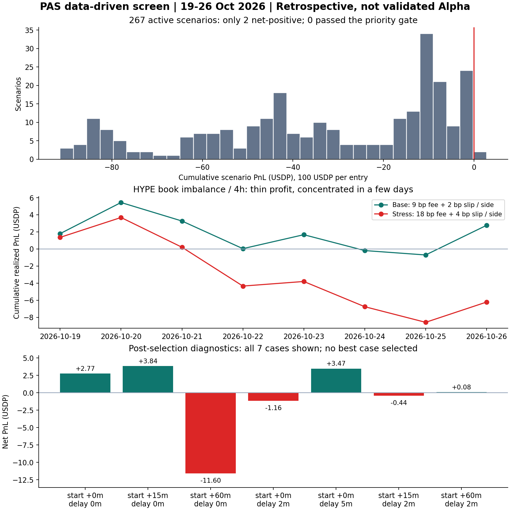

# PAS 第一周数据驱动 Alpha 筛查

研究日期：2026-10-26。结论：**在本次固定的12类简单规则中，没有发现通过稳健性门槛的 Alpha；发现一条较弱的 HYPE 盘口线索，但敏感性复核未通过。** 这不等于证明所有数据驱动方法都无效，也不是对全部可能特征的穷举。

本次实际完成了数据冻结、离线筛查、成本与资金费核算、时间分段和逐笔验证。没有修改 VPS 服务、授权、生产策略或订单。



## 1. 数据与方法

VPS PAS 原始观察库的一致前缀，捕获于 **2026-10-26 20:24:06 UTC/GMT**，最大 seq 224063。所有研究离线执行，原始响应哈希逐条验证。当地日期包含英国10月25日夏令时切换，所有切分统一UTC。

- 原始记录：105,068 book、105,070 context、10,507 metadata-context、3,390 Funding查询响应及28条request-error。
- 分钟研究网格：10-19 13:44 至10-26 20:23 UTC，共10,480点；各资产10,459有效、21缺失。不用插值补洞。
- 十资产都做特征诊断；USDJPY报价换算与合约估值未独立核验，不报其USDP策略损益。
- 九资产 × 12规则 × 3持有期 = 324行。BTC领先规则只适用ETH/HYPE，部分阈值从未触发；实际267行有交易。
- 31,868条情景交易记录来自相互替代的规则实验，**不是账户实际成交，也不是31,868个独立样本**。

在查看本轮结果前写下[固定方案](../alpha-screen-protocol.zh-CN.md)。开发段至10-23 00:00，验证段10-23至10-24，审计段10-24至快照终点。各段独立空仓起步；最后四小时不新开仓。

本周市场走势及旧研究此前已被查看，本轮分段只是回顾性时间隔离，不冒称真正样本外。没有用本次后段结果改阈值或选择持有期。

## 2. 具体测了什么

12条规则：5/60/240分钟动量、60分钟均值回归、20/50bps参考价偏离回归、已结算Funding方向、已收到context Funding方向、前五档盘口不平衡、5分钟oracle变动、BTC领先ETH/HYPE、60分钟标准化突破。

每条持有30/60/240分钟。信号按实际可得时间形成，只能用之后event time确实前进的book模拟进场。一次100 USDP目标名义、数量向零按metadata步长取整，至少10名义，进出均检查实际可见最优档深度，同一组合不重叠持仓。

基础成本每边9bps taker+2bps额外滑点，另付真实买卖价差；压力每边18+4bps。Funding按首次收到的历史结算事件去重，用结算时仓位和此前可得oracle估算，未将预测费率当实际支付。本次成交所需的Funding/oracle均完整；结算估值仍是采样代理，不是账户实际到账对账。

官方费用及小时资金费规则见[比赛说明](https://perpetual-alpha26.github.io/docs/)。这里只模拟足量taker，不模拟排队、部分成交、清算、冲击和真实保证金。固定100 USDP名义的累计损益不是十万账户收益率。

## 3. 总体结果

|口径|全段为正的组合数|
|---|---:|
|中间价价格毛收益，不含Funding|111|
|中间价价格收益+Funding，不计交易摩擦|129|
|实际买卖touch价格+Funding，不计手续费/额外滑点|25|
|加基础手续费与滑点后|2|
|通过预设样本、后段、方向对照、成本压力门槛|0|

267个有交易组合中265个成本后为负；另外57个无交易，不当作盈利策略。上述组合相互相关，不能把129个毛正值看作129份独立Alpha。价差和费用确实吞掉大量弱信号，但也有许多组合价格毛收益本就负，不能把失败全归因于收费。

|规则族|有交易组合|基础成本后正值|
|---|---:|---:|
|5/60/240分钟动量|81|0|
|60分钟均值回归/突破|54|0|
|20bps参考价回归|18|1|
|50bps参考价回归|0|0|
|Funding两种方向规则|54|0|
|盘口不平衡|27|1|
|oracle短期变化|27|0|
|BTC领先ETH/HYPE|6|0|

Funding行测试的是固定期限退出后再入场的方向情景，会产生换手；它不等于线上每12小时观察、同方向继续持有的Funding-LAST执行方式，本次不能用这一行宣称完整否定线上基线。

## 4. 唯一跨三个分段为正的线索：HYPE盘口不平衡/4小时

规则：前五档bid数量总和B、ask数量总和A，不平衡=(B-A)/(B+A)。绝对值至少0.2时，同向开仓，持有4小时。原阈值和期限来自固定方案，不是本次看到盈利后选择。

|区间|笔数|基础净损益USDP|压力净损益USDP|
|---|---:|---:|---:|
|开发段|20|+0.0382|-4.3391|
|验证段|5|+1.6316|+0.5357|
|审计段|16|+1.0969|-2.4087|
|合计|41|**+2.7667**|**-6.2121**|

平均每笔净约6.78bps，胜率56.1%；最差单笔-2.1348 USDP。33笔多头净-1.4544，8笔空头净+4.2212；这不是持续稳定地从两侧获利。

分解：价格mid毛收益+13.5711，价差成本2.6201、额外滑点1.6325、手续费7.3463、Funding+0.7946，净+2.7667。薄收益并非无成本盈利。

相同进出时间、相同数量且双向深度均支持的38笔配对样本：策略+2.4149，固定多头-7.8250、固定空头-13.8156。它有一定择时描述线索；但验证段4笔可配对样本全部多头，与固定多头完全相同，没有独立增量证据。

### 为什么没有将它列为可用Alpha

- 8个UTC日期中4正4负；去掉10-20或10-26任一天，累计净值均转负。
- 去掉表现最好的3笔，净值变为-1.1546 USDP；不是仅靠一笔，但仍依赖少数收益。
- 未调整多重筛选前，按日符号翻转的探索性单侧p=0.375；303个有效规则域组合Bonferroni调整后为1。独立/对称日损益假设也未得到验证，不作显著性声明。
- 不重叠4小时点的盘口特征与未来mid收益相关在开发段约0.098、审计段0.048；一日验证段的高相关只有5个点，不具有稳定证据。
- 基础成本之上只需每边再增加约数个bps，就足以耗尽平均利润，压力情景已明显为负。

## 5. 看到弱线索后的敏感性复核

以下明确为**选中HYPE之后新增的诊断**，不是独立验证；全部七种情况披露，不从中选择新赢家。每个时间段的开始分别顺延0/15/60分钟；额外延迟0/2/5分钟，只改变观察/执行时点，不优化阈值。

|段起点顺延|额外入场延迟|交易数|基础净损益USDP|
|---:|---:|---:|---:|
|0分钟|0分钟|41|+2.7667|
|15分钟|0分钟|41|+3.8445|
|60分钟|0分钟|41|-11.5974|
|0分钟|2分钟|41|-1.1587|
|0分钟|5分钟|40|+3.4706|
|15分钟|2分钟|41|-0.4435|
|60分钟|2分钟|41|+0.0777|

所有七种情况压力成本后均为负。5分钟延迟全段为正，也不能掩盖其验证段为负；不是延迟越大收益必然越差，而是本周结果对4小时交易时钟和少量进出点高度敏感。这不支持现在投入实盘或增大预算。

## 6. 第二条正值及旧赢家如何失效

BTC 20bps参考价回归、持有4小时：全段只有4笔，基础净+0.3594 USDP、压力-0.5164；开发/验证/审计分别+0.1195/-0.1984/+0.4383。配对方向对照超额为0，样本过少，不列为Alpha候选。

开发段靠前的几个结果也未持续：

|资产/规则/持有期|开发净损益|验证净损益|审计净损益|
|---|---:|---:|---:|
|BTC 240分钟动量/4h|+0.7630|-0.6728|-2.9885|
|EWY context Funding方向/4h|+0.7020|-0.8641|-6.1880|
|HYPE均值回归/4h|+0.4991|+0.9402|-8.1830|
|EWY标准化突破/4h|+0.2238|-0.9448|-6.0747|

因此“在前三天找到最赚钱的规则，再让Agent选它”目前也缺乏延续性依据。

## 7. 对下一步的建议

当前最合理的定位是：**有微弱可描述结构，但没有经验证、可直接交给Agent交易的Alpha。** 固定这次失败结果，不继续在同一周调整阈值救回HYPE。

保留HYPE盘口线索作未来shadow观察即可；更值得增加的是数据辨识能力：外部主市场到PAS的实际到达延迟、独立上游价格与本地偏离、盘口变化而非单次静态不平衡。现有分钟采样不能重建队列、逐笔冲击或秒级领先，不能在本数据上假装完成这些策略回测。

若以后研究更少换手的Funding/趋势持仓或maker执行，需要独立协议和真实执行证据。把taker费率直接改成maker、假设每个挂单都成交，会制造虚假Alpha。

Agent先接这些结果的审计与研究工作，而不是把没有成本余量的信号包装成高置信度交易概率。

## 8. 产物、复现及验证

- [全324组合与时间分段JSON](results.json)、[完整比较CSV](scenarios.csv)、[逐笔压缩账本](trades.jsonl.gz)。
- [后续敏感性、集中度与族统计](diagnostics.json)。
- [图PNG](screen-summary.png)、[独立图PDF](screen-summary.pdf)。
- 原始快照在本地 `.cache/alpha-week-2026-10-26/pas-prefix.jsonl.gz`，24,493,406字节，SHA256 `4baa71116daed70cbca25fa7179cf39f84ee555f7d1900079d87820efbf70a14`，不提交原始数据库或账户资料。
- 源码：`scripts/study_pas_weekly_alpha.py`、`validate_pas_weekly_alpha.py`、`diagnose_pas_weekly_alpha.py`、`plot_pas_weekly_alpha.py`。主结果记录方案与运行源码哈希。

从项目根目录：

```powershell
.\.venv\Scripts\python.exe scripts/study_pas_weekly_alpha.py .cache/alpha-week-2026-10-26/pas-prefix.jsonl.gz --output docs/research/weekly-synthesis-2026-10-26/alpha-screen
.\.venv\Scripts\python.exe scripts/validate_pas_weekly_alpha.py
.\.venv\Scripts\python.exe scripts/diagnose_pas_weekly_alpha.py
```

验证：因果前缀、未来资金费不进入过去信号、新book event/深度准入、买卖成本符号测试通过；31,868笔逐笔用Decimal独立重算费用和净损益，与原始book深度、数量步长、100名义上限核对，确认无重叠持仓；全部324结果在源码整理后重跑逐字段一致。新增研究源码Ruff通过，图已目视检查。未运行生产全量回归，因为未改任何生产模块；合成测试和账本核算不能替代真实交易执行验证。
