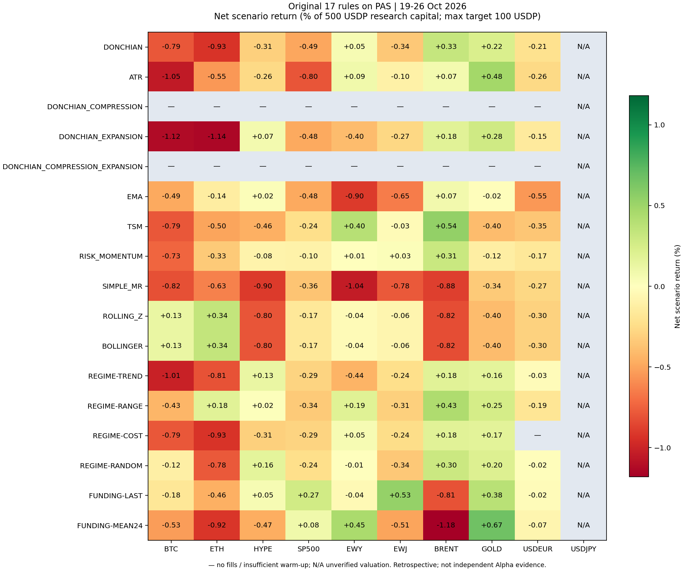
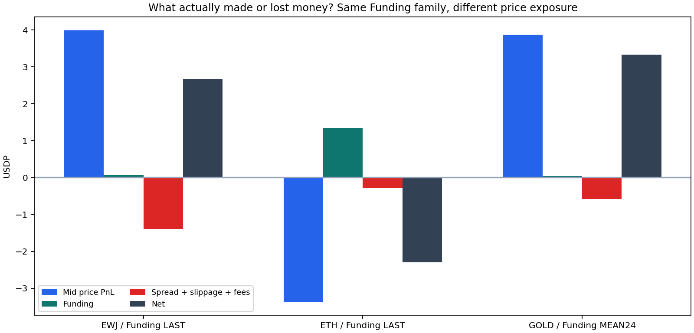

# 原17个传统算法：PAS这一周复测与研究入口

本轮重跑的是PR15中原来的17个单资产传统算法，**不是上一轮12个分钟规则**。结果：小额盘口情景153个“算法×资产”里41个全周净正、28个压力成本后仍净正；但交易数很少、部分结果不延续、存在等价算法与随机对照，不能据此宣称41个Alpha。

全17逐项结果见 [算法表](all17.zh-CN.md)，每个资产的数值、时间分段、规模和成本情景见 [comparison.csv](comparison.csv)。



## 1. 这次与上一轮的区别

|项目|上一轮|本轮|
|---|---|---|
|规则来源|12个预设分钟级筛查规则|PR15冻结的原17算法|
|输入尺度|分钟特征|采样小时OHLC/已知Funding|
|主要持有期|30分钟、1小时、4小时|原设12小时；Z回归允许提前退出，Funding按12小时目标持续持有|
|参数|另写的固定阈值|原lookback24、compression168、原仓位尺度不改|
|结果|2个全段净正|小额盘口41个全段净正|

两轮结果不矛盾：规则、频率、换手及持仓生命周期不同。本轮Funding没有强制每12小时平仓再重开；同方向目标变化低于最小成交额时保留原仓。

## 2. 数据及方法边界

沿用已冻结PAS快照SHA256 `4baa71116daed70cbca25fa7179cf39f84ee555f7d1900079d87820efbf70a14`。完整小时范围约10-19 14:00至10-26 20:00 UTC，首个bar close 10-19 15:00，比较窗口终点10-26 20:00。每资产173根合格小时样本；**10-26 02:00–03:00 UTC有约22分钟内部缺口，该小时不造bar**，会影响后续连续预热。

这些OHLC是实际可得盘口mid的小时采样开高低收，不是真实交易所成交K线，不能重建分钟内极值。ATR、通道等的高低价输入因此也只是采样代理。未拿外部或PAR价格补齐。USDJPY保留17算法信号，但美元估值未核实，未给它编造USDP收益。

原代码源是 [PR15](https://github.com/BouillieAnonymous/Perpetual-Alpha-2026/pull/15) commit `6832145603b2bbd305fbbd91377d16538ecb5951`。signals/relative/replay为字节复制，orders_for及Bar为最小依赖抽取；已与原函数核对非Funding信号逐项相等。Funding调用原函数，但只向它提供决策时已实际收到的结算费率，防止用未来接收数据。

本轮[固定方案](../traditional17-protocol.zh-CN.md)在结果查看前保存。全部历史已被看过，所有分段均为回顾性检查，不是干净的样本外。

## 3. 两种执行情景，不混成一张收益表

**原小时价格情景：**研究资本10000、目标上限2000，延迟一小时，用下一小时采样open+原固定价差/滑点。保留原算法/旧方法的可比性，但不具备历史逐笔成交证明。Funding用旧引擎的事前close估值代理。

**补充盘口情景：**同一信号延迟一小时，在90秒内首条新鲜book尝试，按实际bid/ask、最优档深度和数量步长模拟足量成交。研究资本10000和500都跑；后者目标上限100。每边手续费9bps、额外滑点2bps，压力18+4bps；不假定maker成交。退出深度不足或资金费估值缺失时标为unknown。资金费按真实结算时刻和此前可得oracle估算。

官方费用/最小订单/结算规则核对自[参与指南](https://perpetual-alpha26.github.io/docs/)。实际成交、部分成交、保证金、清算和机器人行为仍未复现，盘口情景也不能称真实可执行收益已被证明。

|全周口径，只含原17算法×9个可估值资产|净正|有成交|不完整|
|---|---:|---:|---:|
|原小时价格/base/资本10000|14|134|93|
|盘口/base/资本10000，目标≤2000|20|97|43|
|盘口/base/资本500，目标≤100|41|134|0|
|盘口/stress/资本500|28|134|0|

小时价格情景的许多不完整记录与缺失小时造成的mark/Funding估值缺失有关，不能将unknown当0或将其正负已知分量当完整收益。大额盘口在本轮“仅最优档、一次尝试”的保守条件下，有较多入场/退出深度不足；这不是交易所禁止大单，而是本模型未模拟扫多档和部分成交，**不能把小额盈利线性放大20倍**。

小额41个正值包含3个随机过滤对照，以及2个与ROLLING_Z重复的BOLLINGER正值。这些不是独立发现。全17表也保留了两条compression规则的预热不足，以及REGIME-COST在一个资产上无成交。

## 4. 几个值得看清的结果

下列都是资本500、目标≤100的独立情景损益，不是比赛十万账户收益。

|资产/算法|全周基础净USDP|压力净USDP|平仓/减仓片段数|主要观察|
|---|---:|---:|---:|---|
|GOLD/FUNDING-MEAN24|+3.3305|+2.8945|2|全周最靠前，但只有2次开仓，不能估稳定性|
|BRENT/TSM|+2.7027|+1.6054|5|三段都正，有择时线索，但样本仍小|
|EWJ/FUNDING-LAST|+2.6720|+1.5729|5|前段赚、审计段亏；主要赚价格，不是资金费|
|GOLD/ATR|+2.3831|+1.2884|5|略低于该资产固定空头的全周净损益|
|EWY/FUNDING-MEAN24|+2.2362|+2.0192|1|只有1次开仓，后两段均亏|
|ETH/ROLLING_Z|+1.6925|+0.3746|6|同时间方向对照有增量，但一日验证无交易|
|ETH/FUNDING-LAST|-2.3042|负|1|资金费收入不足以抵消多头价格亏损|

减仓片段与独立开仓并非同一概念；独立次数见 [episode-counts.json](episode-counts.json)。例如反向一次成交可以同时平旧仓和开新仓，所以成交笔数也不等于回合数。

### BRENT趋势：值得观察，尚不足确认

TSM开发/验证/审计分别净+1.3219/+1.2707/+0.1102 USDP，对应1/1/3个平仓片段。全周压力仍正。

固定多头全周+3.4284，似乎比TSM的+2.7027好。但固定多头持续暴露，而TSM平均名义敞口只有研究资本约5.98%，不能只用两个最终金额断定谁有信息优势。

因此又对**全部41个正值**追加同信号时间、同绝对目标权重的固定多/空诊断，不只挑BRENT。TSM对应+2.7027，对照多头-1.0668、空头-3.5085，显示这批入场时段内方向选择可能有信息。这仍有局限：原TSM有一次深度拒绝，对照多头没有，双方成交路径不完全相同；不能把差额直接当已识别Alpha。

### EWJ资金费：策略名称不等于收益来源

EWJ/Funding-LAST的分解为：

```text
价格mid损益       +3.9877
Funding现金流    +0.0731
价差+滑点        -0.4895
手续费           -0.8992
净损益           +2.6720 USDP
```

它几乎主要靠方向交易赚钱。开发/验证/审计分别+2.5552/+0.0238/-0.8819，后段没有延续。因此值得问“Funding的变化是否有价格预测信息”，不能直接得出“收Funding是Alpha”。

### ETH均值回归：不是纯固定空头，但证据仍少

ETH/ROLLING_Z净+1.6925，固定空头全周+1.7426；后者暴露时间不同。相同信号时间的方向控制，多头-1.5457、空头-1.7874，而回归规则为正，表明它在这些时段的方向选择值得研究。双方均12笔模拟成交、无深度拒绝，比BRENT的配对更接近。

但是它只有6次开仓，开发段+0.2051、验证日0成交、审计段+1.8573，无法宣称跨多个独立事件稳定。BOLLINGER与它完全等价，不是第二条证据。



## 5. 对照与预热的重要发现

- 41个全周正值中，有21行在追加的相同目标时点方向对照中超过较好一侧；含重复规则，全部事后检验，未经独立验证或多重筛选校正。
- 只有BRENT/TSM、BRENT/RISK_MOMENTUM、GOLD/DONCHIAN_EXPANSION在三个独立起步段都净正；它们各段成交片段约1–3个，不足以确认。
- 两条compression规则需要约195根小时样本才能满足原压缩历史要求，本周173根且有中断，故不触发。没有以缩短168小时参数换取信号。
- SIMPLE_MR这次九资产都为负，说明“上一小时涨就反向做、原12小时持有”的规则本周不支持；不等于所有均值回归无效，ETH的标准化偏离规则就是不同假设。
- Random过滤也有3个资产盈利，提醒我们在短样本和众多组合中，看到正收益很容易，正收益不是Alpha证明。

## 6. 带着研究：先从一个能回答清楚的问题开始

建议以EWJ Funding为第一例，详见[一起研究Alpha](research-walkthrough.zh-CN.md)。顺序不是继续找更好参数，而是：

1. **看事实：**发生了哪些信号、当时知道什么、实际模拟成交哪些。
2. **看来源：**收益来自价格、Funding还是低成本；分别拆账。
3. **看基准：**与不交易、简单持仓、相同时间同敞口方向对照分别比较；理解各自回答的问题。
4. **看延续：**是否只在一天或一两笔赚钱；后段没有交易时不算验证通过。
5. **写一个新假设：**例如Funding符号变化是否包含超过过去价格动量的信息，先定义特征和未来响应，再决定是否值得构造策略。
6. **冻结并等待未来：**本周作为开发案例保留，未来新数据检验；不要在这周不停调参直到变绿。

## 7. 产物和验证

- [完整结果JSON](results.json)、[比较CSV](comparison.csv)、[原始信号](signals.jsonl.gz)、[成交/结算账本](book-ledgers.jsonl.gz)、[采样小时输入](sampled-bars.json)。
- [17规则中文表](all17.zh-CN.md)、[追加方向对照](direction-controls.json)、[独立开仓计数](episode-counts.json)、[冻结代码来源](frozen-source-manifest.json)。
- [热图PNG](all17-heatmap.png)、[热图PDF](all17-heatmap.pdf)。
- 为避免把约1491万个分钟权益点塞进Git，完整轨迹留在本地缓存；交付账本保留全部成交、交易、Funding、摘要和每小时末权益。最大回撤仍从原分钟轨迹计算；[压缩说明与双份哈希](compact-manifest.json)记录变换，没有改变任何收益值。

验证通过：非Funding原函数逐项相等、未来前缀不改过去信号、晚收到的Funding不提前使用、成交延迟与退出深度失败保持unknown；2880个含基准盘口情景、6748笔模拟成交逐项核算Decimal费用/摩擦、原始盘口价格/深度、数量步长/名义上限与平仓账本；新增runner/validator/分析/绘图Ruff通过。全周小额ROLLING_Z/BOLLINGER保持等价。未运行生产全量测试，因为未改运行时模块；没有VPS操作、授权改变或下单。

复现入口为项目根目录的 `scripts/study_pas_traditional17.py`，只用原已冻结数据和本目录frozen17离线函数。脚本拒绝覆盖已有results.json；要复跑应先保留本轮输出，并使用单独实验目录/副本，不覆盖现有研究。原始大文件在.cache，不提交钱包、账户或行情数据库。
