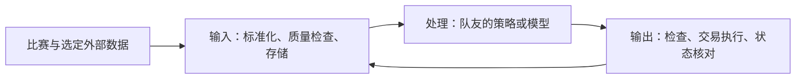

# Perpetual Alpha 2026｜系统接口与部署

更新：2026 年 10 月 8 日（英国时间）。本文件集中维护架构、接口、成本与风险检查、运行环境和部署验收。购买、安装工具与部署程序分别验收，不混为“环境全部就绪”。

## 1. 当前状态

最新 OVH 控制台截图确认 VPS 为 **Active**，系统显示 Ubuntu 26.04，型号 VPS-1 2027，2 vCore、4 GB 内存、40 GB 存储，区域 `os-uk2`，位置显示 London (UK)。公网 IPv4 为 `57.129.179.248`，主机名为 `vps-a6c918ff.vps.ovh.net`。这确认服务器已开通，尚不代表程序部署完成。

10 月 8 日已登录并完成首次强制密码更换，已授权本机现有 Ed25519 公钥，独立会话验证密钥登录成功。主机密钥记录于本地 .cache/ovh-known-hosts；新密码仅保存在本地受限且忽略的文件中，不写入本文。

| 检查项 | 实际检查结果 |
|---|---|
| 本地系统 | WSL2 Ubuntu 26.04 LTS |
| Python | 系统 Python 3.14.4；仓库声明 `>=3.11,<3.14`，版本尚未对齐 |
| Git / SSH | 本地 Git 2.53.0；服务器 ubuntu 密钥登录已验证 |
| Docker / Compose | 在 Ubuntu 内执行失败，提示启用 Docker Desktop 的 WSL 集成；尚不可认定可用 |
| 代码 | 已增加初始化脚本、只读诊断脚本和 Compose；完整采集与交易程序待开发 |
| 服务器 | Ubuntu 26.04 x86_64、2 CPU、约 3.7 GiB 内存、38 GiB 根盘；NTP 同步；Docker 29.8.2、Compose 5.6.0 已安装 |

旧代码固定 BTC、10% 仓位和亏损限制，不代表已经确定的策略与风险参数。后续需要参数化，现阶段未修改。

## 2. 服务器配置

价格、备份与合同来自用户提供的信息；系统与资源已登录核实。不以此表保证供应商备份保留或当前在售套餐条款。

| 项目 | 已提供的信息 |
|---|---|
| 供应商 / 套餐 | OVHcloud VPS-1 2027 |
| 地点 | 最新控制台显示 London (UK)，区域 os-uk2；此前购买方案称 Erith，具体机房未独立核实 |
| CPU | 2 vCore，共享虚拟 CPU |
| 内存 / 存储 | 4 GB / 40 GB NVMe SSD |
| 网络 | 标称 500 Mbps；不代表到比赛接口的延迟 |
| 价格 | 未税 £3.90，按 20% VAT 估算含税 £4.68／月；以账单为准 |
| 合同 / 备份 | No commitment、标准自动备份；保留与取消条款待核对 |
| 系统 | 已登录确认 Ubuntu 26.04 LTS x86_64 |

服务器用于持续行情采集、轻量信号计算、交易执行与监控。预计适合初始轻量工作负载，实际 CPU、内存、磁盘增长与网络稳定性需要测量。外部 LLM API 调用也需检查内存、并发和费用；不保证任意模型或多个进程一定可用。不在此机器上安排大型训练或大规模回测。

## 3. 分工与三段框架

**我负责输入端、统一数据格式、交易输出、基础检查与部署；队友负责策略研究，可以探索 Agent 或强化学习。**队友具体算法和可投入时间待确认；周日继续讨论接口与交付，不再默认让队友主导基础工程。



- 输入：行情、盘口、新闻和账户分别定义记录类型，共享来源、资产、事件时间、接收时间与有效性；保留原始数据。不提前接入所有可能来源。
- 处理：返回目标仓位或定义明确的动作，包含信号 ID、生成时间、有效期、策略版本与原因。接口语义双方共同确认，输出端不猜测买卖动作的含义。
- 输出：拒绝过期或重复信号，检查行情与账户状态、数量和价格规则、交易额度、价差与滑点；处理下单、撤单、拒单和部分成交。超时先查状态，真实仓位以接口为准。

执行端可以估算成本，未来收益需要策略提供预测期限和估计。首版先做成本估算与基础限制；有可信预测后再接“收益覆盖成本”的开仓门槛。减少风险的退出不受盈利门槛阻拦，但仍要检查执行结果。

目标模块包括入口与运行、配置与数据类型、数据适配与存储、账户查询、策略接口、基础风控、执行和报告。先单项目、单执行进程，职责分离不意味着现在必须拆成两台服务器。

## 4. 技术路线与环境一致性

| 层级 | 规划 |
|---|---|
| 系统 | 本地 WSL2 Ubuntu 26.04；服务器计划同版本 |
| Python | 选定符合项目约束的版本并固定依赖；系统 3.14.4 不能直接视作已通过 |
| 部署 | Docker + Docker Compose |
| 代码与远程操作 | Git；GitHub 权限待验证；SSH，VS Code Remote SSH 可选 |
| 交易 | Hyperliquid 测试网 `par` 的 REST / WebSocket |
| 数据与监控 | 初期 SQLite 或文件、日志、心跳；告警渠道待选 |
| 模型 | 队友按策略需要选择，不作为基础框架前提 |

本地优先核对 Docker Desktop 是否运行以及 Ubuntu WSL 集成是否启用，不因命令失败就直接装第二套引擎。服务器使用 Docker Engine 与 Compose 插件。Docker 官方安装文档支持 Ubuntu 26.04，安装与防火墙配置按实际环境检查。[官方安装文档](https://docs.docker.com/engine/install/ubuntu/)

诊断容器已采用 Python 3.12，固定基础镜像摘要与 SDK 0.24.0，并记录实际依赖版本；解决了服务器诊断环境与仓库 Python 范围的一致性。用户本地系统 Python 和 WSL Docker 仍待单独对齐。容器不能保证网络、目录权限、磁盘、资源与后台运行完全一致，因此必须在服务器验收。

### 已部署的基础环境与操作方式

服务器使用 `ubuntu` 管理用户与本机 Ed25519 公钥。初始密码已更换，新密码保存在本地 `.cache/ovh-ubuntu-password.txt`，访问权限限制为当前 Windows 用户；该文件被 Git 忽略，禁止上传或粘贴进文档。主钱包和交易 API 私钥均未配置。

UFW 已启用，允许 IPv4／IPv6 的 22/tcp 入站，其他入站默认拒绝、允许出站。没有发布容器端口。Docker 设置开机启动；已配置每日自动安全更新，禁止自动重启。手工重启仍需在无交易或完成交易停止流程后执行。

项目目录为 `/opt/perpetual-alpha/`，其中 `config/`、`data/`、`logs/` 由 ubuntu 持有，权限 700。部署文件在 `deploy/`。诊断容器以非 root 身份运行、根文件系统只读，有内存／CPU 与日志大小限制。

从本仓库 PowerShell 登录：

```powershell
ssh -o StrictHostKeyChecking=yes -o UserKnownHostsFile=.cache/ovh-known-hosts ubuntu@57.129.179.248
```

登录后重复执行只读连接检查：

```bash
cd /opt/perpetual-alpha/deploy
sudo docker compose run --rm connection-check
```

测试检查十种 par 资产、BTC 双边盘口、WebSocket 与 SQLite 写入，数据库位于 `data/connection-check.sqlite3`。首次 REST 样本约 301／228 ms，只是单次耗时，不代表稳定延迟。诊断完成即退出，不是常驻采集或交易程序。

## 5. 部署检查清单

| 阶段 | 验收标准 | 当前状态 |
|---|---|---|
| 开通核实 | 控制台 Active、IP、系统版本明确 | 已登录核实系统、资源与 IP |
| SSH / 系统初始化 | 密钥、系统更新、时间与防火墙检查 | 密钥、系统与内核更新、重启、NTP、UFW 和目录已验证 |
| 本地运行环境 | Python 与依赖对齐，Docker / Compose 可用 | 部分检查，尚未通过 |
| 本地只读版本 | 真正读取 `par` 数据、存储、日志和正常退出 | 待开发 |
| 服务器只读部署 | 接口与持久化 | 诊断通过，包括主机重启后新容器读回数据库；持续采集待开发 |
| 监控与恢复 | 数据、错误、磁盘、断线与重启 | 主机重启与测试数据保留已通过；常驻监控与订单恢复待实施 |
| 账户与测试订单 | 查询、撤单、成交核对、剩余仓位确认 | 待实施 |
| 正式交易 | 策略、风控、资格跟踪、稳定版本与操作手册完成 | 待实施 |

服务自动重启仅恢复进程，不代表获准交易。交易模式启动时先核对真实仓位、挂单与已处理信号，防止重复执行。只读模式不加载交易私钥。停止进程不等于平仓，需要单独定义交易停止流程。

数据与日志放在持久目录或卷中，不因替换容器被删除。SQLite 使用一致性备份并验证恢复，供应商自动备份不替代数据库与账户恢复检查。升级记录镜像、代码与配置版本；数据格式变化另有迁移计划。

## 6. Agent 与研究扩展

队友先在本地研究 Agent 或强化学习，确认信号价值、计算量和 API 成本后再决定是否需要独立机器。当前不购买第二台 VPS 或 GPU。用户方案提及的 AlphaCrafter 仅为候选，尚未评估或集成。

如需独立研究服务，可采用 Agent 发布信号、交易端通过内部接口主动拉取的方案。Tailscale 或 WireGuard 是待选私网工具；加密连接不替代身份认证、消息校验与权限控制。信号需要唯一 ID、时间戳、有效期与策略版本。

Agent 不持有交易私钥；执行端不运行 Agent 生成的任意代码。研究服务离线或信号过期时停止新动作，已有仓位仍由执行端管理。

## 7. 下一步与比赛结束处理

服务器基础环境和首次只读接口检查已完成；下一步开发持续输入端。尚未接入交易授权或执行订单，本地环境仍需单独对齐。

正式交易计划为 10 月 19 日至 11 月 6 日，报告截止 11 月 9 日，具体时间持续核对主办方通知。交易结束后先保存数据、确认账户风险并验证备份，再按照实际账单和取消条款处理服务器，不自动在比赛结束当日删机。

关联：[项目总览](project-plan.zh-CN.md)、[数据与交易规则](data-development.zh-CN.md)、[研究与实验](research-ideas.zh-CN.md)。


## 8. 目标代码结构（待实现）

```text
src/perpetual_alpha/
  cli.py                 命令入口：连接检查、采集、状态查看
  config.py              加载并验证运行配置
  models.py              共享数据类型
  market_data.py         比赛行情与市场规格读取
  account.py             账户、订单和成交查询
  storage.py             原始快照、规范化数据和事件保存
  strategy.py            信号与目标仓位接口，策略待定
  risk.py                数据、额度和账户风险检查
  execution.py           下单、撤单、成交核对，后续实现
  runtime.py             调度、生命周期与恢复
  reporting.py           数据覆盖、运行与交易摘要
config/                  可共享配置；不保存私钥
docs/                    设计、数据说明与操作手册
tests/                   关键计算、订单状态与恢复测试
deploy/                  Dockerfile、Compose 与部署说明，后续创建
data/、logs/             运行产生的内容，不进入代码仓库
```

## 9. 信息、成本与全账户检查

首版先完成基础检查与成本估算。以下收益门槛是后续可选接口，不要求策略必须先预测收益，也不是当前已实现规则。

### 信息层：什么信息可以进入判断

| 信息类别 | 内容 | 进入判断前检查 |
|---|---|---|
| 比赛自身行情 | 可成交报价、价格、盘口、成交、资金费等 | 市场是否正确、是否过期、价差与流动性是否适合 |
| 外部市场 | 对应资产价格、成交活动、相关市场变化 | 资产与计价口径、事件和接收时间、延迟、是否休市 |
| 宏观与事件 | 官方发布时间、事件类型、可获得的数值与预期 | 是否当时已知、有无后续修订、对应的研究周期 |
| 账户状态 | 净值、持仓、挂单、保证金、成交与费用 | 是否完整、能否与交易所核对、是否存在未确认请求 |

信息缺失、过期或请求状态不确定时，暂缓增加风险；记录具体原因。外部信息既可以支持，也可以否定候选信号。已经公开的宏观叙事不能直接当成可成交收益。

数据来源、保存和时间对齐要求沿用[数据开发规划](data-development.zh-CN.md)。

### 机会层：策略提供什么

策略至少说明：候选资产与方向、信息依据、预期持有时间、失效条件和版本。需要判断收益门槛时，还应有基于验证数据的收益估计及其不确定性说明。

策略可以使用规则或模型，但不能仅凭“看涨”或一个未校准的置信度数字，就默认交易具有足够收益。预测概率也不等于预期收益，需要同时考虑可能赚多少、亏多少及成本。

策略尚不能给出可信收益估计时，先在观察与研究阶段积累证据。可以按历史类似信号的结果进行条件估计，但必须使用未参与调参的数据检验，不能把最好看的历史平均值作为保证。

### 值得交易的门槛

针对新开仓或增加风险，采用概念条件：

**估计毛收益率 − 预计完整持仓周期成本 − 不确定性余量 > 最低要求净收益率。**

各项必须针对同一持仓周期和同一名义金额口径：

- 毛收益：候选机会对应的预期价格收益，不是已经实现的盈利，也不是两个市场当前价差的简单替代。
- 成本：预计开仓和平仓手续费、价差、额外滑点及持仓期间的资金费净支出；资金费可能支出或收入，未知时使用保守假设。
- 不确定性余量：为预测误差、延迟和成本误差留出空间，数值后续依据验证与压力测试确定。
- 最低净收益要求：与持仓周期、成本和风险一起讨论，目前不设固定比例。

估计收益若已经使用预期实际成交价，应避免再次扣除同一笔价差或滑点。若以中间价计算毛收益，则需要明确加入执行成本。

纯示例：预计毛收益 0.40%，完整周期成本 0.25%，不确定性余量 0.10%，剩余为 0.05%；若最低要求净收益为 0.08%，该机会不通过。数字仅用于说明计算，不是项目参数。

门槛需要适应订单大小：大订单可能造成更多滑点，所以组合批准的数量变化后，应重新检查成本和收益条件。除平均收益外，还要检查亏损可能性与极端情形，不能以高预期收益覆盖风险限制。

**重要边界：撤单、减仓、止损、强制风险退出不以盈利门槛为前提。** 避免系统因为退出不赚钱而拒绝降低风险。减仓仍需核对方向、数量和成交结果；网络故障时明确记录未完成的退出。

### 组合层：整个账户可以承担多少风险

先定义风险维度，再共同确定数值，不把此前举例的仓位或亏损比例当成已经批准的配置。

| 维度 | 管理目标 |
|---|---|
| 单笔交易 | 控制订单金额、预期亏损及允许的执行偏差 |
| 单资产 | 限制某一个资产的总名义敞口与风险贡献 |
| 总敞口 | 所有资产绝对名义金额之和，相对于账户净值限制 |
| 净敞口 | 监测方向性敞口，同时保留资产分类与共同风险因素的限制 |
| 相关风险 | 防止 BTC 与 ETH 等相似方向的持仓集中承担同一种风险 |
| 保证金与杠杆 | 检查实际可用保证金，保留缓冲，限制杠杆与清算风险 |
| 待成交订单 | 纳入可能成交后的风险；未确认撤单的订单不能提前释放预算 |
| 累计亏损 | 当日亏损、最高净值回撤及对应暂停与恢复条件 |
| 运行状态 | 数据、授权或账户不可靠时暂停新风险，重新核对后再处理 |

总敞口和净敞口不能互相替代。例如做多 BTC 名义金额 100、做空 ETH 名义金额 100，总敞口是 200，简单净额为零，但仍有两个资产相对变化的风险。

统一保证金模式下，持仓共享抵押资金；某个资产亏损会影响其他持仓的保证金空间。账户余额不能直接视为全部可用保证金。实际限制与状态应依照[官方保证金说明](https://perpetual-alpha26.github.io/docs/#venue-mechanics)查询与核对。

批准新机会前计算“持仓＋可能成交订单＋拟新增订单”的风险。风险预算不够时，可以缩小或拒绝；缩小后若不满足最小订单或收益门槛，则不交易，不能为满足最小订单反过来扩大风险。

## 10. 运行、停止与版本更新


- 初期 SQLite 适合单进程方案；数据文件放在持久目录，更新代码时不得覆盖或删除。备份应通过一致性备份方法实施，不能假定复制正在写入的文件就完整。
- 最少监控最后一次有效行情时间、缺失区间、请求失败次数、磁盘空间与进程状态；交易阶段再增加仓位、挂单、费用、账户净值和资格进度。
- 只读停止只需结束采集并确认文件保存；交易停止必须另行定义停止开仓、撤单和剩余仓位处理。杀进程不等于平仓。
- 更新时记录旧版本和配置，先停止当前实例，再部署已验证版本；数据格式变动需要迁移计划。回退代码不保证可以回退数据库结构。
- 两个人都需要会查看日志、检查状态、停止服务和恢复只读运行；交易阶段再共同学习账户检查与停止流程。

### 工程验收

上线前需验证行情过期、网络中断、拒单、部分成交、请求结果不确定、重复启动、程序重启、亏损限制和人工停止等情形。

重要结果包括：不盲目重复下单；重启先核对账户；触发限制后停止增加风险并处理挂单和持仓；平仓失败时明确显示剩余风险。无法联网时不能保证撤单或平仓成功，恢复后必须重新核对。

### 10 月 8 日最终验收记录

系统可用更新与虚拟机内核更新已完成，并执行一次主机重启。重启后内核为 `7.0.0-38-generic`，密钥登录正常，Docker 为 active／enabled，NTP 已同步，UFW 仍只允许 SSH 入站。新容器再次完成 REST／WebSocket 检查，并报告数据库已有 1 次成功记录，验证主机重启与容器重建后数据保留。诊断容器 Python 为 3.12.15。

部署文件位于仓库 `deploy/`：`bootstrap-server.sh`、`Dockerfile.check`、`requirements-check.txt`、`compose.yaml`、`check-venue.py`。诊断无交易密钥、无签名动作、无订单。此结果不代表 24 小时稳定性、账户授权、交易执行或订单恢复已验收。
