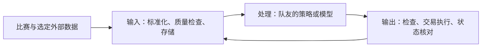

# Perpetual Alpha 2026｜系统接口与部署

更新：2026 年 10 月 8 日（英国时间）。本文件集中维护架构、接口、成本与风险检查、运行环境和部署验收。购买、安装工具与部署程序分别验收，不混为“环境全部就绪”。

## 1. 当前状态

最新 OVH 控制台截图确认 VPS 为 **Active**，系统显示 Ubuntu 26.04，型号 VPS-1 2027，2 vCore、4 GB 内存、40 GB 存储，区域 `os-uk2`，位置显示 London (UK)。公网 IPv4 为 `57.129.179.248`，主机名为 `vps-a6c918ff.vps.ovh.net`。这确认服务器已开通，尚不代表程序部署完成。

10 月 8 日已登录并完成首次强制密码更换，已授权本机现有 Ed25519 公钥，独立会话验证密钥登录成功。主机密钥记录于本地 .cache/ovh-known-hosts；新密码仅保存在本地受限且忽略的文件中，不写入本文。

| 检查项 | 实际检查结果 |
|---|---|
| 本地系统 | WSL2 Ubuntu 26.04 LTS |
| Python | 系统 Python 3.14.4；仓库声明 `>=3.11,<3.14`，版本尚未对齐 |
| Git / SSH | 本地 Git 2.53.0；服务器 ubuntu 密钥登录已验证 |
| Docker / Compose | 在 Ubuntu 内执行失败，提示启用 Docker Desktop 的 WSL 集成；尚不可认定可用 |
| 代码 | 已实现只读报价采集、固定格式、SQLite、状态查询、单进程与重启；策略／执行接口已预留，交易尚未实现 |
| 服务器 | Ubuntu 26.04 x86_64、2 CPU、约 3.7 GiB 内存、38 GiB 根盘；NTP 同步；Docker 29.8.2、Compose 5.6.0 已安装 |

旧配置中的固定 BTC、10% 仓位和亏损限制已移除；当前仅有可配置采集资产，不预设交易策略或风险数值。

## 2. 服务器配置

价格、备份与合同来自用户提供的信息；系统与资源已登录核实。不以此表保证供应商备份保留或当前在售套餐条款。

| 项目 | 已提供的信息 |
|---|---|
| 供应商 / 套餐 | OVHcloud VPS-1 2027 |
| 地点 | 最新控制台显示 London (UK)，区域 os-uk2；此前购买方案称 Erith，具体机房未独立核实 |
| CPU | 2 vCore，共享虚拟 CPU |
| 内存 / 存储 | 4 GB / 40 GB NVMe SSD |
| 网络 | 标称 500 Mbps；不代表到比赛接口的延迟 |
| 价格 | 未税 £3.90，按 20% VAT 估算含税 £4.68／月；以账单为准 |
| 合同 / 备份 | No commitment、标准自动备份；保留与取消条款待核对 |
| 系统 | 已登录确认 Ubuntu 26.04 LTS x86_64 |

服务器用于持续行情采集、轻量信号计算、交易执行与监控。预计适合初始轻量工作负载，实际 CPU、内存、磁盘增长与网络稳定性需要测量。外部 LLM API 调用也需检查内存、并发和费用；不保证任意模型或多个进程一定可用。不在此机器上安排大型训练或大规模回测。

## 3. 分工与三段框架

**我负责输入端、统一数据格式、交易输出、基础检查与部署；队友负责策略研究，可以探索 Agent 或强化学习。**队友具体算法和可投入时间待确认；周日继续讨论接口与交付，不再默认让队友主导基础工程。



- 输入：行情、盘口、新闻和账户分别定义记录类型，共享来源、资产、事件时间、接收时间与有效性；保留原始数据。不提前接入所有可能来源。
- 处理：固定返回目标仓位 Decision（协议 1.0），包含决策 ID、输入上下文 ID、时间、有效期、策略版本和原因；不返回含义模糊的买卖指令。完整格式见第 12 节。
- 输出：拒绝过期或重复信号，检查行情与账户状态、数量和价格规则、交易额度、价差与滑点；后续实现下单、撤单、拒单和部分成交。超时先查状态，真实仓位以接口为准。

执行端可以估算成本，未来收益需要策略提供预测期限和估计。首版先做成本估算与基础限制；有可信预测后再接“收益覆盖成本”的开仓门槛。减少风险的退出不受盈利门槛阻拦，但仍要检查执行结果。

目标模块包括入口与运行、配置与数据类型、数据适配与存储、账户查询、策略接口、基础风控、执行和报告。先单项目、单执行进程，职责分离不意味着现在必须拆成两台服务器。

## 4. 技术路线与环境一致性

| 层级 | 规划 |
|---|---|
| 系统 | 本地 WSL2 Ubuntu 26.04；服务器计划同版本 |
| Python | 选定符合项目约束的版本并固定依赖；系统 3.14.4 不能直接视作已通过 |
| 部署 | Docker + Docker Compose |
| 代码与远程操作 | Git；GitHub 权限待验证；SSH，VS Code Remote SSH 可选 |
| 交易 | Hyperliquid 测试网 `par` 的 REST / WebSocket |
| 数据与监控 | 初期 SQLite 或文件、日志、心跳；告警渠道待选 |
| 模型 | 队友按策略需要选择，不作为基础框架前提 |

本地优先核对 Docker Desktop 是否运行以及 Ubuntu WSL 集成是否启用，不因命令失败就直接装第二套引擎。服务器使用 Docker Engine 与 Compose 插件。Docker 官方安装文档支持 Ubuntu 26.04，安装与防火墙配置按实际环境检查。[官方安装文档](https://docs.docker.com/engine/install/ubuntu/)

诊断容器已采用 Python 3.12，固定基础镜像摘要与 SDK 0.24.0，并记录实际依赖版本；解决了服务器诊断环境与仓库 Python 范围的一致性。用户本地系统 Python 和 WSL Docker 仍待单独对齐。容器不能保证网络、目录权限、磁盘、资源与后台运行完全一致，因此必须在服务器验收。

### 已部署的基础环境与操作方式

服务器使用 `ubuntu` 管理用户与本机 Ed25519 公钥。初始密码已更换，新密码保存在本地 `.cache/ovh-ubuntu-password.txt`，访问权限限制为当前 Windows 用户；该文件被 Git 忽略，禁止上传或粘贴进文档。主钱包和交易 API 私钥均未配置。

UFW 已启用，允许 IPv4／IPv6 的 22/tcp 入站，其他入站默认拒绝、允许出站。没有发布容器端口。Docker 设置开机启动；已配置每日自动安全更新，禁止自动重启。手工重启仍需在无交易或完成交易停止流程后执行。

项目目录为 `/opt/perpetual-alpha/`，其中 `config/`、`data/`、`logs/` 由 ubuntu 持有，权限 700。部署文件在 `deploy/`。诊断容器以非 root 身份运行、根文件系统只读，有内存／CPU 与日志大小限制。

从本仓库 PowerShell 登录：

```powershell
ssh -o StrictHostKeyChecking=yes -o UserKnownHostsFile=.cache/ovh-known-hosts ubuntu@57.129.179.248
```

登录后重复执行只读连接检查：

```bash
cd /opt/perpetual-alpha/deploy
sudo docker compose run --rm connection-check
```

测试检查十种 par 资产、BTC 双边盘口、WebSocket 与 SQLite 写入，数据库位于 `data/connection-check.sqlite3`。首次 REST 样本约 301／228 ms，只是单次耗时，不代表稳定延迟。诊断完成即退出，不是常驻采集或交易程序。

## 5. 部署检查清单

| 阶段 | 验收标准 | 当前状态 |
|---|---|---|
| 开通核实 | 控制台 Active、IP、系统版本明确 | 已登录核实系统、资源与 IP |
| SSH / 系统初始化 | 密钥、系统更新、时间与防火墙检查 | 密钥、系统与内核更新、重启、NTP、UFW 和目录已验证 |
| 本地运行环境 | Python 与依赖对齐，Docker / Compose 可用 | 部分检查，尚未通过 |
| 本地只读版本 | 真正读取 `par` 数据、存储、日志和正常退出 | 待开发 |
| 服务器只读部署 | 接口与持久化 | 持续 REST 采集已启动；报价质量、去重、数据库恢复与单进程检查通过 |
| 监控与恢复 | 数据、错误、磁盘、断线与重启 | 主机重启与测试数据保留已通过；常驻监控与订单恢复待实施 |
| 账户与测试订单 | 查询、撤单、成交核对、剩余仓位确认 | 待实施 |
| 正式交易 | 策略、风控、资格跟踪、稳定版本与操作手册完成 | 待实施 |

服务自动重启仅恢复进程，不代表获准交易。交易模式启动时先核对真实仓位、挂单与已处理信号，防止重复执行。只读模式不加载交易私钥。停止进程不等于平仓，需要单独定义交易停止流程。

数据与日志放在持久目录或卷中，不因替换容器被删除。SQLite 使用一致性备份并验证恢复，供应商自动备份不替代数据库与账户恢复检查。升级记录镜像、代码与配置版本；数据格式变化另有迁移计划。

## 6. Agent 与研究扩展

队友先在本地研究 Agent 或强化学习，确认信号价值、计算量和 API 成本后再决定是否需要独立机器。当前不购买第二台 VPS 或 GPU。用户方案提及的 AlphaCrafter 仅为候选，尚未评估或集成。

如需独立研究服务，可采用 Agent 发布信号、交易端通过内部接口主动拉取的方案。Tailscale 或 WireGuard 是待选私网工具；加密连接不替代身份认证、消息校验与权限控制。信号需要唯一 ID、时间戳、有效期与策略版本。

Agent 不持有交易私钥；执行端不运行 Agent 生成的任意代码。研究服务离线或信号过期时停止新动作，已有仓位仍由执行端管理。

## 7. 下一步与比赛结束处理

服务器基础环境和只读持续报价输入已完成；下一步扩展数据类型并对齐队友接口。尚未接入交易授权或执行订单，本地环境仍需单独对齐。

正式交易计划为 10 月 19 日至 11 月 6 日，报告截止 11 月 9 日，具体时间持续核对主办方通知。交易结束后先保存数据、确认账户风险并验证备份，再按照实际账单和取消条款处理服务器，不自动在比赛结束当日删机。

关联：[项目总览](project-plan.zh-CN.md)、[数据与交易规则](data-development.zh-CN.md)、[研究与实验](strategy-development.zh-CN.md)。


## 8. 实际程序结构与后续模块

本地项目根目录：`D:\development\Perpetual Alpha 2026`。服务器项目根目录：`/opt/perpetual-alpha`。以下是已经存在的文件，不是仅供参考的目标目录。

```text
Perpetual Alpha 2026/
├── src/perpetual_alpha/       程序代码
│   ├── cli.py                实际启动入口；采集、单次检查、查看状态与停止
│   ├── config.py             读取和校验只读采集配置
│   ├── market_data.py        比赛 REST 查询、标准格式、数据有效性检查
│   ├── storage.py            SQLite 保存、去重、最新样本与运行心跳
│   ├── interfaces.py         策略／执行协议与目标仓位类型；尚未调用
│   ├── models.py             早期模型与精度工具；当前采集主流程未使用
│   └── __init__.py           包和版本信息
├── config/collector.toml     本地默认采集配置
├── deploy/
│   ├── Dockerfile            持续采集程序的容器构建文件
│   ├── compose.yaml          持续服务、挂载、健康检查与重启策略
│   ├── bootstrap-server.sh   服务器基础环境初始化脚本
│   ├── Dockerfile.check      一次性连接检查的容器构建文件
│   ├── check-venue.py         REST／WebSocket 和存储诊断
│   └── requirements-check.txt 固定依赖版本
├── tests/test_foundation.py  数据校验、去重与重新打开数据库的测试
├── docs/                     项目文档，README.md 为入口
└── pyproject.toml            Python 项目与命令声明
```

### 已实现的运行链路

**Compose 启动 → cli.py 加载 config.py → market_data.py 读取与标准化 → storage.py 保存 → 心跳、状态检查与日志。**

服务器当前启动命令为 `python -u -m perpetual_alpha.cli collect`。Dockerfile 将代码复制到容器的 `/app/src/perpetual_alpha`；服务器上的源码副本位于 `/opt/perpetual-alpha/src/perpetual_alpha`。修改源码后需要重新构建并更新容器，单纯修改服务器文件不会自动改变正在运行的镜像。

服务器生效的配置位于 `/opt/perpetual-alpha/config/collector.toml`，挂载至容器 `/app/config/collector.toml`。数据库位于 `/opt/perpetual-alpha/data/market.sqlite3`，挂载至 `/data/market.sqlite3`。数据库、日志与凭证不是源代码，不进入 Git。

### 三段框架现在完成了多少

| 部分 | 已实现 | 尚未实现 |
|---|---|---|
| 输入端 | 比赛 BTC／ETH 报价、标准格式、SQLite 与质量检查 | K 线、外部行情、新闻与账户数据 |
| 中间处理端 | Strategy 协议、目标仓位数据类型 | 队友的实际策略、Agent／强化学习及调用调度 |
| 输出端 | Execution 协议、服务日志和状态查看 | 真正下单、撤单、账户核对和交易风控 |

当前服务只采集，不能交易。后续 account.py、risk.py、execution.py、strategy.py 等具体实现尚未创建，不把接口类型视为已经具备交易功能。cli.py 当前承担简化调度；复杂度增加后再拆 runtime.py。具体操作见本文件第 11 节。

## 9. 信息、成本与全账户检查

首版先完成基础检查与成本估算。以下收益门槛是后续可选接口，不要求策略必须先预测收益，也不是当前已实现规则。

### 信息层：什么信息可以进入判断

| 信息类别 | 内容 | 进入判断前检查 |
|---|---|---|
| 比赛自身行情 | 可成交报价、价格、盘口、成交、资金费等 | 市场是否正确、是否过期、价差与流动性是否适合 |
| 外部市场 | 对应资产价格、成交活动、相关市场变化 | 资产与计价口径、事件和接收时间、延迟、是否休市 |
| 宏观与事件 | 官方发布时间、事件类型、可获得的数值与预期 | 是否当时已知、有无后续修订、对应的研究周期 |
| 账户状态 | 净值、持仓、挂单、保证金、成交与费用 | 是否完整、能否与交易所核对、是否存在未确认请求 |

信息缺失、过期或请求状态不确定时，暂缓增加风险；记录具体原因。外部信息既可以支持，也可以否定候选信号。已经公开的宏观叙事不能直接当成可成交收益。

数据来源、保存和时间对齐要求沿用[数据开发规划](data-development.zh-CN.md)。

### 机会层：策略提供什么

策略至少说明：候选资产与方向、信息依据、预期持有时间、失效条件和版本。需要判断收益门槛时，还应有基于验证数据的收益估计及其不确定性说明。

策略可以使用规则或模型，但不能仅凭“看涨”或一个未校准的置信度数字，就默认交易具有足够收益。预测概率也不等于预期收益，需要同时考虑可能赚多少、亏多少及成本。

策略尚不能给出可信收益估计时，先在观察与研究阶段积累证据。可以按历史类似信号的结果进行条件估计，但必须使用未参与调参的数据检验，不能把最好看的历史平均值作为保证。

### 值得交易的门槛

针对新开仓或增加风险，采用概念条件：

**估计毛收益率 − 预计完整持仓周期成本 − 不确定性余量 > 最低要求净收益率。**

各项必须针对同一持仓周期和同一名义金额口径：

- 毛收益：候选机会对应的预期价格收益，不是已经实现的盈利，也不是两个市场当前价差的简单替代。
- 成本：预计开仓和平仓手续费、价差、额外滑点及持仓期间的资金费净支出；资金费可能支出或收入，未知时使用保守假设。
- 不确定性余量：为预测误差、延迟和成本误差留出空间，数值后续依据验证与压力测试确定。
- 最低净收益要求：与持仓周期、成本和风险一起讨论，目前不设固定比例。

估计收益若已经使用预期实际成交价，应避免再次扣除同一笔价差或滑点。若以中间价计算毛收益，则需要明确加入执行成本。

纯示例：预计毛收益 0.40%，完整周期成本 0.25%，不确定性余量 0.10%，剩余为 0.05%；若最低要求净收益为 0.08%，该机会不通过。数字仅用于说明计算，不是项目参数。

门槛需要适应订单大小：大订单可能造成更多滑点，所以组合批准的数量变化后，应重新检查成本和收益条件。除平均收益外，还要检查亏损可能性与极端情形，不能以高预期收益覆盖风险限制。

**重要边界：撤单、减仓、止损、强制风险退出不以盈利门槛为前提。** 避免系统因为退出不赚钱而拒绝降低风险。减仓仍需核对方向、数量和成交结果；网络故障时明确记录未完成的退出。

### 组合层：整个账户可以承担多少风险

先定义风险维度，再共同确定数值，不把此前举例的仓位或亏损比例当成已经批准的配置。

| 维度 | 管理目标 |
|---|---|
| 单笔交易 | 控制订单金额、预期亏损及允许的执行偏差 |
| 单资产 | 限制某一个资产的总名义敞口与风险贡献 |
| 总敞口 | 所有资产绝对名义金额之和，相对于账户净值限制 |
| 净敞口 | 监测方向性敞口，同时保留资产分类与共同风险因素的限制 |
| 相关风险 | 防止 BTC 与 ETH 等相似方向的持仓集中承担同一种风险 |
| 保证金与杠杆 | 检查实际可用保证金，保留缓冲，限制杠杆与清算风险 |
| 待成交订单 | 纳入可能成交后的风险；未确认撤单的订单不能提前释放预算 |
| 累计亏损 | 当日亏损、最高净值回撤及对应暂停与恢复条件 |
| 运行状态 | 数据、授权或账户不可靠时暂停新风险，重新核对后再处理 |

总敞口和净敞口不能互相替代。例如做多 BTC 名义金额 100、做空 ETH 名义金额 100，总敞口是 200，简单净额为零，但仍有两个资产相对变化的风险。

统一保证金模式下，持仓共享抵押资金；某个资产亏损会影响其他持仓的保证金空间。账户余额不能直接视为全部可用保证金。实际限制与状态应依照[官方保证金说明](https://perpetual-alpha26.github.io/docs/#venue-mechanics)查询与核对。

批准新机会前计算“持仓＋可能成交订单＋拟新增订单”的风险。风险预算不够时，可以缩小或拒绝；缩小后若不满足最小订单或收益门槛，则不交易，不能为满足最小订单反过来扩大风险。

## 10. 运行、停止与版本更新


- 初期 SQLite 适合单进程方案；数据文件放在持久目录，更新代码时不得覆盖或删除。备份应通过一致性备份方法实施，不能假定复制正在写入的文件就完整。
- 最少监控最后一次有效行情时间、缺失区间、请求失败次数、磁盘空间与进程状态；交易阶段再增加仓位、挂单、费用、账户净值和资格进度。
- 只读停止只需结束采集并确认文件保存；交易停止必须另行定义停止开仓、撤单和剩余仓位处理。杀进程不等于平仓。
- 更新时记录旧版本和配置，先停止当前实例，再部署已验证版本；数据格式变动需要迁移计划。回退代码不保证可以回退数据库结构。
- 两个人都需要会查看日志、检查状态、停止服务和恢复只读运行；交易阶段再共同学习账户检查与停止流程。

### 工程验收

上线前需验证行情过期、网络中断、拒单、部分成交、请求结果不确定、重复启动、程序重启、亏损限制和人工停止等情形。

重要结果包括：不盲目重复下单；重启先核对账户；触发限制后停止增加风险并处理挂单和持仓；平仓失败时明确显示剩余风险。无法联网时不能保证撤单或平仓成功，恢复后必须重新核对。

### 10 月 8 日最终验收记录

系统可用更新与虚拟机内核更新已完成，并执行一次主机重启。重启后内核为 `7.0.0-38-generic`，密钥登录正常，Docker 为 active／enabled，NTP 已同步，UFW 仍只允许 SSH 入站。新容器再次完成 REST／WebSocket 检查，并报告数据库已有 1 次成功记录，验证主机重启与容器重建后数据保留。诊断容器 Python 为 3.12.15。

部署文件位于仓库 `deploy/`：`bootstrap-server.sh`、`Dockerfile.check`、`requirements-check.txt`、`compose.yaml`、`check-venue.py`。诊断无交易密钥、无签名动作、无订单。此结果不代表 24 小时稳定性、账户授权、交易执行或订单恢复已验收。

## 11. 基础框架第一版：已在服务器运行

10 月 8 日已实现并部署 collector 常驻服务。每 30 秒读取 par 的市场上下文与 BTC／ETH 盘口，将报价、标记价、参考价、资金费率、原始响应、事件时间和接收时间保存到 SQLite。BTC／ETH 是采集示例，不代表最终交易资产；此版使用 REST 轮询，WebSocket 仍由诊断检查验证，K 线、新闻、外部数据和账户尚未接入常驻服务。

数据格式 schema_version=1；source 为 hyperliquid-testnet/par。event_ms 是盘口时间，received_ms 是盘口接收时间，context_received_ms 仅为上下文接收时间，不冒充其交易所事件时间。每个盘口时间戳只保留一条该资产记录。数据缺失、过期、非有限数值、错误市场或倒挂报价拒绝保存；错误记录到运行状态并退避重试。有效性需由消费端根据当前时间重新检查。

实现文件：config.py、market_data.py、storage.py、cli.py；interfaces.py 预留 Strategy 和 Execution 协议。TargetPosition 明确为有符号目标资产数量；决策 ID、版本、原因与有效期统一放在 Decision 中（第 12 节）。协议暂未调用，不会产生订单。旧 practice.toml 和固定仓位／亏损配置已移除；当前 collector.toml 仅包含只读采集设置。

服务器数据位于 `/opt/perpetual-alpha/data/market.sqlite3`，采用 WAL 与重复事件去重。配置为 `/opt/perpetual-alpha/config/collector.toml`。Docker Compose 采用 unless-stopped 重启策略，单进程文件锁阻止同一数据库上的重复采集；SIGTERM 正常保存状态后关闭。healthcheck 失败显示不健康，不会由 Docker 自动触发重启；需要查看日志或人工处理。

登录后操作：

```bash
cd /opt/perpetual-alpha/deploy
# 查看服务与最近日志
sudo docker compose ps
sudo docker compose logs --tail 30 collector
# 查看各资产样本量、时效和运行状态
sudo docker compose exec -T collector python -m perpetual_alpha.cli status
# 停止／启动／重启（只读采集，无订单）
sudo docker compose stop collector
sudo docker compose up -d collector
sudo docker compose restart collector
```

一次性 `check` 使用同一数据库时，需要先停止常驻 collector，否则文件锁会拒绝第二个采集进程。健康状态检查使用只读数据库连接，不持有采集锁；UTC 用于日志和数据。自动重试等待可被停止信号打断，网络查询仍有超时限制。

已验收：错误市场／过期／倒挂数据拒绝、重复记录与数据库重新打开保留、真实报价读取、重复进程拒绝、容器正常停止与重新启动。未验收：长时间稳定性、全部资产采集、断网恢复演练、自动告警、策略调用、账户查询和交易。用户 WSL 尚未运行同一镜像，不能把服务器通过当作本地也已通过。

## 12. 三段之间的固定接口：协议 1.0

本节是双方实现时共同遵守的接口约定。项目选择为：**输入按需求提供可扩展数据集，策略只返回最终目标仓位，执行回报实际处理结果。**不由策略直接调用下单接口。格式现在确定，不代表策略调度、数据集适配器或交易执行已经完成。Python 类型及决策 JSON 校验在 `src/perpetual_alpha/interfaces.py`。

### 12.1 共用规则

- `protocol_version` 为字符串 `1.0`；不兼容版本明确拒绝，不猜字段含义。
- 时间统一为 UTC Unix 毫秒整数。价格、资金、数量和收益率在接口 JSON 中使用十进制字符串，禁止 NaN／Infinity。程序内部用 Decimal 处理交易数量；已有采集数据库浮点列不直接作为交易精度依据。
- `symbol` 是完整比赛代码，例如 par:BTC；外部标的按其来源代码记录，不能冒充比赛资产。
- 数值未知用 null，数据没有或不可用要明确标状态，不能把缺失转成零。时间为 null 表示源未提供，不能虚构交易所时间。
- 大量历史数据放数据服务／存储中按窗口读取，不把无限历史、完整新闻库或任意代码塞进一条策略请求。
- 增加数据集、来源、字段、历史长度不改信号和执行协议。修改既有字段的意义、单位或目标表达方式需要新版本并共同确认。

### 12.2 策略声明数据需求：DataRequest

策略的 `requirements()` 返回需求列表，各 dataset_id 唯一。

| 固定字段 | 格式与含义 |
|---|---|
| dataset_id | 策略读取该数据集的稳定名称，例如 btc_quotes |
| source | 已登记的来源，例如 hyperliquid-testnet/par |
| kind | 数据类型，例如 quote、candle、news、feature |
| symbols | 标的代码数组；宏观等无特定标的数据可为空 |
| fields | 需要的字段数组，对应数据集的字段定义 |
| lookback_ms | 需要的历史长度，毫秒；0 表示只请求最新记录 |
| max_records | 正整数记录上限；返回最新窗口，按事件时间升序 |
| max_age_ms | 最新数据允许的接收时效，毫秒；交易行情还须检查源时间 |
| required | boolean；必需数据未就绪则不进入正常开仓决策 |
| parameters | 数据类型参数对象，例如 K 线 interval="1h"；只允许适配器支持的 JSON 参数，默认空对象 |

字段单位由数据集元信息明确给出。例如 quote 的 bid／ask 使用 USD/BTC，资金费率使用每小时小数率，成交量注明资产单位或名义金额。fields 不支持的项目必须报告 missing 或 error，不偷偷换另一个市场数据。当前支持的数据范围以实际适配器为准，不承诺新闻或 K 线已实现。

### 12.3 输入端 → 策略端：StrategyContext

固定外壳如下，datasets 的条目数量和每条 records 长度可以改变：

```json
{
  "protocol_version": "1.0",
  "context_id": "ctx-unique-id",
  "asof_ms": 1791424800000,
  "datasets": {
    "btc_quotes": {
      "schema_version": "quote/1.0",
      "source": "hyperliquid-testnet/par",
      "kind": "quote",
      "parameters": {},
      "status": "ready",
      "required": true,
      "truncated": false,
      "error": null,
      "units": {"bid": "USD/BTC", "ask": "USD/BTC"},
      "records": [
        {
          "record_id": "par:BTC:1791424799000",
          "symbol": "par:BTC",
          "event_ms": 1791424799000,
          "received_ms": 1791424799300,
          "data": {"bid": "83000.0", "ask": "83010.0"}
        }
      ]
    }
  },
  "account": null,
  "execution_reports": []
}
```

示例数值仅说明格式。datasets 状态固定为 ready／missing／stale／error；没有数据时 records=[]，保留该需求条目。部分所需字段或历史不足时必须说明 error，不称作 ready。超过窗口上限截取最近记录并标 truncated=true。数据集 data 字段可以增减，但必须同步 fields、units 和该数据集 schema_version；策略不能依赖未声明的字段。

输入冻结在 asof_ms：只能给出截至该时刻实际收到的信息，不给未来接收、未来收盘或后来修订的版本。无源事件时间时 event_ms=null，按 received_ms 处理。K 线数据另需 open_ms、close_ms、is_closed；采用收盘策略时只给满足窗口且已经收到的完整 K 线。每个数据集独立带时间和状态，不假设新闻、盘口与小时 K 线天然同步。

账户未接入时 account=null，不能造一个零余额账户。有账户时结构固定为 observed_ms、status、equity_usd、available_margin_usd、positions、open_orders；金额为字符串，未知金额为 null。positions 条目为 symbol、quantity、mark_price；open_orders 条目为 order_id、symbol、side（buy／sell）、remaining_quantity、reduce_only。数量为资产单位，positions.quantity 带方向。账户状态 ready／stale／error；真实资产量为零才填写 "0"。交易执行端必须另行复查，不因策略输入中 account 显示 ready 就直接相信旧状态。

execution_reports 是此前该策略决策的执行反馈列表，元素采用下面的回报格式，不包含其他队伍账户。

### 12.4 策略端 → 输出端：Decision

固定选择**目标仓位**，不同时支持目标比例、订单数量变化和裸 buy／sell。JSON 格式：

```json
{
  "protocol_version": "1.0",
  "decision_id": "decision-unique-id",
  "context_id": "ctx-unique-id",
  "strategy_id": "baseline",
  "strategy_version": "v1",
  "created_ms": 1791424800000,
  "expires_ms": 1791424860000,
  "targets": [{"symbol": "par:BTC", "quantity": "0.001"}],
  "reason": "strategy explanation"
}
```

quantity 是**希望最终实际持有的有符号资产数量**：正数做多，负数做空，"0" 表示该资产目标空仓。例如实际已有 0.0004 BTC、目标 0.001 BTC，执行端根据真实仓位及未完成订单计算差额，不再买入整整 0.001 BTC。账户净值百分比由策略先换算，不把 "0.1" 混用为 10% 或 0.1 BTC。

- targets=[] 是不提出新目标；未出现在列表中的资产保持原目标／持仓，不自动平仓。
- 不提出新目标不等于取消旧挂单。挂单有效期、风控撤单和旧决策处理由执行端负责。
- 同一批 targets 内每个 symbol 只出现一次；quantity 必须是有限十进制字符串。不存在的市场、精度或最小金额不符合、过期或未来生成的决策由输出端拒绝，不自动放大。
- 每次新决策使用新 decision_id；同一个 ID 的重试内容必须一致。执行端持久化去重，重复请求返回已有处理状态，不创建新订单；同 ID 不同内容拒绝并记 ID_CONFLICT。
- v1 targets **不保证多资产同时成交或整批原子执行**。配对策略必须处理单边成交风险；不能将此接口当作双边成交保证。
- v1 不让策略指定杠杆、交易私钥、任意订单参数或代码。执行端根据独立配置和真实状态进行检查，可以拒绝；不悄悄改变目标数量。将来如需要风险缩量，应明确记录批准目标，而非直接伪称达到原目标。
- 反向目标由输出端确认原仓位处理完后再增开反向风险；超时查状态，不盲目重发。是否允许新决策取代旧目标必须由输出端明示并记录；默认同一资产仍有未确认请求时拒绝新目标，reason_code=BUSY。

协议不强迫策略预测收益。v1 不包含未经验证的收益／置信度门槛；首版只估成本与执行限制。若以后需要预测周期、期望收益等字段，新增明确版本，退出仍不受盈利门槛阻拦。

### 12.5 输出端 → 策略与记录端：ExecutionReport

```json
{
  "protocol_version": "1.0",
  "report_id": "report-unique-id",
  "decision_id": "decision-unique-id",
  "sequence": 1,
  "observed_ms": 1791424801000,
  "status": "accepted",
  "reason_code": "OK",
  "message": "target accepted; not yet filled",
  "items": [
    {
      "symbol": "par:BTC",
      "target_quantity": "0.001",
      "actual_quantity": "0.0004",
      "filled_quantity": "0",
      "order_ids": [],
      "error": null
    }
  ]
}
```

| 固定状态 | 含义 |
|---|---|
| accepted | 请求通过检查，尚不代表提交或成交 |
| running | 正在执行／等待订单确认 |
| partial | 一部分已经执行，目标未全部达成 |
| completed | 已核实达到所有列出的目标，且无相关未确认订单；空 targets 为无动作完成 |
| rejected | 执行前拒绝；涉及的资产未因该请求创建新订单 |
| failed | 已确认无法继续；可能已有部分成交，必须报告实际风险 |
| unknown | 请求或账户结果尚不能确定；应查询核对，不能视为失败后重发 |

report_id 每次回报唯一；sequence 从 1 开始对同一 decision_id 递增。filled_quantity 是该决策累计净成交资产量（买入正、卖出负），不是最终账户仓位；actual_quantity 由最新账户核对得到，无法核实时为 null。order_ids 使用字符串，含所有本决策相关订单；items.error 记录该资产错误。

reason_code 初始固定为 OK、INVALID_INPUT、UNSUPPORTED_VERSION、EXPIRED、FUTURE_SIGNAL、ID_CONFLICT、BUSY、DATA_UNAVAILABLE、ACCOUNT_UNAVAILABLE、RISK_LIMIT、ORDER_RULE、VENUE_REJECTED、NETWORK_UNKNOWN、INTERNAL_ERROR。新增原因码需要约定；message 为解释文字，不代替状态或原因码。

状态以回报而不是 HTTP 成功判断。accepted 和 running 不代表赚钱，也不代表持仓已改变。跨资产部分失败不能只返回一个成功 boolean。

### 12.6 实现边界与后续接入

当前已经更新 Python DataRequest、Decision、TargetPosition、ExecutionReport 类型，以及 Decision JSON 序列化／校验和测试。输入 StrategyContext 的组装、请求满足判断、回报持久化、ID 去重、风控、真实执行与序列管理尚待实现；不能因格式已确定就当成这些行为已工作。已有采集行与本协议 context 的不同格式需由适配器转换，不要求重写全部历史库。

验证：5 项基础与接口测试通过，涵盖数量字符串的往返、空目标的无动作语义、重复资产／非有限数量／版本／有效期拒绝，以及不能在实际仓位未知时报告 completed。测试在服务器容器中挂载最新源码执行，未重启或改变现有只读采集服务，也未接入真实交易。

输入和策略可以先在同一 Python 进程传对象，独立 Agent 时再用相同 JSON 接入内部 API。传输方式不改变目标语义。下一步与队友确认其第一批 DataRequest，再实现采集库 → StrategyContext 的适配器，不根据尚未选择的模型提前收集所有数据。

## 13. 本地官方 SDK 与账户只读接入

10 月 8 日已完成第一、二阶段。Windows 项目内 `.venv` 使用 Python 3.11.15，官方 SDK 0.24.0；运行入口与 PowerShell 步骤见[根目录 README](../README.md)。沿用已有结构，新增 api_client.py 和三个检查脚本，没有替换服务器采集程序。

用户截图的 API Wallet 为 `0x02fcacbbb73bbefe8f541f6ce46919842cf0fb06`。Testnet userRole 返回角色 agent，对应 Team Wallet 为 `0x37bc6c61a2408474c15e3a0c69f44e83bb26970a`；再通过该 Team Wallet 的 extraAgents 核对了代理地址和名称 pa26-bot-dev。公开地址已配置到本地忽略的 .env；未取得、载入或保存任何交易私钥。

| 实际只读验收 | 结果 |
|---|---|
| check_connection.py | par metadata 十种资产；BTC／ETH 报价和双边 L2 盘口通过 |
| check_account.py | unifiedAccount；USDPR total=1000000.0、hold=0.0；仓位、挂单、近期成交均为空 |
| check_api_wallet.py | pa26-bot-dev 授权存在且未过期；未验证签名密钥持有 |
| 自动测试 | 7 项基础／协议／只读客户端测试通过；Windows 沙箱测试临时目录改用项目 .cache/test-tmp |
| test_order.py | 确认直接运行被 TRADING_DISABLED 拒绝，无密钥加载、无订单 |

SDK Info 固定 Testnet 地址、skip_ws=True、perp_dexs=[par]、15 秒超时。适用账户查询显式使用 dex=par，账户地址始终为 Team Wallet；把 agent 地址误填为 Team Wallet 会被拒绝。API 客户端没有 Exchange、账户管理或签名方法。此前 WebSocket 诊断与当前 SDK REST 检查分开记录，不宣称本地 SDK WebSocket 已验收。

统一账户下 par marginSummary.accountValue 返回 0，不能据此否定 spotClearinghouseState 的实际 USDPR 余额；余额不是自由保证金，后续交易阶段需查询实际交易额度。当前账户结果只反映查询时刻。

第三阶段待用户确认后开展：本地手动配置 API Wallet 私钥、Exchange 接入、独立交易开关和执行恢复。当前 test_order.py 是禁用占位，即便修改 ENABLE_TRADING 也不能下单。未授权代理、切换模式、生成主钱包或部署账户配置到服务器。


## 14. G02：API Wallet 小额交易链路验收（2026-10-08）

用户重新配置 API Wallet 并明确授权交易测试。新签名地址 0x6755835c4bddd1eff7d1412cd6050f75148e29c9 与本地密钥匹配，extraAgents 授权有效；Team Wallet 不变。仅加载 API 私钥，没有读取 Team Wallet 私钥，没有修改账户模式或程序授权代理。此前第 13 节为当时只读阶段快照。

本地 test_order.py --execute 实测：1 倍交叉杠杆设置成功；挂单 62124093852 已确认 canceled；买单 62124099005 成交 0.0002 BTC，均价 83141；只减仓卖单 62124102941 成交 0.0002 BTC，均价 82977。已实现状态查询、撤单、成交读取与实际仓位核对。最终所有 par 仓位和挂单为空，USDPR 余额 999999.9373。价差损失 0.0328、手续费 0.0299，总成本 0.0627 USDPR。

订单意图先持久化到忽略的 data/order-test.jsonl，记录 client ID、订单状态、成交和账户，不记录密钥或签名载荷。交易入口默认禁用；--execute 才加载 API 密钥并调用 Exchange。每笔测试订单上限 25 USDPR；未知结果停止并查询，不自动重复提交；失败留下锁及剩余风险记录。

10 项自动测试通过；实际网络超时、拒单、部分成交、断网和崩溃恢复尚未故障演练。此 gate 证明本地正常执行链路，不代表策略／风控／三段接口全部集成或服务器交易已部署。服务器只读采集继续运行，未部署交易私钥。
